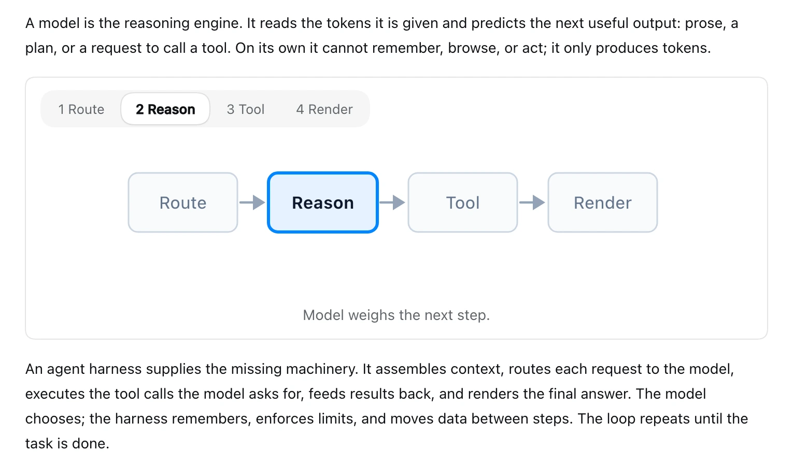
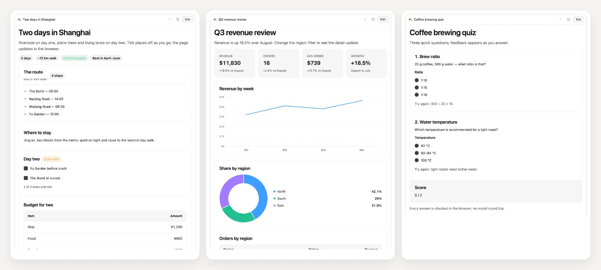
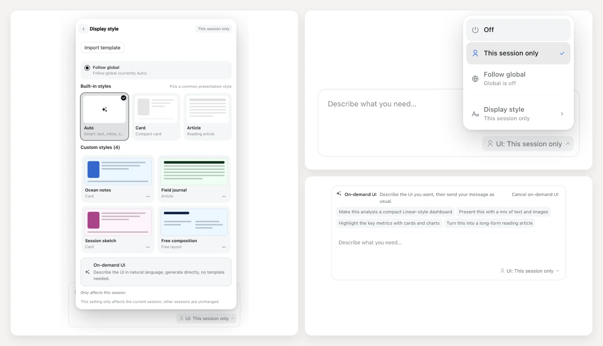

# dsh-intelligent-ui

[中文](README.md) | English

[](https://www.npmjs.com/package/@zephinel/dsh-intelligent-ui)
[](LICENSE)
[](https://www.npmjs.com/package/@deepseek-ai/dsh)
[](https://github.com/Zephinel/dsh-intelligent-ui/actions/workflows/publish.yml)

**Let DeepSeek Harness (DSH) answers grow interactive UI right inside them.** Explanations and analyses stay Markdown with interactive diagrams, charts or widgets embedded directly mid-answer; when you want a standalone itinerary, dashboard, form or quiz, the turn ends with an editable, exportable, savable interactive page. Ported from [Open Intelligent UI](https://github.com/thesysdev/open-intelligent-ui) (MIT) on [OpenUI Lang 1.0](https://openui.com), with an Agent Skill (`intelligent-ui`) registered automatically.



> **Current status**: npm `latest` is `@zephinel/dsh-intelligent-ui@0.7.0`: inline UI in explanations by default, standalone pages as editable cards, plus editing, revisions, export and templates. Also listed in awesome-dsh-plugin / dsh-market and Open Plugin Market; see [CHANGELOG](https://github.com/Zephinel/dsh-intelligent-ui/blob/main/CHANGELOG.md).

[Install](#install) · [What it looks like](#what-it-looks-like) · [Generate and edit](#generate-and-edit) · [Documentation index](#documentation-index) · [Local development](#getting-the-code-and-local-development)

## Install

**DSH Web** (pick one; restart any running Web process after installing):

```bash
# npm 0.7.0: inline UI, turn-tail cards, editing and export (pinned)
dsh plugin --profile web add @zephinel/dsh-intelligent-ui@0.7.0
# or follow the latest commits on GitHub main (needs local build tools and possibly build-script approval)
dsh plugin --profile web add github:Zephinel/dsh-intelligent-ui
dsh web
```

`dsh plugin` needs pnpm. pnpm 11/12 does not resolve versions published less than 24 hours ago by default; the npm command above pins the version, so it installs immediately.

**DSH Desktop**: the marketplace follows its own index build schedule and may still show the previous release; to use the current release immediately, install `github:Zephinel/dsh-intelligent-ui` via **Plugins → Add plugin → arrow → Install a third-party plugin** to follow the repository's latest commits, or install the pinned npm version above.

Once loaded, a **UI** control appears on the right of the composer. Click **UI → This session only** (or send `/iui on`), then ask normally:

```text
Explain the difference between a harness and a model        # embeds interactive UI mid-answer
Plan two days in Shanghai, with checkboxes and adjustments  # delivers an editable turn-tail page card
```

Inline UI needs the `conversation.chat.markdown.fence` slot from DSH 0.2.2-rc.2+; an older Host keeps the inline programs as code blocks. Install sources, uninstall, version switching and troubleshooting: [Development and deployment](https://github.com/Zephinel/dsh-intelligent-ui/blob/main/docs/development.en.md#installation).

## What it looks like


Inline blocks and turn-tail cards share one browser renderer, and all interactive state (`$variables`, `@Set`, `@functions`) executes locally: checkboxes, sliders, timers, stage switches and budget recalculations never require another model call. Only actions that intentionally continue the conversation (`@ToAssistant`, such as form submissions) place a short message back into the composer.

## Generate and edit



The three pages above were generated directly in real DSH sessions (DeepSeek V4.1 Flash), not hand-written fixtures.

In **Auto** mode, the model chooses among four delivery forms per answer: plain Markdown, inline UI, a turn-tail page card, or an inline explanation plus a companion page (distinct roles, no duplicated content, at most one card per turn). For standalone pages, you can also pin Card or Article layout per session under **UI → Display style**, or use **On-demand UI** to describe a bespoke page in plain language.


Rendered turn-tail cards stay editable: select blocks to request targeted edits, drag or keyboard-reorder sections, switch or describe a new visual style, and review or restore any revision from history. Full flow: [usage guide](https://github.com/Zephinel/dsh-intelligent-ui/blob/main/docs/usage.en.md#edit-a-rendered-page).

## Components


Built from **57 components, 73 functions and 5 action steps** covering layout, typography, inputs, maps/images, charts/tables, interactive quizzes and SVG drawings. Narrow screens reflow to a single column and long chart labels truncate cleanly. Full parameter tables: [component catalog](https://github.com/Zephinel/dsh-intelligent-ui/blob/main/skills/intelligent-ui/references/components.md).

## Switch and style



- **Layered controls**: set global defaults on the Plugins detail page and override per session with the composer **UI** control (or `/iui on|off|inherit`, `/iui style …`). Inline UI needs no separate switch.
- **Temporary styles and templates**: on-demand pages work right away; theme-bearing results offer **Save as template**, reusing the validated style without changing your current or global default.


Full switch, template and export details: [usage guide](https://github.com/Zephinel/dsh-intelligent-ui/blob/main/docs/usage.en.md).

## Documentation index

Detailed docs live in `docs/` (excluded from the npm tarball, so links below point to GitHub):

| Document | What it covers |
| --- | --- |
| [Usage guide](https://github.com/Zephinel/dsh-intelligent-ui/blob/main/docs/usage.en.md) | Switch and prompts, inline UI, editing and revision history, templates, export, FAQ |
| [Development and deployment](https://github.com/Zephinel/dsh-intelligent-ui/blob/main/docs/development.en.md) | Install/uninstall/restart, local commands, CI, release flow, marketplace maintenance |
| [Architecture and behavior](https://github.com/Zephinel/dsh-intelligent-ui/blob/main/docs/architecture.en.md) | Host/Client tree, switch semantics, editing pipeline, export and update prompt |
| [Known limitations](https://github.com/Zephinel/dsh-intelligent-ui/blob/main/docs/limitations.en.md) | Boundaries that still exist or are unverified |
| [Verification record](https://github.com/Zephinel/dsh-intelligent-ui/blob/main/docs/verification.en.md) · [CHANGELOG](https://github.com/Zephinel/dsh-intelligent-ui/blob/main/CHANGELOG.md) · [GitHub Releases](https://github.com/Zephinel/dsh-intelligent-ui/releases) | Test and packaging records, version changes and releases |
| [Agent Skill](https://github.com/Zephinel/dsh-intelligent-ui/blob/main/skills/intelligent-ui/SKILL.md) · [Component catalog](https://github.com/Zephinel/dsh-intelligent-ui/blob/main/skills/intelligent-ui/references/components.md) | Model-facing syntax, delivery rules and component parameter tables |

## Getting the code and local development

```bash
git clone https://github.com/Zephinel/dsh-intelligent-ui.git
cd dsh-intelligent-ui
npm install                # prepare builds automatically
node scripts/install.mjs   # install into the web profile
dsh web
```

Environment: DSH 0.2.2 plugin API (validated on `0.2.2-rc.5`; inline UI needs the `conversation.chat.markdown.fence` slot from `0.2.2-rc.2+`), Node 24 (with npm), pnpm and Git; the browser half uses `@deepseek-ai/dsh-client-locale` (included in DSH Web 0.2.2). There is no watch server: run `npm run build` and restart DSH after changes.

Current verification: Node tests **880/880** (Host 324, Client 516, packaging 40); **12/12** browser suites pass, including **944** checks in the Artifact block-editing suite, **75** checks in the nested edit-renderer suite and **76** image-export assertions. Full commands and history: [Development and deployment](https://github.com/Zephinel/dsh-intelligent-ui/blob/main/docs/development.en.md#development) and [verification record](https://github.com/Zephinel/dsh-intelligent-ui/blob/main/docs/verification.en.md).

## Contributing

- Issues and feature requests: [GitHub Issues](https://github.com/Zephinel/dsh-intelligent-ui/issues); fork before cloning to submit a PR, and run `npm run check` first.
- CI ([`ci.yml`](https://github.com/Zephinel/dsh-intelligent-ui/blob/main/.github/workflows/ci.yml)): docs-only changes (CHANGELOG/PRODUCT/docs) run docs checks, while README is packaged content and runs the full gate. Releases run on `v*` tags via the [Trusted Publishing workflow](https://github.com/Zephinel/dsh-intelligent-ui/blob/main/.github/workflows/publish.yml).
- When behavior, copy or counts change, sync both READMEs, `CHANGELOG.md` and `docs/` per the [doc-sync skill](https://github.com/Zephinel/dsh-intelligent-ui/blob/main/.agents/skills/sync-iui-docs/SKILL.md). Maintainer: [@Zephinel](https://github.com/Zephinel).

## License

This project is [MIT](LICENSE), based on Open Intelligent UI (MIT, Copyright (c) 2026 Thesys Inc.) and the OpenUI ecosystem. Third-party notices live in [NOTICE](NOTICE) and [licenses/](licenses/). Map basemaps and route data come from OpenFreeMap / OpenMapTiles / OpenStreetMap, Esri and OSRM, with attribution displayed inside rendered maps.
