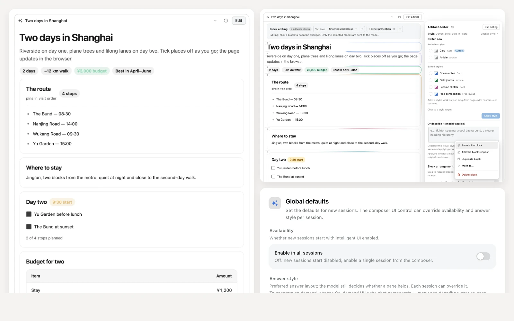
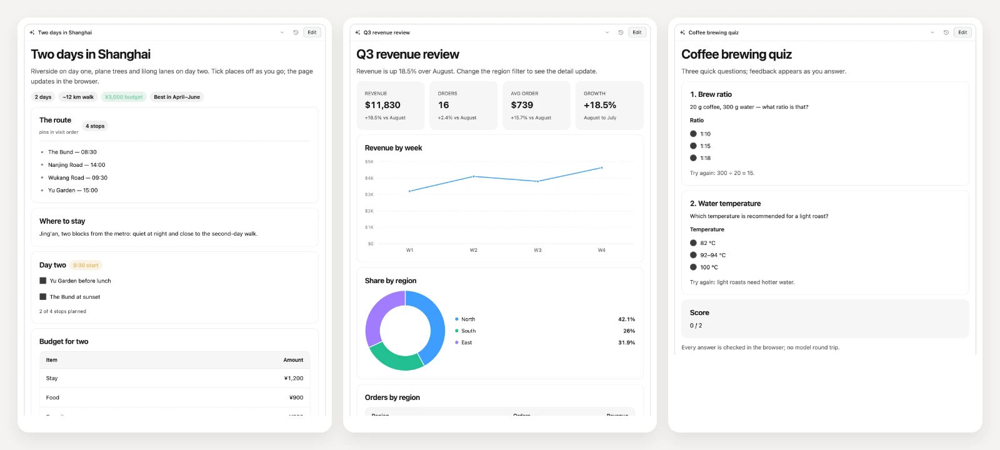
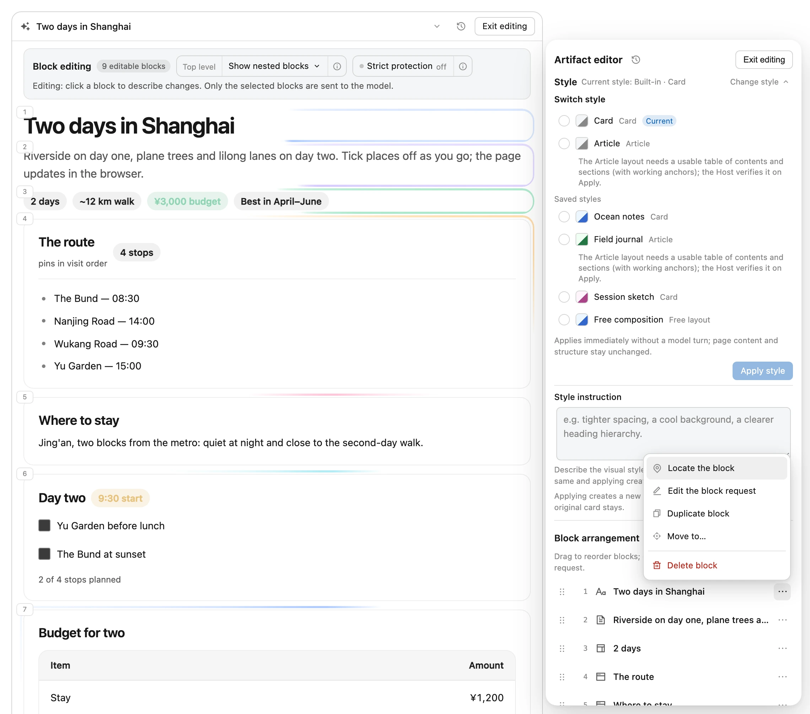
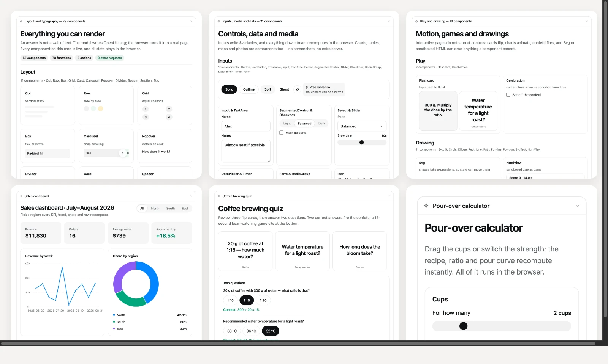
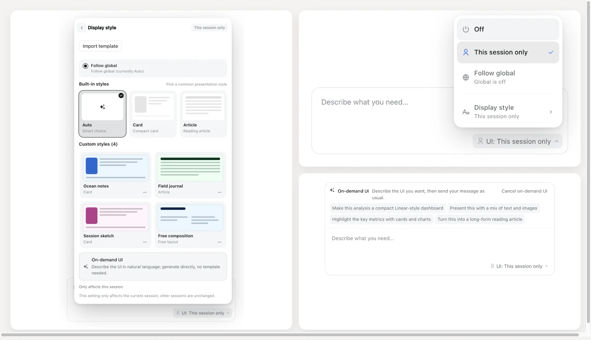
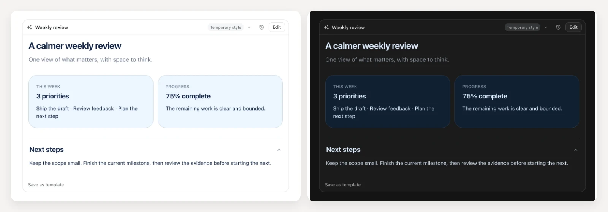

# dsh-intelligent-ui

[中文](README.md) | English

[](https://www.npmjs.com/package/@zephinel/dsh-intelligent-ui)
[](LICENSE)
[](https://www.npmjs.com/package/@deepseek-ai/dsh)
[](https://github.com/Zephinel/dsh-intelligent-ui/actions/workflows/publish.yml)

**Turn a DeepSeek Harness (DSH) model answer into a page you can actually use.** After installing and enabling the plugin, ask:

```text
Plan two days in Shanghai, with checkboxes and adjustments
```

The model calls the `render_ui` tool and writes its answer as an [OpenUI Lang 1.0](https://openui.com) program; at the end of the turn, DSH renders it into an interactive page — maps, photos, charts, checklists, forms, SVG drawings and mini-games are all real components.

Ported from [Open Intelligent UI](https://github.com/thesysdev/open-intelligent-ui) (MIT), with an Agent Skill (`intelligent-ui`) that the plugin registers automatically.

> [!NOTE]
> **Current status**: published on GitHub and npm as **`@zephinel/dsh-intelligent-ui@0.5.0`** (`latest`). Custom styles, on-demand generation, free layouts and template file import/export, plus the renderer-contract, Host-validation and export-semantics fixes, are all included in 0.5.0; the local main branch (not yet pushed) additionally carries unreleased B1/B2 style editing and revision-history deletion, which npm 0.5.0 does not include.

[Quick start](#quick-start) · [Getting the code](#getting-the-code) · [Build, test and deploy](#build-test-and-deploy)

## What it looks like



- When the user asks "plan two days in Shanghai", the model no longer replies with just a paragraph: it renders an itinerary page (map + photos + timeline + checklist + budget) at the end of the answer that can be clicked, checked off and dragged.
- The `$variables`, `@Set` and `@functions` inside the card all execute locally in the browser: checkboxes, sliders, steppers, timers and budget allocation never require another model request.
- A rendered page can be edited again: click **Edit** in the card header, write change requests for blocks, drag or keyboard-reorder them in **Block arrangement**; duplicate, delete, move, nested editing, quick adjust and revisions are recorded deterministically by the Host. See the [usage guide](docs/usage.en.md#edit-a-rendered-page) for the full flow.
- Only actions that genuinely need to continue the conversation (`@ToAssistant`, such as a form submission) put a short message back into the composer and send it.

## Generation

Generation is the core of the extension: open the **UI** control to the right of the composer (or send `/iui on`), then ask normally. The model calls `render_ui` and writes the answer as an [OpenUI Lang](https://openui.com) program; DSH renders it as an interactive page when the turn ends.

- No extra step: ask → the model generates → the card appears at the end of the turn.
- **The model decides whether a page helps (Auto has no default)**: it renders one when showing the answer helps the reader understand faster or more accurately — a concept, mechanism/process, structure, comparison, data or interaction; a bare fact, a term restatement, a one-sentence definition that does not explain how something works, code/translation, chit-chat or an explicit text request stays in Markdown. When both seem to fit, the kind decides: a bare fact or a term restatement stays text, while an explanation of how something works is a page even when the prose version would be short. When it renders, pick Card / Article per session under **UI → Display style**, or let **Auto** choose (Card, Article or a free layout); **On-demand UI** describes the result without picking a template.
- `$variables`, `@Set` and `@functions` run in the browser; only `@ToAssistant` puts a short message back into the composer.
- The result is real components: checkboxes, drag, expand and play all work, and the page can be edited afterwards.



The composite above comes from real DSH sessions (DeepSeek V4.1 Flash · Max): the same renderer produced an itinerary, a data dashboard and a quiz — three different artifact types, not hand-written fixtures.

See the [usage guide](docs/usage.en.md) for switches, styles, templates and on-demand generation.

## Editing a rendered page

A rendered page stays editable.



- Click **Edit** in the card header to open the canvas; root blocks show a soft orbit glow.
- Each row's **More** menu offers Locate/Edit/Duplicate/Move/Delete; Delete confirms inside the menu.
- Block requests, drag/keyboard reordering, nested editing, Divider/Spacer quick adjust and structure previews all happen in the left panel; structural operations first enter this round's pending queue, and **Apply** (after confirming the total preview) makes the Host record one structural revision atomically. A structure-only Apply closes the draft after recording; with model requests, a global note or ordering, the remaining request is auto-sent after the structural revision (the chip stays for a manual send while the composer holds prose).
- Revision history (the header history icon, which shows the rendered revision number for edited revisions) lists each artifact's revisions and can delete recorded ones behind an inline confirmation; the initial render cannot be deleted and a revision still used as another revision's base must have its newer revision deleted first. Deleting a revision a card renders names the rollback target in the confirmation and rolls that card back to the newest older revision whose program is still retained (if that target is deleted later, the client resolves the fallback chain to a revision that still exists); the stage selects that rollback target and stays read-only while it displays it, and selecting another revision restores editing. The redirected card is read-only so it cannot share an edit session with the revision's native card. A revision that an unsent draft in the chat is editing cannot be deleted, and a revision still used as a newer revision's base hides its delete action with an explanation. When no fallback exists the row offers no delete, and other cards still showing the revision only roll back when a fallback is available — otherwise they may become stale.
- The **Style** section at the top of the panel (expand it with **Change style**) does two things: **Switch style** selects and previews a built-in Card/Article or saved template; confirm with **Apply style** (zero model, records a new revision immediately, changing only style identity and theme, not content; Article needs a page with contents and sections and is disabled otherwise), while **Or describe it (model-applied)** (max 2000 chars) asks the model to restyle the page (the Host enforces the layout and only warns about content changes) and records a new temporary-style revision. Temporary results can be restyled here too. Cards on a new Host that are editable no longer show the footer Adjust style button (old Hosts or non-editable cards keep that fallback; a redirected read-only fallback card shows neither Save nor Adjust).
- See the [usage guide](docs/usage.en.md#edit-a-rendered-page) for the full flow.

## Component tour

Generated pages are built from the components below. The renderer is not a chat bubble around a paragraph — it is a full component library: **57 components, 73 functions, 5 action steps**. The composite below is a real render from the extension: same renderer, same DSH theme tokens, no mockups:



Three real examples (sales dashboard, coffee brewing quiz, pour-over calculator in the narrow capture) are in the same image; on narrow screens cards reflow to one column and long chart labels truncate instead of overflowing.

## Capabilities

| Capability | What it gives you |
|---|---|
| Interactive pages | Maps, photos (including local image files in the workspace), charts, checklists, forms, SVG drawings and mini-games are real components |
| Block editing and arrangement | Write change requests for blocks on a rendered page and drag or keyboard-reorder the top-level blocks (the canvas previews the target order); content edits, order-only or combined updates all work, the model returns block fragments and the Host merges them into a page whose unselected blocks stay byte-identical, producing a new revision. One chat can keep several drafts in parallel (one active canvas, one chip per artifact); one send can submit up to 3 artifacts' requests and each revision is independent; a historical revision can be restored as a local revision card without a model call, or branched from when it is outdated; nested blocks inside `Col`/`Row`/`Box`/`Grid`/`Card`/`Section`/`Carousel` accept content edits, same-parent reordering, model-added blocks and zero-model duplicate/delete/cross-container-move structure operations behind an opt-in toggle while the root order stays unchanged |
| Image export | Saves the rendered result as one PNG with a raw, rounded or card frame; background color and 1x/2x live on the Plugin detail page |
| Interactive-page export | Saves every card from the turn as a single-file HTML page; workspace image files are inlined as data URLs so they render offline, and `@ToAssistant` copies its message plus a paste-back-into-DSH hint |
| Local execution | `$variables`, `@Set` and `@functions` run in the browser; only `@ToAssistant` writes a message back |
| Answer as a document (experimental) | An experimental Plugin-detail switch: an ordinary rendered answer drops the card shell and reads as chat message text; the model writes the whole answer into the page and adds no prose outside it. See [Known limitations](https://github.com/Zephinel/dsh-intelligent-ui/blob/main/docs/limitations.en.md) |
| Switch and style | Global defaults on the Plugin detail page; composer overrides per session; built-in Auto / Card / Article and custom templates |
| Custom templates and visual themes | Reusable display preferences with light/dark palettes, font, radius, density and shadow; use, rename, edit or delete in My styles |
| Chat-native on-demand UI | No template required; choose On-demand UI in the UI panel, send a normal message, clarify with the built-in question tool when needed |
| Free on-demand layouts | Compose the page from the user's request; saved templates keep the free layout, preferences and theme without a Card/Article shell |
| Temporary results and optional saving | Inline style snapshots are ready to use, adjust or save later; no required preview, naming or saving |
| Bilingual UI | Follows DSH's Chinese or English UI language |
| Agent Skill | Registers `intelligent-ui` with the plugin so the model can load syntax, examples and troubleshooting on demand |
| Plugin detail page | Manage global enablement, default style, templates, composition, experimental features and export preferences in one place |
| Update notice | The Host reads the npm `latest` stable version (six-hour cache; highlights come from the human-reviewed `release-notes/<version>.md`); a newer version adds one sidebar card whose "View details" label opens a popover with the points; clicking the rest of the card (including the always-right arrow) opens the plugin detail page. The card stays in normal flow and never covers Plugins or Automation tasks |
| Replayable | Programs and temporary styles replay from recorded tool arguments; exported pages freeze the scheme at export time |

## Getting the code

Clone the repository from GitHub:

```bash
git clone https://github.com/Zephinel/dsh-intelligent-ui.git
cd dsh-intelligent-ui
```

To contribute, fork this repository and clone your fork. To use the plugin, install from npm without a checkout (see [Quick start](#quick-start)).

## Prerequisites

These commands are for DSH Web and source development; DSH Desktop users can follow the in-app steps in [Quick start](#quick-start).

- **DSH 0.2.2 plugin API** (the [`dsh` CLI](https://www.npmjs.com/package/@deepseek-ai/dsh)): the Host/Client halves and plugin protocol target this version; the verified version is `0.2.2-rc.1` (current latest), and later versions are unverified. Install the latest: `npm install -g @deepseek-ai/dsh`.
- **[Node.js 24 and its bundled npm](https://nodejs.org/en/download)**: builds, tests and the publish workflow use Node 24. The repository has no `engines` or `.nvmrc` pin, so select Node 24 before running `npm install`; the Host's Node 22 build target does not verify the whole toolchain on Node 22.
- **[Git](https://git-scm.com/downloads)**: needed only to get the source; the repository sets no minimum version.
- **`@deepseek-ai/dsh-client-locale`**: the browser half requires a deployment that composes it; DSH Web 0.2.2 includes it by default, and without it the switch and card do not mount (the Host tool and prompt keep working).

Confirm the tools are present:

```bash
node --version   # v24.x
npm --version
dsh --version    # verified: 0.2.2-rc.1
git --version    # only needed to get the source
```

The restart examples cover a foreground `dsh web`, macOS launchd and Linux systemd; for other supervisors restart the corresponding service. Verified platforms: macOS (Web + DSH Desktop) and Windows (DSH Desktop); Linux is unverified.

## Quick start

**DSH Web**: install the published 0.5.0 package and start the Web UI (first foreground run):

```bash
dsh plugin --profile web add @zephinel/dsh-intelligent-ui@0.5.0
dsh web
```

If Web is already running, restart that process after installing (foreground: Ctrl+C, then run `dsh web` again; launchd/systemd: restart the service). Open the printed URL and look for the **UI** control on the right of the composer; the DSH profile determines the address and port.

Alternative sources replace the install command above: use `dsh plugin --profile web add @zephinel/dsh-intelligent-ui` to follow npm's latest version, or `dsh plugin --profile web add github:Zephinel/dsh-intelligent-ui` for committed GitHub code. Neither installs uncommitted changes from your checkout.

**DSH Desktop** needs no terminal command — install it inside the app:

1. Open **Plugins** in the sidebar → **Add plugin** (or the arrow → **Install a third-party plugin**).
2. Enter `@zephinel/dsh-intelligent-ui@0.5.0` (or just the package name for the latest), then click **Install**.
3. When the install finishes, click **Enable now**; if the **UI** control does not appear, quit and reopen DSH Desktop.

The desktop profile is owned by the Electron app, so `dsh plugin --profile desktop` is rejected. A mainland-China mirror can lag behind the official npm registry for a fresh release; switch the install source back to npm if the version is not found.

After installing, click **UI**, choose **This session only** (or send `/iui on`), then send the itinerary example at the top. An interactive itinerary at the end of the turn confirms it works. To set the session Auto / Card / Article style, reopen the **UI** menu and choose **Display style** (or click the already-active **This session only** entry) — switching the scope itself no longer opens the panel.

See [Development and deployment](https://github.com/Zephinel/dsh-intelligent-ui/blob/main/docs/development.en.md) for the local-checkout development loop, uninstall and troubleshooting; the extension has no development server of its own.

## Switch and answer style



- **Global defaults:** the Plugin detail page sets **Enable in all sessions** and **Answer style** for new sessions; choose a built-in style or a saved global template.
- **Session overrides:** Composer **UI** chip: switching the scope only changes the enable state and never opens the panel; open the panel from the **Display style** row, or by clicking the already-active session entry while it resolves to enabled. built-in Auto / Card / Article preview cards, **Custom styles** (saved templates), then **On-demand UI** at the bottom. **Follow global** follows the global switch for this session without turning it on globally; the chip shows `global on` / `global off`, so a globally-off state reads `Follow global · global off`. Commands are `/iui on|off|inherit` and `/iui style auto|card|article|inherit|<cs_id>`.
- **Auto** decides both format and layout: first whether the answer needs a page at all; when it renders, compact Card for interactive/structured answers, Article for detailed/long-form ones, or a free layout when neither shell fits (`Toc`/`Section` optional). Article needs a `Toc`, collapsible `Section`s and substantive prose. **Card / Article are layout preferences for when a page is rendered**; the model may still answer in Markdown when text serves better.
- **Document answer (experimental):** the Plugin detail page's **Experimental** group offers **Answer as a document (experimental)**. When on, an ordinary rendered answer has no card header, collapse control, frame or actions and reads as this turn's chat message text; the model puts ordinary content (prose, tables, ...) and interactive blocks into one `render_ui` program and adds no Markdown outside it. It is a stopgap for in-message UI: the page still lives at the turn tail, copying, search and transcript Markdown export do not include its body, and the switch will be removed once DSH supports in-message UI natively; on-demand generation, saved templates and Artifact edit requests are unaffected.
- **On-demand UI:** choosing it closes the panel, focuses the composer and shows a cancellable hint with examples. Examples fill without sending and preserve the existing draft. Send normally: clear requests render directly; material ambiguity uses the built-in `ask_user_question`, then generation continues after the answer.
- Session enable/style settings are written atomically to `<DSH_HOME>/dsh-intelligent-ui.json`. An on-demand operation changes neither setting; a temporary style is not the selected style. See [Architecture and behavior](https://github.com/Zephinel/dsh-intelligent-ui/blob/main/docs/architecture.en.md) for the boundaries.

## Usage

With the switch on, ask in natural language:

- "Plan two days in Shanghai, with checkboxes and adjustments"
- "Build a 7-speed bicycle shifting simulator"
- "Turn these tables into a filterable sales dashboard"
- "Introduce Chinese history with expandable dynasties"
- Choose **On-demand UI**, then send "Turn this analysis into a compact dashboard with cards and charts"
- Click **Edit** in a rendered page, change blocks or reorder them, then send normally

Edit requests live in composer chips: one per artifact, `Edit {title} · revision N · {summary}` (plus ` · branch` when branching). Removing a chip only detaches its draft from this send; re-attach it from the **pending edits** area. One send can merge up to 3 artifacts.

With the switch on, the model decides per answer whether a page helps; to require a page for that turn (or when the model still answers in text), invoke `/intelligent-ui` in an enabled session. See the [usage guide](docs/usage.en.md) for switches, templates, on-demand generation and editing.

### Temporary results



Temporary results are usable immediately; style adjustment happens inside the card's **Edit** canvas (**Style → Change style**: describe the change or switch to a built-in/saved style; the Host keeps the layout and only warns about content changes), while **Save as template** asks for a name and scope. Saving reuses the validated style snapshot and does not select the template or change the global default. Old Hosts or non-editable temporary cards keep the footer Adjust style fallback; redirected read-only fallback cards keep neither Save nor Adjust.

## Build, test and deploy

Start at the checkout root from [Getting the code](#getting-the-code). `npm install` builds automatically through `prepare`; the local installer defaults to the `web` profile and backs up its patch. If that profile already has the npm/GitHub version, remove it first with `dsh plugin --profile web remove @zephinel/dsh-intelligent-ui` to avoid registering the plugin twice. See [Two install modes and switching](https://github.com/Zephinel/dsh-intelligent-ui/blob/main/docs/development.en.md#two-install-modes-and-switching) for the switch and rollback steps, and [Pre-release checks](https://github.com/Zephinel/dsh-intelligent-ui/blob/main/docs/development.en.md#pre-release-checks) for the publish gate.

```bash
npm install
dsh plugin --profile web list  # check the profile; initializes it on first use
node scripts/install.mjs
dsh web
```

If Web is already running, restart it after installing and open the printed URL. Once **UI** appears on the right of the composer, enable it and try a request as in [Quick start](#quick-start). There is no separate development server or watch mode; run `npm run build` and restart DSH after each change. See [Development and deployment](https://github.com/Zephinel/dsh-intelligent-ui/blob/main/docs/development.en.md) for uninstall and troubleshooting.

Everyday checks and packaging:

| Command | Purpose |
|---|---|
| `npm run build` | Generate the prompt, Host, Client and standalone export-page bundles |
| `npm test` | Run Host, Client and packaging Node tests after a build |
| `npm run typecheck` | Run `tsc --noEmit` (the browser `src/client` half is currently excluded: its DSH platform types are runtime-provided) |
| `npm run check` | Full pre-submit check: typecheck, build, Node tests, renderer checks, docs facts/links and packaged-manifest facts |
| `npm run pack:check` | Preview the final npm package file list without publishing |
| `npm run check:release` | Extract the packed tarball, check that every packed path exists in the checkout, hash-compare `lib/`, `skills/`, `locale/` and the bundle patch, then install it into a throwaway `$DSH_HOME` on an isolated port and verify the installed file set and hashes, the mounted row, the served client bundle and uninstall; never touches the user's profile; needs the `dsh` CLI and pnpm on PATH |
| `npm run test:browser` | Run 9 browser suites after a build; Chrome required. `test/browser/visual-baselines/` holds manual visual baselines (5 PNGs + `captures.json` + `SHA256SUMS`) with no automated pixel comparison |

- Current verification record (local `main`, pushed and in sync with origin/main; the Auto format decision, the merged revision stage/version bar and block-arrangement batch operations, the composer notice and draft-row chips, this independent re-review follow-up, and the sidebar update card (Host reads npm `latest` plus the human-reviewed release highlights; the card opens a popover whose arrow opens the plugin detail page)): **819/819** Node tests (Host 318, Client 464, packaging 37; covering block editing/arrangement/multi-card/branch/restore/draft persistence/temporary style/nested editing/hierarchical order/structure operations/container expansion/model additions/cross-container moves/structure preview/strict protection/runtime state/panel animation and width fit/experimental document mode (prompt, tool, replay and browser rendering)/revision history and deletion rollback/local image sources/active revision stage and visibility fallback/recent-tasks version bar with screenshot thumbnails/root and nested batch selection, ordering, duplicate/delete and draft confirmation; and the edit pipeline (pending structure queue, batch save/cancel, explicit global-instruction save, total Apply preview, draft remap after the structural revision, automatic model-request send and root structure operations on deep pages up to CST depth 10, plus the Phase A review fixes: nested Apply rebuild, queued-structure send blocking, attached preservation, preview contract checks and honest auto-send confirmation, and the Phase B review fixes: displayed-revision deletion fallback/read-only recovery, concrete image-export errors, props revision labels, the single 20-op shared cap and the contextual docs-facts checker)); renderer parse/render **42/42** each, CSS/prop contract **50/50** and **63/63**, typography **22/22**, i18n **4** programs, nested CSS-compensation contract **28/28 direct + 5/5 scoped**; **9/9** browser suites passed, including **101** settings template-exchange, **114** on-demand, **50** interactive-page and **76** image-export assertions, plus **944** checks in the Artifact block-editing suite and **75** checks in the nested edit-renderer suite. Browser tests cover components/contracts; real-model validation scope and remaining scenarios are in the [verification record](https://github.com/Zephinel/dsh-intelligent-ui/blob/main/docs/verification.en.md) (historical evidence).
- `node scripts/capture-screenshots.mjs` rebuilds panel, hint, temporary-result and settings captures at 2x in Chrome using fixed DSH tokens, production components and fake services. English UI; shell card glyphs use lucide stand-ins.
- The typography check inside `npm run check` needs a local Chrome; without one that check is skipped and the remaining tests still run. Use `CHROME_BIN` for a non-default Chrome executable location (also used by the browser suites).

The published artifact is a DSH bundle; deploying means installing the plugin into the target DSH profile. See [Development and deployment](https://github.com/Zephinel/dsh-intelligent-ui/blob/main/docs/development.en.md) for uninstall and version notes.

## Publication and listing

The extension is published to npm and GitHub and indexed by these DSH community markets (DSH has no built-in official marketplace; Discover only reads user-added index sources):

- **awesome-dsh-plugin / dsh-market**: [awesome entry](https://github.com/awesome-dsh-plugin/awesome-dsh-plugin/blob/main/data/plugins/Zephinel__dsh-intelligent-ui.yml) · [listing page](https://awesome-dsh-plugin.com/p/Zephinel/dsh-intelligent-ui/); dsh-market's catalog comes from awesome and syncs with it.
- **Open Plugin Market**: [index entry](https://dshopen.org/plugins/@zephinel/dsh-intelligent-ui/) ([dshopen.org](https://dshopen.org/)).
- **bradeGithub/DSH-Plugins-Marketplace**: auto-indexed from the GitHub `dsh-plugin` topic.

npm package: [`@zephinel/dsh-intelligent-ui`](https://www.npmjs.com/package/@zephinel/dsh-intelligent-ui) (default `latest`); GitHub repository: [Zephinel/dsh-intelligent-ui](https://github.com/Zephinel/dsh-intelligent-ui) (topics: `dsh-plugin`, `dsh-bundle`, `deepseek-harness`, `intelligent-ui`, `agent-skills`).

Market versions follow npm `latest`; after publishing a new version and pushing the repository, the markets refresh on their own schedule without a new submission. Screenshots come from this repository's `screenshots.json`; maintenance details are in [Development and deployment](https://github.com/Zephinel/dsh-intelligent-ui/blob/main/docs/development.en.md#community-marketplace-maintenance).

## Contributing

- Questions and feature requests: use [GitHub Issues](https://github.com/Zephinel/dsh-intelligent-ui/issues).
- Run `npm run check` before opening a PR; CI ([`ci.yml`](https://github.com/Zephinel/dsh-intelligent-ui/blob/main/.github/workflows/ci.yml)) runs the local gate on PRs and main: CHANGELOG/PRODUCT/docs-only diffs run just the docs checks, while the packed README pair takes the full gate; the nine browser suites run on main for code changes. Releases use the [GitHub Actions Trusted Publishing workflow](https://github.com/Zephinel/dsh-intelligent-ui/blob/main/.github/workflows/publish.yml) on `v*` tags; the development guide describes the process.
- Contributors and AI coding agents should follow the [doc-sync skill](https://github.com/Zephinel/dsh-intelligent-ui/blob/main/.agents/skills/sync-iui-docs/SKILL.md): when behavior, copy or counts change, update both READMEs, `CHANGELOG.md` and the matching documents under `docs/`. In a checkout, use the local `.agents/skills/sync-iui-docs/SKILL.md`.
- Maintainer: [@Zephinel](https://github.com/Zephinel).

## Known limitations

Cards appear at the end of the turn; full boundaries for model validation, network dependencies, export, template security, editing scope, legacy pages/base limits and unverified accessibility are in [Known limitations](docs/limitations.en.md).

- The experimental document answer only simulates message-body presentation: the content still lives in a turn-tail `render_ui` result rather than in the message, so copying, search and transcript Markdown export omit its body; the document page has no card editing entry or revision history; only the Web renderer (Web/Desktop) shows it — clients that do not render plugin cards (TUI/headless) show nothing. The switch affects future answers only; a recorded document answer keeps its recorded presentation.
- Editing covers direct children of the root `Col` and blocks inside seven containers; the CST node budget is 200, so larger pages are not editable.
- Legacy pages need no manual migration: the first open of editing, revision history or restore registers the authoritative program automatically; under a mixed old Host or a failed registration, quick property adjust falls back to instruction editing and structure operations may need a re-render.
- Real screen readers, Windows High Contrast, iPad/Safari and dark-theme input-focus contrast are unmeasured; visual baselines are manual comparisons.
- After a client-bundle change, restart `dsh-web`; a page refresh is not enough.

## FAQ

**Must I create a template, preview or name it first?** No. Choose On-demand UI and chat normally; use the result immediately. A name is needed only when you choose Save as template. Temporary results do not replace the selected session style.

**Can I save later or keep adjusting?** Yes. Open the card's **Edit** canvas and either describe the visual change under **Style → Change style** or switch directly with **Switch style**; Save as template stays on the card footer. Saving uses the clicked result's version, not a later result. If the registry has evicted it, saving reports an unavailable snapshot.

**Why did clarification not continue generation?** A structured `ask_user_question` answer resumes the same operation; after a text question, the next message automatically continues it. Only expiry, restart, failure or interruption needs a re-arm/retry. Concurrent messages in multiple tabs may also consume the same intent.

**Why does an answer come back as plain text with no card?** First check that the switch is on for that session (the **UI** control in the composer, or `/iui on`). Even then the model decides whether a page helps: a short answer, a concise explanation, code, a translation or an explicit text request is expected to stay in Markdown. To require a page for that turn, invoke the skill explicitly with `/intelligent-ui` in a session where the switch is on. See [Usage](#usage).

**Why is there no export pill under an answer?** Only answers rendered by the extension have it; it is absent when the switch is off, the model replies in text, or rendering fails. See [Usage](#usage) and [Known limitations](#known-limitations).

**Why did the UI not change (or show an error) after rebuilding the plugin?** A page refresh may still load the old revision: restart the DSH process that serves the Web UI, then reopen the page. See [Development and deployment](https://github.com/Zephinel/dsh-intelligent-ui/blob/main/docs/development.en.md) for the exact errors and handling.

## Documentation

Detailed docs, the changelog and repository maintenance skills are excluded from the npm package, so their links use absolute GitHub URLs. For uncommitted features, use the corresponding files in the checkout.

- [Architecture and behavior](https://github.com/Zephinel/dsh-intelligent-ui/blob/main/docs/architecture.en.md): Host/Client component tree, the full switch and answer-style semantics, Artifact block editing, arrangement and multi-card parallel editing, UI language, image and interactive-page export flows, and the Agent Skill.
- [Development and deployment](https://github.com/Zephinel/dsh-intelligent-ui/blob/main/docs/development.en.md): install and uninstall, development commands, the restart tip after renaming/rebuilding, Host/Client version mismatch, release layout and community marketplace maintenance.
- [Verification record](https://github.com/Zephinel/dsh-intelligent-ui/blob/main/docs/verification.en.md): end-to-end verification, test and packaging results (historical).
- [Changelog](https://github.com/Zephinel/dsh-intelligent-ui/blob/main/CHANGELOG.md): additions, changes and fixes per release.
- [Usage guide](https://github.com/Zephinel/dsh-intelligent-ui/blob/main/docs/usage.en.md): switch, asking, editing, templates and export.
- [Known limitations](https://github.com/Zephinel/dsh-intelligent-ui/blob/main/docs/limitations.en.md): current boundaries and unverified areas.
- [GitHub Releases](https://github.com/Zephinel/dsh-intelligent-ui/releases): dated release pages with install notes.

## Credits and third-party dependencies

This extension builds on the following open-source projects and assets; thanks to their authors and maintainers:

- **[Open Intelligent UI](https://github.com/thesysdev/open-intelligent-ui) / [OpenUI](https://github.com/thesysdev/openui)** — the starting point for the component library, renderer, system prompt and component spec. MIT, Copyright (c) 2026 Thesys Inc.
- **OpenUI packages** — `@openuidev/lang-core`, `@openuidev/react-lang`, plus the transitive `@openuidev/devtools` and `@openuidev/observability`; they parse OpenUI Lang, define components and render them. MIT.
- **[Remix Icon](https://github.com/Remix-Design/RemixIcon)** — icons used by the plugin's own chrome (edit, delete, move, locate, info, etc.); path data is transcribed as-is. Remix Icon License v1.0, Copyright (c) 2017-2026 Remix Design.
- **[lucide-react](https://github.com/lucide-icons/lucide)** — icons for the model-rendered `Icon` component. ISC.
- **[KaTeX](https://github.com/KaTeX/KaTeX)** — math rendering for the `Math` component, including the bundled fonts. MIT.
- **[MapLibre GL JS](https://github.com/maplibre/maplibre-gl-js)** — map and route rendering; its worker source is embedded in the bundle. BSD-3-Clause, Copyright (c) MapLibre contributors.
- **[SnapDOM](https://github.com/zumerlab/snapdom)** (`@zumer/snapdom`) — answer-card image export. MIT, Copyright (c) 2025 ZumerLab.
- **[zod](https://github.com/colinhacks/zod)** — runtime validation for component props and OpenUI programs. MIT.

**React / React DOM** (MIT) are provided by the DSH Web platform; the standalone interactive-page bundle inlines them. Map tiles and routing data come from OpenFreeMap / OpenMapTiles / OpenStreetMap, Esri and OSRM, and the map shows the corresponding attribution in place.

Full license texts are in [NOTICE](NOTICE) and [licenses/](licenses/). If something is missing or misattributed, please open an issue or PR.

## License

This project is [MIT](LICENSE). It is based on Open Intelligent UI (MIT, Copyright (c) 2026 Thesys Inc.) and the OpenUI ecosystem; the browser bundle contains lucide-react (ISC), KaTeX (MIT), MapLibre GL JS (BSD-3-Clause), zod (MIT) and SnapDOM (MIT); the standalone interactive-page bundle also inlines React / React DOM (MIT). Full notices and license texts are in [NOTICE](NOTICE) and [licenses/](licenses/).
