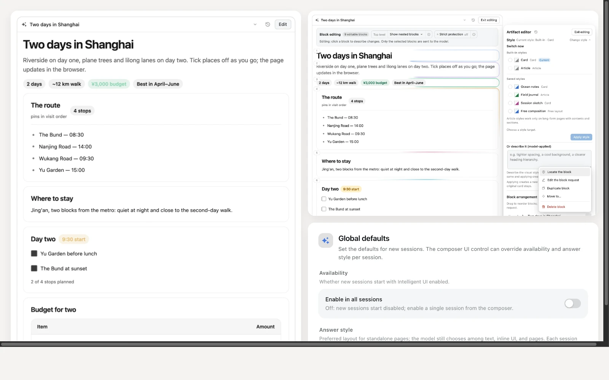
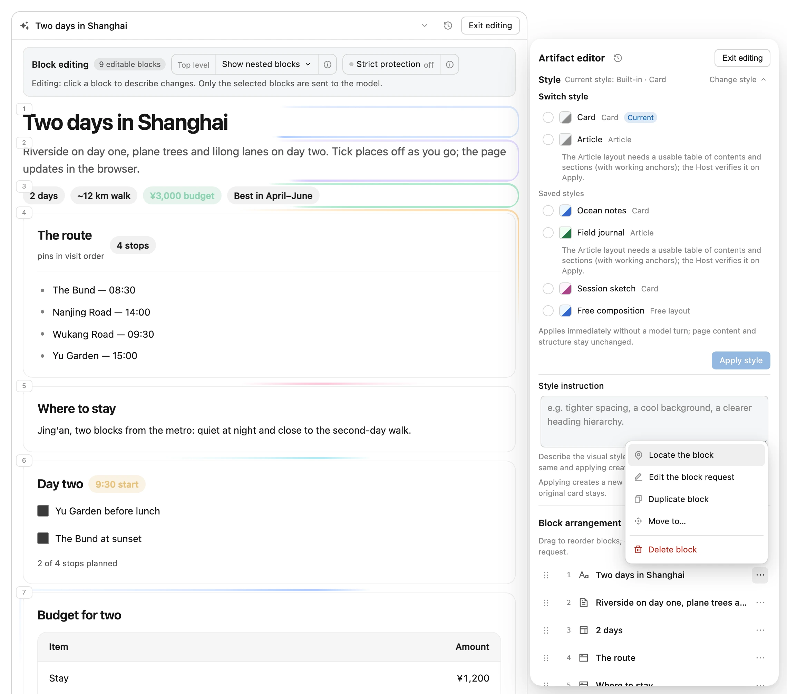
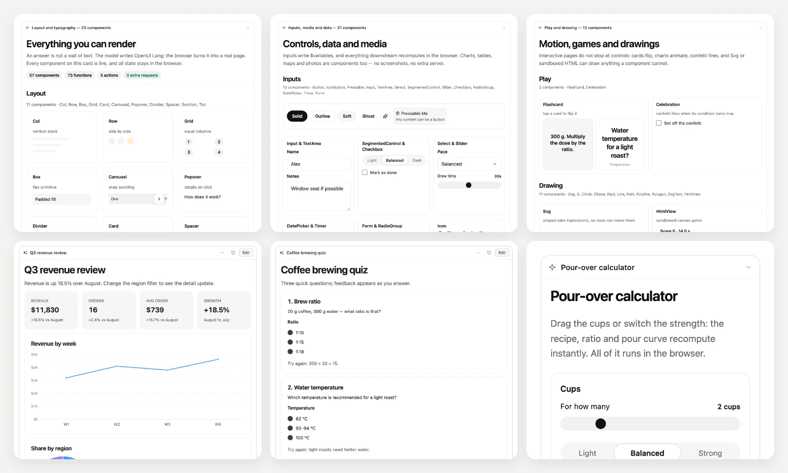
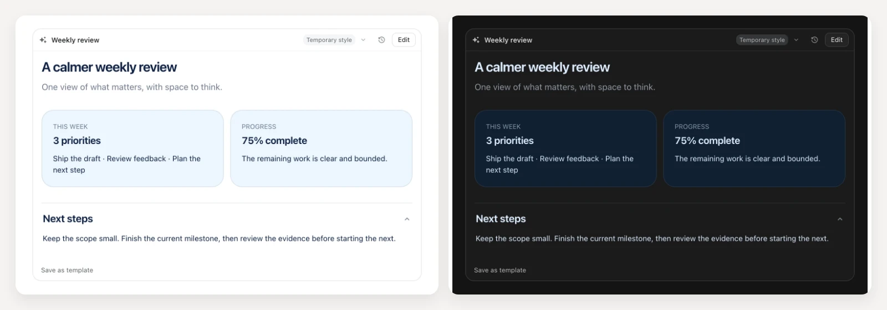

# dsh-intelligent-ui

[中文](README.md) | English

[](https://www.npmjs.com/package/@zephinel/dsh-intelligent-ui)
[](LICENSE)
[](https://www.npmjs.com/package/@deepseek-ai/dsh)
[](https://github.com/Zephinel/dsh-intelligent-ui/actions/workflows/publish.yml)

**Let DeepSeek Harness (DSH) answers grow interactive UI right inside them.** After installing and enabling the plugin, ask normally:

```text
Explain the difference between a harness and a model
```

Explanations and analyses stay Markdown; where it helps, the model writes [OpenUI Lang 1.0](https://openui.com) into an `openui` fence in the answer — maps, photos, charts, flows, checklists, forms and SVG drawings sit directly inside the reply, read together with the prose. When you need a standalone page you can actually use, ask for it:

```text
Plan two days in Shanghai, with checkboxes and adjustments
```

Then the model delivers an editable, exportable, savable interactive page as a card at the end of the turn. Both paths use real components; inline UI needs no extra inline-mode switch (the session UI switch still enables the plugin). Ported from [Open Intelligent UI](https://github.com/thesysdev/open-intelligent-ui) (MIT), with an Agent Skill (`intelligent-ui`) that the plugin registers automatically.

> [!NOTE]
> **Current status**: published on GitHub and npm; `@zephinel/dsh-intelligent-ui@0.6.2` is npm `latest`, and the plugin is listed in awesome-dsh-plugin / dsh-market, Open Plugin Market and other community markets. Verification: Node tests **869/869** (Host 323, Client 507, packaging 39); **11/11** browser suites pass, including **944** checks in the Artifact block-editing suite, **75** checks in the nested edit-renderer suite and **76** image-export assertions. Version changes are in the [CHANGELOG](https://github.com/Zephinel/dsh-intelligent-ui/blob/main/CHANGELOG.md); past verification is in the [verification record](https://github.com/Zephinel/dsh-intelligent-ui/blob/main/docs/verification.en.md).

[What it looks like](#what-it-looks-like) · [Install](#install) · [Generate and edit](#generate-and-edit) · [Documentation index](#documentation-index) · [Getting the code and local development](#getting-the-code-and-local-development)

## What it looks like



An explanation's UI appears inside the answer; a standalone page appears as a card at the end of the answer. Its `$variables`, `@Set` and `@functions` all execute locally in the browser: checkboxes, sliders, steppers, timers and budget allocation never require another model request. Only actions that genuinely need to continue the conversation (`@ToAssistant`, such as a form submission) put a short message back into the composer.

## Install

**DSH Web**: install the published `0.6.2` from npm, then start the Web UI.

```bash
dsh plugin --profile web add @zephinel/dsh-intelligent-ui@0.6.2
dsh web
```

If a Web process is already running, restart it after installing; open the URL it prints (the address and port come from the DSH profile), and the **UI** control on the right of the composer means the plugin loaded. To follow the latest version, drop `@0.6.2`; to install committed code from GitHub, use `github:Zephinel/dsh-intelligent-ui`.

**DSH Desktop**: sidebar **Plugins** → **Add plugin**, enter `@zephinel/dsh-intelligent-ui@0.6.2` (or just the package name for the latest version) → **Install** → **Enable now**.

For first use, click **UI**, choose "This session only" (or send `/iui on`), then send the explanation example above; inline UI in the reply confirms it works (the itinerary request renders a card at the end instead). Inline fences need the `conversation.chat.markdown.fence` slot in DSH 0.2.2-rc.2+; earlier builds show a code block. Install sources, uninstall, version switching and troubleshooting: [Development and deployment](https://github.com/Zephinel/dsh-intelligent-ui/blob/main/docs/development.en.md#installation).

## Generate and edit


The composite above comes from real DSH sessions (DeepSeek V4.1 Flash · Max): one renderer produced the itinerary, dashboard and quiz, not hand-written samples.

The model picks the form the answer needs: **explanations, analyses and comparisons** stay Markdown with inline UI where a chart, table, flow or small interaction helps; a **standalone interactive deliverable** — a page, dashboard, tool, form, game or editable result — is the only case that calls `render_ui` to produce a turn-tail card; plain text when that suffices. One answer never uses both forms. When a standalone page renders, choose Card / Article per session under **UI → Display style**, or let **Auto** choose; **On-demand UI** only describes the request and picks no template.



A rendered page can keep changing: write change requests for blocks, drag or keyboard-reorder them, switch or describe the style; the result becomes a new revision, and the history can be reviewed at any time. Full flow: [usage guide](https://github.com/Zephinel/dsh-intelligent-ui/blob/main/docs/usage.en.md#edit-a-rendered-page).

## Components



Generated pages are built from **57 components, 73 functions and 5 action steps**: layout, text, inputs, media, data, interaction and drawing. On narrow screens cards reflow to a single column, and long chart labels truncate instead of overflowing. Full parameter tables: [component catalog](https://github.com/Zephinel/dsh-intelligent-ui/blob/main/skills/intelligent-ui/references/components.md).

## Switch and style


- **Global defaults** are on the plugin detail page; the **UI** control to the right of the composer overrides them per session (or `/iui on|off|inherit`), and `/iui style …` commands have their own entry.
- **Temporary results** are ready to use; only a theme-bearing temporary-style result shows **Save as template**, which asks for a name and reuses the result's validated style without changing the current selection or the global default.



Switch semantics, styles and templates: [usage guide](https://github.com/Zephinel/dsh-intelligent-ui/blob/main/docs/usage.en.md).

## Documentation index

Detailed docs live in the repository's `docs/` directory and are not published with the npm package, so the links below use absolute GitHub URLs; uncommitted features follow the files in the checkout.

| Document | What it covers |
| --- | --- |
| [Usage guide](https://github.com/Zephinel/dsh-intelligent-ui/blob/main/docs/usage.en.md) | Switch, asking and styles, editing and revisions, templates, export, FAQ |
| [Development and deployment](https://github.com/Zephinel/dsh-intelligent-ui/blob/main/docs/development.en.md) | Install/uninstall/restart, local commands, CI, release flow, marketplace maintenance |
| [Architecture and behavior](https://github.com/Zephinel/dsh-intelligent-ui/blob/main/docs/architecture.en.md) | Host/Client tree, switch semantics, editing pipeline, export and update prompt |
| [Known limitations](https://github.com/Zephinel/dsh-intelligent-ui/blob/main/docs/limitations.en.md) | Boundaries that still exist or are unverified |
| [Verification record](https://github.com/Zephinel/dsh-intelligent-ui/blob/main/docs/verification.en.md) · [CHANGELOG](https://github.com/Zephinel/dsh-intelligent-ui/blob/main/CHANGELOG.md) · [GitHub Releases](https://github.com/Zephinel/dsh-intelligent-ui/releases) | Test and packaging results, version changes and release pages |
| [Agent Skill](https://github.com/Zephinel/dsh-intelligent-ui/blob/main/skills/intelligent-ui/SKILL.md) · [Component catalog](https://github.com/Zephinel/dsh-intelligent-ui/blob/main/skills/intelligent-ui/references/components.md) | Model-facing syntax and component parameter tables |

## Getting the code and local development

```bash
git clone https://github.com/Zephinel/dsh-intelligent-ui.git
cd dsh-intelligent-ui
npm install          # prepare builds automatically
node scripts/install.mjs   # install into the web profile
dsh web
```

To submit changes, fork the repository and clone your copy first.

Environment: the DSH 0.2.2 plugin API (validated on `0.2.2-rc.5`, `dsh` CLI; inline UI needs the fence slot in `0.2.2-rc.2+`), Node 24 with its bundled npm, and Git; the browser half needs `@deepseek-ai/dsh-client-locale` (DSH Web 0.2.2 includes it by default). The extension has no separate development server or watch mode: rebuild with `npm run build` and restart DSH after a change. Run `npm run check` before submitting; the full command table, install-mode switching, CI and release flow are in [Development and deployment](https://github.com/Zephinel/dsh-intelligent-ui/blob/main/docs/development.en.md#development).

## Contributing

- Questions and feature requests: use [GitHub Issues](https://github.com/Zephinel/dsh-intelligent-ui/issues).
- Run `npm run check` before opening a PR. CI ([`ci.yml`](https://github.com/Zephinel/dsh-intelligent-ui/blob/main/.github/workflows/ci.yml)) runs the local gate on PRs and main: docs-only changes (CHANGELOG/PRODUCT/docs) take the docs checks, while README is packaged content and takes the full gate. Releases run on `v*` tags through the [Trusted Publishing workflow](https://github.com/Zephinel/dsh-intelligent-ui/blob/main/.github/workflows/publish.yml).
- When behavior, copy or counts change, sync both READMEs, `CHANGELOG.md` and the matching documents under `docs/` per the [doc-sync skill](https://github.com/Zephinel/dsh-intelligent-ui/blob/main/.agents/skills/sync-iui-docs/SKILL.md) (in a checkout, the local file is authoritative). Maintainer: [@Zephinel](https://github.com/Zephinel).

## License

This project is [MIT](LICENSE), based on Open Intelligent UI (MIT, Copyright (c) 2026 Thesys Inc.) and the OpenUI ecosystem. The distributed artifact includes third-party components; full license notices are in [NOTICE](NOTICE) and [licenses/](licenses/). Map basemaps and route data come from OpenFreeMap / OpenMapTiles / OpenStreetMap, Esri and OSRM, and their attribution is shown in the map itself. If something is missing or misattributed, please open an issue or PR.
