# dsh-intelligent-ui

中文 | [English](README.en.md)

[](https://www.npmjs.com/package/@zephinel/dsh-intelligent-ui)
[](LICENSE)
[](https://www.npmjs.com/package/@deepseek-ai/dsh)
[](https://github.com/Zephinel/dsh-intelligent-ui/actions/workflows/publish.yml)

**把 DeepSeek Harness（DSH）的模型回答变成一张真正能用的页面。** 安装并启用后，直接提问：

```text
帮我排一个上海两日游，要能勾选和调整
```

模型调用 `render_ui` 工具，把答案写成一份 [OpenUI Lang 1.0](https://openui.com) 程序；DSH 聊天页在该轮结束时把它渲染成可交互页面——地图、照片、图表、清单、表单、SVG 绘图、小游戏都是真实组件，不是截图。

基于 [Open Intelligent UI](https://github.com/thesysdev/open-intelligent-ui)（MIT）移植，并附带一个随插件自动注册的 Agent Skill（`intelligent-ui`）。

> [!NOTE]
> **当前状态**：已发布到 GitHub 与 npm，npm 版本 **`@zephinel/dsh-intelligent-ui@0.5.0`**（`latest`）。自定义样式、按需生成、自由布局与模板文件导入/导出，以及渲染契约、Host 校验与导出语义修复均已包含在 0.5.0 中。

[快速开始](#快速开始) · [获取代码](#获取代码) · [构建、测试与部署](#构建测试与部署)

## 效果

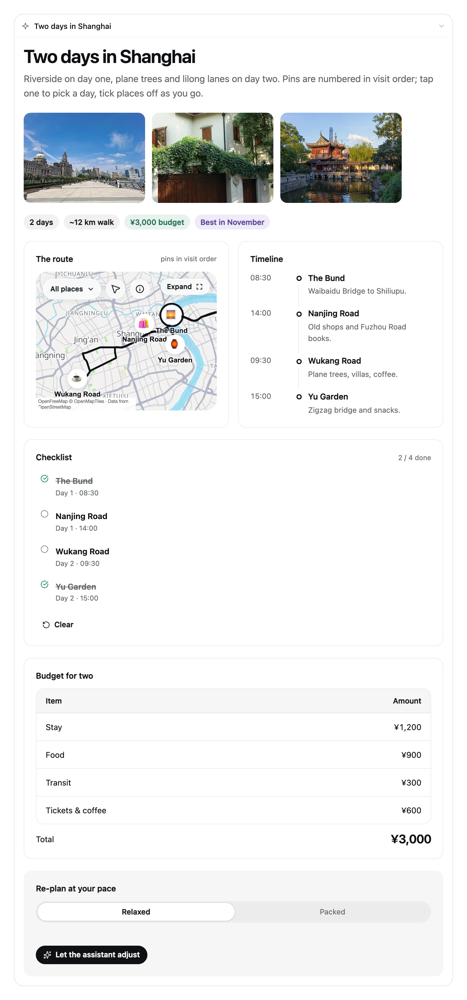

- 用户问「帮我排一个上海两日游」，模型不再只回一段文字：回答末尾直接渲染一张可点击、可勾选、可拖动的行程页面（地图 + 照片 + 时间线 + 清单 + 预算）。
- 卡片内的 `$变量`、`@Set`、`@functions` 全部在浏览器本地执行：勾选、滑动条、Stepper、计时器、预算分配都不需要再请求模型。
- 已经渲染的页面还能继续改：点卡片标题栏的「编辑」（进入编辑后每个顶层可编辑区块都有一道淡色光晕沿它看不见的边缘绕行一周（约 2.6 秒一圈，各区块错相位、淡蓝/淡紫/淡绿/淡黄/淡粉/淡青轮换），悬停时变亮；选中区块是浮动描边 + 阴影，而不是蓝框（编辑画布本身布局与普通卡片一致，所有选择装饰由几何 overlay 绘制）；左侧编排/嵌套/请求行与画布支持双向 hover 联动，行尾有「定位」按钮，根层常显页面序号（嵌套 hover 显示），打开区块编辑器时其余内容压暗；选中 `Divider`/`Spacer` 时弹出的是快捷调整：颜色与单位用自定义下拉、宽度/粗细/高度带自定义滑块（都不是系统控件），改动在画布实时预览、应用后由 Host 确定性记录修订，不需要模型；动态绑定或超范围属性会自动回退到指令编辑并说明原因，无改动时不能应用），为区块填写修改要求，或在「区块编排」里拖拽、用键盘方向键调整顶层区块顺序（画布实时预览目标顺序）；正常发送后模型只返回选中区块的改写片段，Host 合并回原页面——未选区块逐字节不变——并按新顺序生成新的「修订」。同一聊天里可以同时保留多份卡片编辑草稿（各有一个 chip；输入框卡片顶部的草稿条可切换/附加/丢弃，单画布），一次发送最多提交 3 个 Artifact 的修改请求，每个 Artifact 独立生成自己的修订。旧修订也可以继续：历史修订卡片上可以「恢复为新修订」（不调用模型，生成本地修订卡片），过期修订的编辑冲突横幅可以「从此修订创建新修订」形成分支。临时样式结果也能做区块内容修改（保留原样式快照）；排序或整体说明仍需已有已保存/内置样式的页面。容器内部的区块也能改：编辑画布可切换到「嵌套区块」，选中 `Col`/`Row`/`Box`/`Grid`/`Card`/`Section`/`Carousel` 内的子区块填写修改要求（M4-1 内容替换），并可在「嵌套区块编排」里调整同一容器内的子区块顺序（M4-2）；编排行上还可以复制、删除区块（M4-3），或把区块「移动到…」另一个容器（M4-4 跨容器移动；Host 零模型确定性执行并记录修订），并可在嵌套组里「添加区块」由模型生成新内容（M4-4 additions；发送后模型生成新块并记录修订）。结构操作先显示**变更预览**（新增/删除/保留行与受影响的顶层区块数），确认后才记录修订（M4-5/B2-5 结构 diff 预览）。进入编辑时会根据 **sidebar 之后的聊天列** 动态收窄聊天内容（内容右缘与面板左缘保留 24px 间距），编辑中拖动 shell 的聊天宽度把手也会立即重新适配，退出后恢复用户原来的宽度；编辑面板不再提供「展开/收起」按钮。编辑画布工具栏还有可选的「严格保护」开关：开启后 Host 会拒绝任何对未选顶层区块的改动，错误后请求保持待处理、可用同一请求重试（B2-5）。编辑面板与插件内其它自绘 UI 的图标统一使用 Remix Icon（path 内联、无运行时依赖、跟随 `currentColor`）；OpenUI 程序内容里的 `Icon("…")` 仍由 lucide 动态解析（属程序数据）。编辑面板头部也有「退出编辑」按钮；面板本身是圆角浮动卡片，带约 320ms 的显示/消失动画（`prefers-reduced-motion` 时禁用）；结构性删除使用持久的「取消 / 删除」两态确认（没有自动恢复倒计时，直到取消、点击外部或按 Escape）；区块修改输入的 popover 在锚点滚出视口时仍会完整落在视口内，输入框获得焦点时的 2px focus ring 四边（含底部）也完整可见。编辑产生的新修订卡片会**部分保留运行时状态**：渲染器持有的 `$state` 与表单字段初始值会从被编辑的基础修订继承（B2-6）；第三方组件内部状态与编辑画布内的交互值不保留。Article 与自由版式都已完成真机验证（B2-8）：Article 卡片可编辑并生成仍为 article 的 Revision 2；自由版式必须经 On-demand UI 生成（`style=free` + `temporaryStyle`，普通 `render_ui` 传 free 会被 Host 拒绝），编辑后 Revision 2 仍为 temporary/free。窄屏 390×844 无横向溢出、点「编辑」只显示窄屏提示不进入编辑器；900×1000 编辑画布可正常打开（B2-9）。`test/browser/visual-baselines/` 保存 5 张手动视觉基线（article/free 卡片、article 编辑器、结构预览模态、390 窄屏），仅用于人工对照，**没有自动像素 diff**（B2-10）。编辑画布支持屏幕阅读器与纯键盘操作（B1-5）：重排/新增/移除/移动/预览开关通过 polite live region 播报，拖拽手柄与「移动到…」菜单有 aria-describedby 提示，移动菜单支持方向键/Home/End/Enter/Escape 与焦点返回，添加表单与嵌套组有可访问名称，新增 focus-visible 焦点环。
- 只有真正需要继续对话的动作（`@ToAssistant`，例如表单提交）会把一条简短消息放回输入框并发送。

## 组件一览

渲染器不是把一段文字包进聊天气泡，而是一套完整的组件库：**57 个组件、73 个函数、5 种动作**。下面三张卡片都是扩展的真实渲染结果——同一套渲染器、同一套 DSH 主题 token，没有设计稿：

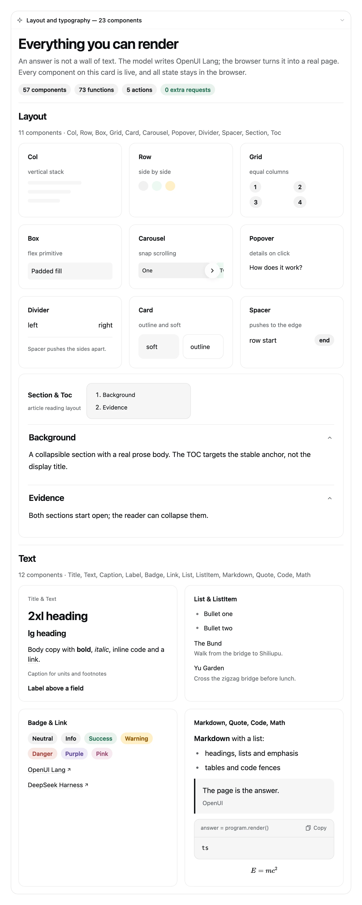

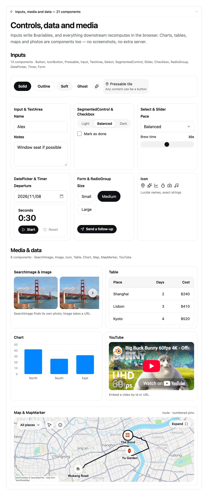

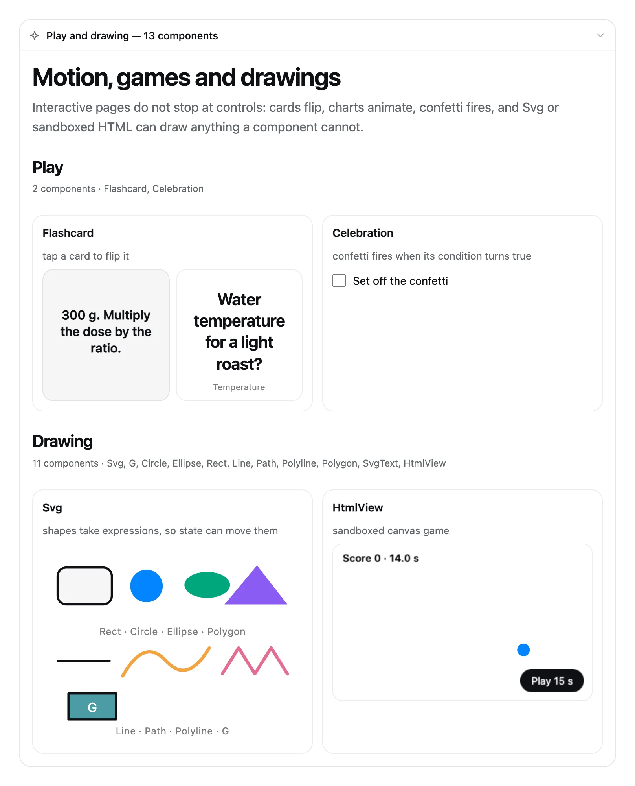

## 更多示例

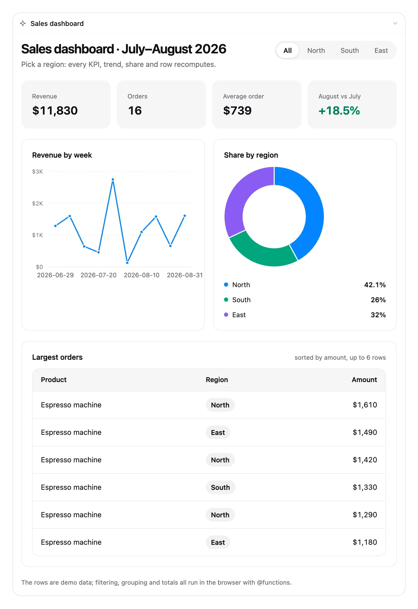

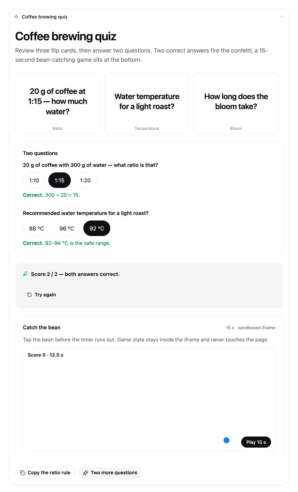

窄屏下卡片自动切为单列，地图与图表按卡片宽度自适应；图表分类标签过长时会截断而不是溢出（约 380 px 宽）：

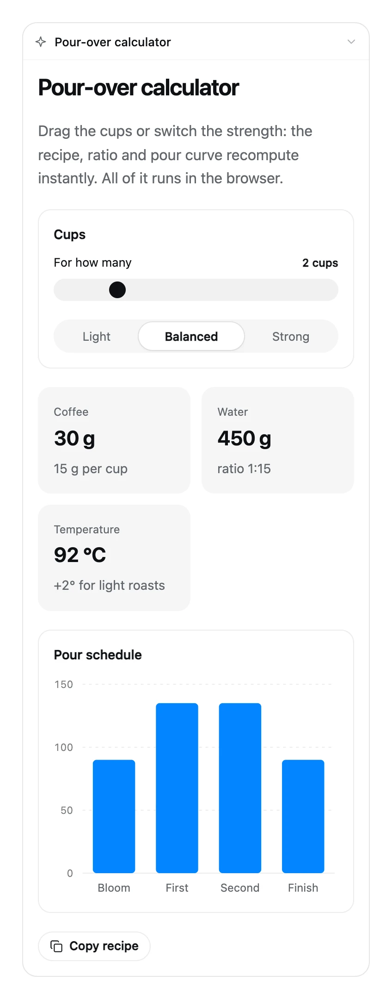

## 核心能力

| 能力 | 说明 |
|---|---|
| 交互页面 | 地图、照片、图表、清单、表单、SVG 绘图、小游戏都是真实组件，不是截图 |
| 区块编辑与编排 | 在已渲染页面上为区块填写修改要求、拖拽或用键盘调整顶层区块顺序（画布实时预览目标顺序）；支持只改内容、只调顺序或两者同时，内容修改以区块片段返回、由 Host 合并回未选区块逐字节不变的页面，结果是新的修订。同一聊天可并行保留多份草稿（单画布激活、每 Artifact 一个 chip），一次发送最多提交 3 个 Artifact 的修改请求，各修订独立生成；历史修订可零模型恢复为本地修订卡片，或在冲突时基于旧修订创建新分支；临时样式结果支持区块内容修改（保留原样式快照）；容器内嵌套区块（`Col`/`Row`/`Box`/`Grid`/`Card`/`Section`/`Carousel`，opt-in）支持内容修改、同父内部排序、模型新增区块，以及零模型的复制/删除/跨容器移动结构操作（记录新修订，根层顺序不变） |
| 导出图片 | 把该轮渲染结果保存为一张 PNG：原始 / 圆角 / 卡片三种美化；背景色与 1x/2x 在插件详情页设置 |
| 导出交互页面 | 把该轮全部卡片导出为单个 HTML 文件，浏览器打开后继续交互；`@ToAssistant` 改为复制文案并提示回 DSH 粘贴 |
| 本地执行 | `$变量`、`@Set`、`@functions` 在浏览器运行；只有 `@ToAssistant` 回写消息 |
| 开关与样式 | 全局默认在插件详情页；输入框 UI 控件按会话覆盖；内置 Auto / Card / Article 与自定义模板 |
| 自定义模板与视觉主题 | 保存可复用的展示偏好与明暗配色、字体、圆角、密度、阴影；在「我的样式」中使用、重命名、编辑或删除 |
| 聊天内按需生成 | 无需模板；在 UI 面板选择「按需生成」，正常发送需求，必要时用内置提问工具澄清 |
| 按需自由布局 | 按用户需求编排页面；保存模板保留自由布局、偏好与主题，再次使用仍无 Card/Article 外壳 |
| 临时结果与可选保存 | 结果自带内联样式快照，可直接使用、调整样式或事后保存为模板；不强制预览、命名或保存 |
| 双语界面 | 跟随 DSH 的中文或英文界面语言 |
| Agent Skill | 随插件注册 `intelligent-ui`，模型按需加载完整语法、示例与排障 |
| 插件详情页 | 集中管理全局启用、默认样式、模板、编排方式与导出偏好 |
| 可重放 | 程序与临时样式随工具参数重放；导出页面冻结导出时的主题方案 |

## 获取代码

从 GitHub 克隆仓库：

```bash
git clone https://github.com/Zephinel/dsh-intelligent-ui.git
cd dsh-intelligent-ui
```

如果要提交改动，先 Fork 本仓库再克隆自己的副本；只想使用插件时，直接安装 npm 包即可（见[快速开始](#快速开始)）。

## 前置条件

以下命令用于 DSH Web 与源码开发；DSH Desktop 用户可直接按[快速开始](#快速开始)中的应用内步骤安装。

- **DSH 0.2.1 插件接口**（[`dsh` CLI](https://www.npmjs.com/package/@deepseek-ai/dsh)）：Host/Client 与插件协议按这个版本开发；实际验证版本是 `0.2.1-rc.2`，更晚版本未验证。安装命令固定到已验证版本：`npm install -g @deepseek-ai/dsh@0.2.1-rc.2`。
- **[Node.js 24 与自带的 npm](https://nodejs.org/en/download)**：构建、测试与发布工作流使用 Node 24。仓库没有 `engines` 或 `.nvmrc` 版本锁，运行 `npm install` 前需自行选用 Node 24；Host 的 Node 22 编译目标不代表整个工具链已在 Node 22 验证。
- **[Git](https://git-scm.com/downloads)**：仅获取源码时需要，仓库未指定最低版本。
- **`@deepseek-ai/dsh-client-locale`**：浏览器半边要求部署组合了它；DSH Web 0.2.1 默认包含，缺少时开关和卡片不会挂载（Host 工具与提示词仍可用）。

确认工具存在：

```bash
node --version   # v24.x
npm --version
dsh --version    # 已验证：0.2.1-rc.2
git --version    # 仅获取源码时需要
```

重启示例覆盖前台 `dsh web`、macOS launchd 与 Linux systemd；用其他方式托管时重启对应服务。验证平台：macOS（Web + DSH Desktop）与 Windows（DSH Desktop）；Linux 未验证。

## 快速开始

**DSH Web**：从 npm 安装已发布的 0.5.0，再启动 Web UI（首次前台运行示例）：

```bash
dsh plugin --profile web add @zephinel/dsh-intelligent-ui@0.5.0
dsh web
```

已有 Web 进程时，安装后重启该进程（前台：Ctrl+C 后重新运行 `dsh web`；launchd/systemd：重启对应服务）。打开它打印的 URL，输入框右侧出现 **UI** 控件即加载成功；地址与端口由 DSH profile 决定。

其他安装来源可替代上面的安装命令：跟随 npm 最新版用 `dsh plugin --profile web add @zephinel/dsh-intelligent-ui`；从 GitHub 已提交代码安装用 `dsh plugin --profile web add github:Zephinel/dsh-intelligent-ui`。两者都不会安装当前 checkout 的未提交改动。

**DSH Desktop（桌面版）** 不需要终端命令，在应用内安装：

1. 侧栏 **插件** → **添加插件**（或箭头 → **安装第三方插件**）。
2. 输入 `@zephinel/dsh-intelligent-ui@0.5.0`（或只填包名装最新版），点 **安装**。
3. 安装完成后点 **立即启用**；若输入框右侧没有 **UI** 控件，退出并重开 DSH Desktop。

桌面版的 profile 由 Electron 应用独占管理，`dsh plugin --profile desktop` 会被拒绝。国内镜像可能晚于 npm 官方源同步刚发布的版本；装不到时把安装源切回 npm 官方源。

安装后在输入框右侧点 **UI** 控件，选择「仅本会话」（或发送 `/iui on`），再发送开头的行程示例。该轮结束后出现可交互的行程页面即验证成功。需要时可在同一面板设置本会话的 Auto / Card / Article 样式。

本地开发（从 checkout 构建并安装）、卸载与排障见[开发与部署](https://github.com/Zephinel/dsh-intelligent-ui/blob/main/docs/development.md)；扩展没有独立的开发服务器。

## 开关与回答样式

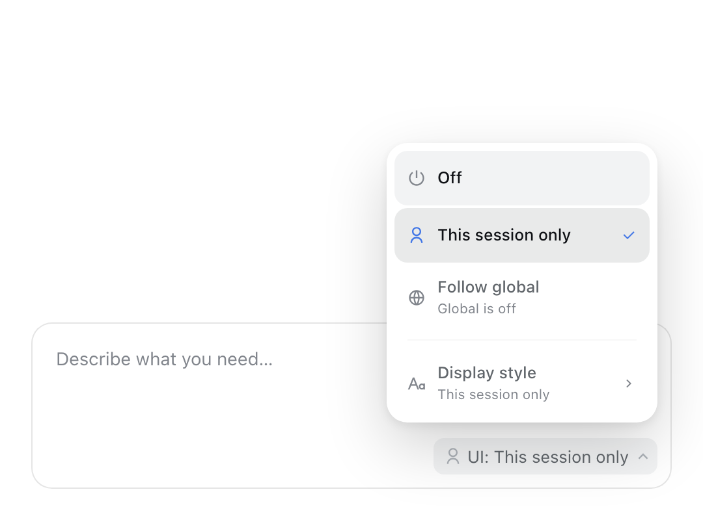

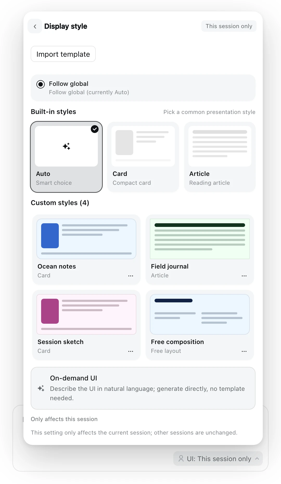

- **全局默认**：插件详情页的「在所有会话中启用」与「回答样式」设置新会话默认值；可以选择内置样式或已保存的全局模板。
- **会话覆盖**：点 Composer 的 **UI** chip →「仅本会话」或「显示样式」进入面板。上方是内置 Auto / Card / Article 预览卡片，中间是「自定义样式」（已保存模板），底部是「按需生成」。「全部会话」表示本会话跟随全局开关，不会打开全局开关；`/iui on|off|inherit` 与 `/iui style auto|card|article|inherit|<cs_id>` 提供命令入口。
- **Auto** 由模型按请求选择：交互/结构化用紧凑 Card，详尽/深入/长文用 Article。Article 需要 `Toc`、可折叠 `Section` 和实质正文。
- **按需生成**：选择后面板关闭，焦点回到输入框，出现可取消的提示与示例；示例只填入内容，保留已有草稿，不自动发送。正常发送后，清晰需求直接渲染，有重要歧义时由内置 `ask_user_question` 结构化提问，回答后继续生成。
- 会话启用/样式设置原子写入 `<DSH_HOME>/dsh-intelligent-ui.json`；按需操作不改这些设置，临时样式也不是当前选中的样式。完整边界见[架构与行为](https://github.com/Zephinel/dsh-intelligent-ui/blob/main/docs/architecture.md)。

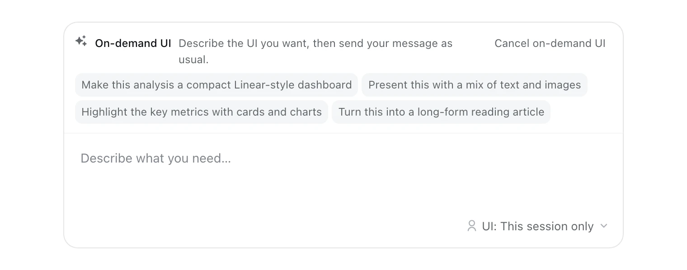

## 使用

打开开关后直接用自然语言提问，例如：

- 「帮我排一个上海两日游，要能勾选和调整」
- 「做一个 7 速自行车的换挡模拟器」
- 「把这几张表变成一个可以筛选的销售看板」
- 「介绍一下中国历史，要能按朝代展开」
- 先选「按需生成」，再发送「把这次分析做成紧凑仪表盘，用卡片和图表突出关键指标」
- 点结果下的「调整样式」，再发送「保留内容，改成留白更多的阅读版式」
- 点已渲染页面标题栏的「编辑」，为区块填写修改要求；在「区块编排」里拖拽或用键盘方向键调整顺序（画布会实时预览目标顺序），然后正常发送
- 在旧修订卡片上点「恢复为新修订」（不调用模型）；或在旧修订的编辑冲突横幅点「从此修订创建新修订」创建分支

编辑请求会留在输入框的 chip 里：每个被编辑的 Artifact 一个 chip，标签为「编辑 {title} · 修订 N · {摘要}」（摘要如「2 项修改」「调整区块顺序」「整体说明」）；从旧修订分支时追加「 · 分支」。一次发送最多合并 3 个 Artifact 的请求；手动删除某个 chip 只会把对应草稿从本次发送中移除（草稿保留，可在右侧「待提交编辑」区重新附加）；点 chip 可回到该草稿的编辑画布。

开启后，**有结构的回答默认用卡片呈现**——包括讲解、介绍、时间线、阶段、对比和可探索内容；文字只用于单个事实、一两句话的答复、你明确要文字/文档/代码，或渲染连续失败。开关没打开时，模型看不到 `render_ui`，会直接用文字回答——这不是故障；打开开关再问即可。

如果一定要保证出卡片（或模型仍然回了文字），在开关已打开的会话里用 `/intelligent-ui` 显式调用技能；显式调用会被当作直接指令。也可以说「读取 intelligent-ui skill 然后用 render_ui 做一个…」。

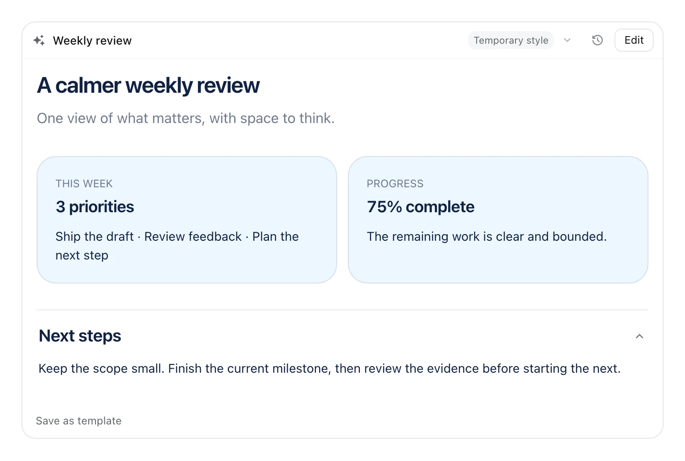

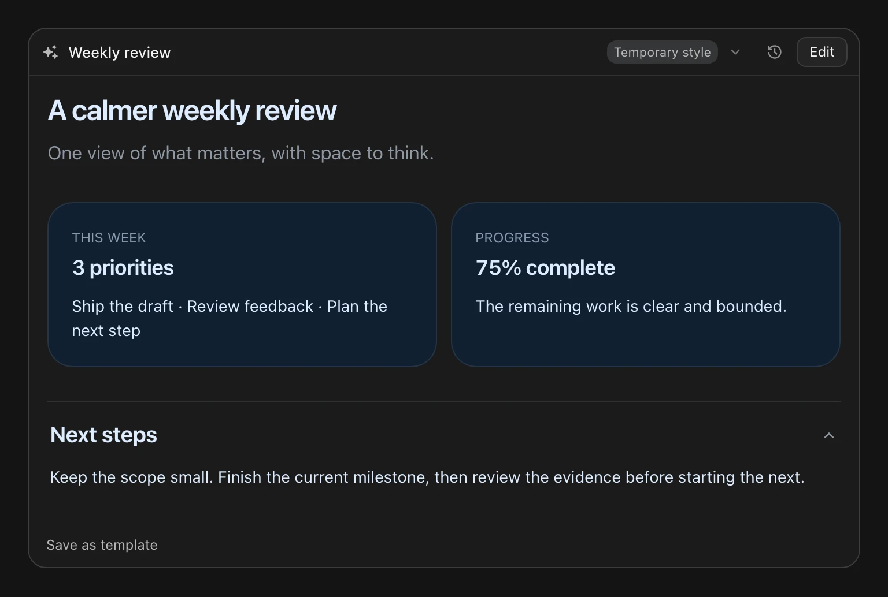

临时结果可以立即使用。点「调整样式」会关联这张结果并在保留草稿的前提下填入调整提示，仍需正常发送；点「保存为模板」才填写名称、描述与可用范围（本会话或全局）；保存完整保留该结果的布局（free/card/article）、偏好与显式明暗主题，不再选择布局。结果没有显式主题时继承会话主题，此时不提供「保存为模板」，因为没有可复制的配色。自由模板使用独立预览与「自由布局」提示；选中后仍无 Card/Article 外壳，保留 DSH 卡片标题栏，Toc/Section 可选。保存复用该结果的已校验样式，不再次生成，也不自动选中模板或更改全局默认；不要求先预览、命名或保存。

**0.5.0 起**：Host 要求新按需生成使用自由布局；调整保留父结果的布局（free、旧 card 或 article）。若父快照已不在最近 200 条结果注册表中，调整会报错；请取消调整后重新选择「按需生成」。历史结果仍可从工具参数重放。

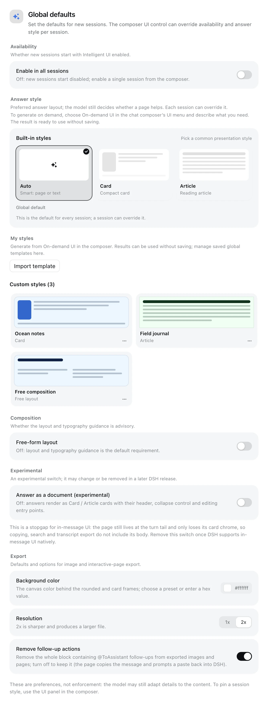

插件详情页按 **可用性**、**回答样式**、**我的样式**、**编排方式** 和 **导出** 分组。「我的样式」管理已保存的全局模板，可设为默认、重命名、编辑描述/展示偏好、导出文件、导入模板或删除；Composer 管理当前会话可见的全局与会话模板。生成入口在 Composer，设置页提供说明，不设生成工作台。全局值是新会话的默认；输入框 UI 控件里的会话值优先。**自由布局**只影响设计规范的建议强度，与回答样式正交。**导出** 保存图片的默认背景色、1x/2x 分辨率，以及图片/交互页面是否移除 `@ToAssistant` 追问控件及其表单字段（含正文的 Card 保留正文，只有纯追问区块整块消失；默认移除）。

**模板文件分享**：在插件设置页「我的样式」或 Composer 的「显示样式」面板中点模板的 `…` →「导出文件」，检查敏感信息提示后点「下载」，得到 `<模板名>.iui-style.json`。Composer 面板同时覆盖仅本会话的模板，因此不必先另存为全局模板。文件包含名称、描述、基础布局、展示规范全文和主题；分享前检查其中是否包含个人或内部信息。接收方在「我的样式」或「显示样式」面板点「导入模板」，选择文件或粘贴 JSON →「预览」→ 检查名称、描述、布局、明暗色板及展示规范全文。可以改名、编辑或清空展示规范；导入前必须勾选「我已阅读并理解上述风险，确认导入该外部模板」，再点「导入模板」。导入只新建全局模板（Composer 里的导入同样只写全局；导入到本会话仍待会话授权校验后开放），不自动应用，也不改变当前选择或全局默认；随后可正常选用、编辑、删除或再次导出。

模板交换格式 v1 只包含可移植样式配置，支持 `card|article|free`，不含本地 id、作用域、会话和时间戳。支持 v1 的插件版本可以导入该格式；未知版本会被拒绝，不尝试降级解析。导入器只接受该交换格式：原始模板导出文件与持久化库文件都会被拒绝（当前没有外部用户，不维护旧格式兼容）。交换格式版本独立于 npm 包版本；未来引入 v2 应继续支持 v1，新增布局或移除 `baseLayout` 必须显式演进格式，不允许 v1 静默接受未知布局。

单次只交换一个模板，输入最多 **32 KiB（UTF-8 字节）**；文件大小先检查再读取，不依赖扩展名或 MIME。允许全文包住的一层 Markdown 代码围栏，不从任意说明文字中提取 JSON。未知字段和模板库备份均拒绝。全局最多 40 个模板；重名时建议 `(Imported)` 后缀，仍冲突时需改名，配额满时先删除不需要的模板。没有分享码、在线链接、批量备份或会话范围导入；Composer 的导入同样只写全局。

**安全边界**：外部模板的名称与展示规范会进入提示词、可能影响模型行为；描述仅保存/导出，不会进入提示词。三者都按不可信文本处理，预览、阅读确认和不自动应用是缓解措施，不能消除提示词注入；实际执行权限仍由 DSH 工具/权限层控制。当前实现按 owner 已确认的方案（2026-10-24）用免责声明 + 阅读确认后保留外部内容；真实部署的 Origin/CSRF 与工具越权审计仍是发布前建议补做的加固。

回答渲染完成后，消息底部操作栏的**最右侧**会出现带「导出」字样的**药丸按钮**（只有扩展渲染的回答才有）。点开后可把该轮全部卡片保存为一张 PNG——**原始**（只截取答案本身）、**圆角**（背景色 + 圆角留白）或 **卡片**（留白、圆角与柔和阴影）；也可以导出为单文件 HTML，直接在浏览器打开即可继续交互，页面里的 `@ToAssistant` 改为复制消息并提示回到 DSH 粘贴。导出的图片只包含渲染出的卡片，不包含聊天里的 Markdown 文字或导出按钮本身。完整流程见[架构与行为](https://github.com/Zephinel/dsh-intelligent-ui/blob/main/docs/architecture.md)。

## 构建、测试与部署

从[获取代码](#获取代码)的 checkout 根目录开始。`npm install` 的 `prepare` 会自动构建；本地安装器默认写入 `web` profile 并自动备份。若该 profile 已安装 npm/GitHub 版，先用 `dsh plugin --profile web remove @zephinel/dsh-intelligent-ui` 移除，避免同一插件重复注册。

```bash
npm install
dsh plugin --profile web list  # 检查 profile；首次使用会初始化
node scripts/install.mjs
dsh web
```

已有 Web 进程时，安装后重启该进程，再打开它打印的 URL；输入框右侧出现 **UI** 控件后按[快速开始](#快速开始)启用并试问。扩展没有独立开发服务器或 watch 模式；每次修改后重新 `npm run build` 并重启 DSH。卸载与排障见[开发与部署](https://github.com/Zephinel/dsh-intelligent-ui/blob/main/docs/development.md)。

日常检查与打包：

| 命令 | 用途 |
|---|---|
| `npm run build` | 生成 prompt、Host、Client 与独立导出页面 bundle |
| `npm test` | 构建后运行 Host、Client 与打包的 Node 测试 |
| `npm run typecheck` | 运行 `tsc --noEmit`（浏览器 `src/client` 暂因运行时平台类型不可解析而排除） |
| `npm run check` | 提交前完整检查：typecheck、构建、Node 测试与 renderer 检查 |
| `npm run pack:check` | 预览 npm 包最终文件清单，不发布 |
| `npm run test:browser` | 先构建；运行 9 个浏览器套件，需要 Chrome |

- 当前 main 分支验证记录：Node 测试 **510/510**（Host 241、Client 247、packaging 21；区块编辑/编排/多卡片/分支/恢复/草稿持久化/临时样式/嵌套编辑/层级排序/结构操作/容器扩展/模型新增/跨容器移动/结构预览/严格保护/运行时状态/面板动画与宽度适配特性测试文件合计 239 条）；renderer 解析/渲染各 **42/42**，CSS/组件契约 **50/50** 与 **63/63**，排版 **22/22**，i18n **4** 个程序，嵌套 CSS 补偿契约 **28/28 direct + 5/5 scoped**；浏览器 **9/9** 套件通过，其中设置页模板交换 **101** 条、按需流程 **114** 条、交互页面 **46** 条、图片导出 **65** 条断言，Artifact 区块编辑套件 **313** 条检查、嵌套编辑渲染套件 **75** 条检查。浏览器测试覆盖组件/契约；真实模型验证范围与尚未覆盖的场景见[验证记录](https://github.com/Zephinel/dsh-intelligent-ui/blob/main/docs/verification.md)（历史记录）。
- `node scripts/capture-screenshots.mjs` 以固定 DSH token、生产组件与假服务在 Chrome 2x 重建面板、提示、临时结果与设置截图；英文 UI，卡片壳层图标用 lucide 替身。
- `npm run check` 里的排版检查（typography）需要本机 Chrome；没有 Chrome 时该检查会跳过，其余测试仍会运行。非默认安装位置可用 `CHROME_BIN` 指定 Chrome 可执行文件（也适用于浏览器套件）。

发布物是一个 DSH bundle；部署就是把插件安装进目标 DSH profile。卸载与版本注意事项见[开发与部署](https://github.com/Zephinel/dsh-intelligent-ui/blob/main/docs/development.md)。

## 贡献

- 问题与功能请求：使用 [GitHub Issues](https://github.com/Zephinel/dsh-intelligent-ui/issues)。
- 提交 PR 前运行 `npm run check`；仓库没有 PR CI，以本地命令结果为准。发布由 [GitHub Actions Trusted Publishing 工作流](https://github.com/Zephinel/dsh-intelligent-ui/blob/main/.github/workflows/publish.yml)执行，流程见开发文档。
- 贡献者与 AI 协作代理都应遵循[文档同步技能](https://github.com/Zephinel/dsh-intelligent-ui/blob/main/.agents/skills/sync-iui-docs/SKILL.md)：行为、文案或计数变化时，同步中英 README、`CHANGELOG.md` 与 `docs/` 对应文档。checkout 中以本地 `.agents/skills/sync-iui-docs/SKILL.md` 为准。
- 维护者：[@Zephinel](https://github.com/Zephinel)。

## 已知限制

- 卡片在该轮**结束时**出现；生成过程中进程区显示一行「交互式回答」（英文界面 "Interactive answer"）。
- 模型偶发生成不合法 OpenUI Lang；Host 校验会返回精确错误，通常同一轮内自修（实测 1–2 次）。
- 地图底图依赖 OpenFreeMap 瓦片，路线依赖 OSRM demo，照片依赖 Wikipedia/Wikimedia；离线时地图降级为地点列表、照片降级为占位块。
- KaTeX 使用 DSH 壳层已加载的全局样式；若该样式被移除，Math 组件会退化为纯文本。
- 生成提示词约 10K tokens，**只在开关命中该会话时发送**（全局开启，或该会话显式开启）；关闭时这部分开销为 0（工具 schema 也不出现）。Article 模式会生成更长的页面，输出 token 与渲染时间相应增加。
- 扩展 UI 文案随 DSH 界面语言切换；但 `/iui` 的 Host 返回文案、命令面板里的命令描述与 README 截图仍是英文（前两者是 DSH 平台行为）。
- 导出图片时，沙盒 iframe（`HtmlView` 里的小游戏）不会被截入图片，图片中该区域会缺失；地图通过保留 WebGL 绘制缓冲入图，禁用 WebGL 的浏览器会按地图自身的降级逻辑显示地点列表。
- 同一轮回复渲染出的多张卡片会合并成一张图片；导出的是**当前屏幕上渲染出的内容**，因此导出的图片会包含当时的交互状态（勾选项、筛选结果等）。导出会等待卡片内的图片加载和图片搜索完成（最多约 12.5 秒）；离线或仍未就绪时按页面上的占位状态导出。
- 交互页面导出会把渲染器、当前主题与全部卡片内联进一个 HTML（约 3.4–4.9 MB），因此文件较大但无需安装；地图、照片等组件仍依赖网络。页面里的 `@ToAssistant` 会尝试写入剪贴板并弹出提示；剪贴板不可用时提示会保留原消息供手动复制。
- 浏览器半边要求部署组合 `dsh-client-locale`（DSH Web 0.2.1 默认包含）；最小自定义 profile 缺少它时开关和卡片不挂载，Host 工具与提示词仍可用。
- 插件详情页里的配置依赖 DSH 的 settings 服务：最小自定义 profile 未组合 `dsh-settings` / `dsh-client-ui-settings` 时不出现；Host/Client 版本错位时开关可能显示为不可用。全局启用/样式与自由布局只改变提示词与页面形态，不保证每个模型都完全遵守；会话样式覆盖仍以 Host 注入的提示词为准。
- 交互页面导出需要部署提供 `webServer` 服务（DSH Web 0.2.1 默认包含）；最小自定义 profile 缺少它时无法导出交互页面，图片导出不受影响。

- 临时样式保存在工具参数/结果快照中，不进入模板库；历史工具参数仍在加载窗口时可重放。事后保存依赖有界结果注册表（最近 200 条），被淘汰的结果可能仍能重放但无法再保存。保存模板与结果快照在 `<DSH_HOME>` 的独立 JSON 文件中持久化。
- 样式创建/按需生成使用部署的默认主对话模型服务；扩展不提供独立生成模型或 draft 访谈服务。`ask_user_question` 是结构化澄清路径；工具不可用时降级为文字提问，文字轮结束后提示会保留，下一条消息继续同一操作，不需要重新选择「按需生成」（过期、重启或失败后除外）。
- 按需操作只在内存中：等待发送（armed）10 分钟过期，重启后活动操作无法恢复，需要重新武装；已完成结果不因此丢失。每会话最多一个活动操作：armed 时重新武装会替换，已绑定的 running/clarifying 拒绝重新武装且需先取消；最多两轮澄清。文本结束但未渲染时操作回到待继续状态，下一条消息继续；失败/中断会显示重试/关闭提示。
- 多标签页采用保守绑定：提示只显示在发起标签页，但 Host 绑定该会话的下一条人工消息，并不验证发送标签来源；请在发起标签页发送，避免另一标签同时发送。
- 自定义主题只应用到 renderer host，portaled Popover 与沙盒 iframe 保留默认主题；语义状态色保持渲染器定义。导出交互页面冻结导出时的明/暗方案，不随系统切换。
- 区块编辑与编排覆盖根 `Col` 的**全部直接子区块**，包括 `Caption`、`Divider`、`Spacer`、`Toc` 和根层 `Title`（M4-6）；`Divider`/`Spacer` 还有零模型的**快捷调整**：弹出面板里调颜色/宽度/粗细或宽度/高度，画布实时预览，应用时走 Host 确定性属性路由并直接记录修订。区块可以调整顺序、复制、删除、同容器内移动或跨容器移动/新增；目标顺序必须恰好包含基础版本的全部顶层区块（最多 100 个），Host 会按语句名/标题把模型返回的区块映射回该顺序并回报归一化程序。真正的不可编辑项只剩安全类：`@Each` 模板、opaque 表达式、共享命名表达式、深度/节点上限（CST 节点预算 200，覆盖长文章页面），以及带 `Section`/`Toc` anchor 的复制。内容修改走 `edit_ui_blocks`：模型只返回选中区块的片段（`root = Col([...])`，可带新的辅助语句），Host 合并回原页面；Phase 1 仍把完整页面作为只读上下文放进请求，输入 token 的节省留到 Phase 2。临时样式结果只支持区块内容编辑：编辑请求携带结果自带的样式快照，Host 复用它且不传 `styleId`；纯排序或纯整体说明在客户端被阻止并提示需要「已保存/内置样式」，Host 的 `render_ui` 回退路径也会拒绝；没有有效快照的临时卡片不可编辑。一次只编辑一个版本：基础版本过期或已有更新修订时会被拒绝并提示刷新；每条修改说明最多 2,000 字符、整体说明最多 4,000 字符、单次最多 12 条内容修改；发送前至少要有内容修改、顺序调整或整体说明之一，没有变化的请求会被拒绝；未选区块若被改动会收到保留警告。窗口宽度小于 720px 时不提供区块编辑：卡片与编辑视图会显示最小尺寸提示（可在提示中退出/关闭），加宽窗口后恢复。
- 编辑的健壮性：Composer 里编辑请求 chip 的引用是确定性的，刷新后仍能解析；编辑会话已失效时发送会提示重新打开编辑（也可删除 chip）。编辑期间每 15 秒以及窗口重新聚焦/可见时会后台检查修订，发现并发更新会提前显示冲突横幅。画布里的「预览目标顺序」只影响编辑态，已记录的修订与导出在发送前保持不变；失败的工具行会显示一行原因（完整文本在悬停 title 中），不展示程序参数。一次发送涉及多个 Artifact 时，Turn 结束后会按请求 id 核对修订：已生成修订的草稿消失，未完成的草稿恢复为「未完成，草稿已保留」的角标，可重新附加到下一次发送再试——不会自动重发。Host 侧未完成的 pending 仍按 15 分钟 TTL 保留，不会在 Turn 结束时清理；Turn 归属使用发送时间窗口启发式。真实模型的「部分成功」路径尚未做真机验证（单卡/双卡成功路径已真机通过）。编辑草稿按标签页缓存在 `sessionStorage`：刷新页面后 Composer chip 与卡片草稿角标会恢复（仅同一标签页；跨标签不共享，branch 标记/超大 program 不恢复）。同一修订在另一个标签页打开编辑时会显示「另一标签页正在编辑此修订 / 接管编辑」软租约横幅：接管只做提示与抢占，不合并修改；广播不可用时无提示，Host 修订校验仍是最终权威。
- 多卡片并行编辑（M3-1，v1）：同一聊天最多保留 6 份有内容的编辑草稿，同一时刻只有一张卡片展开编辑画布；一次发送最多附加 3 份草稿（其余草稿显示为 detached，可在「待提交编辑」区手动附加），同一条用户消息最多处理 3 个请求。每个请求独立执行、独立生成修订，Host 不做跨 Artifact 事务：一条失败不会回滚其他已成功的修订。Turn 结束后客户端按 requestId 对账：成功项清掉草稿，未完成项恢复为「未完成，草稿已保留」的可编辑草稿（`submitFailed`，detached、重新生成 requestId；每聊天最多保留 12 条未决 submitted，超限淘汰最旧），需要用户重新附加后再 Send，不会自动重发。Host 侧未完成的 pending 仍按 TTL 保留；Turn 归属靠发送时间窗口（`turn.start-5s` 到 `turn.end`）启发式，历史 Turn 不会认领新提交，但极端时钟/长延迟场景未验证；真实模型的部分成功路径未做真机验证。同一 Artifact 可以在多个草稿中并存不同修订，但同一次发送只接受它的第一条请求。传输层仍是「每个 chip 一个 V1 信封，Host 合并为内部批处理」，没有 V2 复合信封；信封仍携带完整页面作为上下文，输入 token 的节省留待 Phase 2。
- 历史修订、分支与本地恢复（M3-2）：旧修订卡片上的「恢复为新修订」不调用模型，Host 直接记录一条新修订（revision = 当前 latest + 1），客户端把返回结果存为**本地修订卡片**（`localStorage`，每会话最多 20 张，`localRevision` 标记）；本地卡片只在触发恢复的那个 Turn 渲染（不是对话最底部），并且只存在于浏览器本地存储——清存储/换设备会丢失，不进入 assistant 消息条目，也不参与导出/图片导出/回放链。恢复只对非最新修订可用（最新修订返回 `already_latest`）。分支编辑在旧修订的冲突横幅启用后发送 `branch:true` 请求，仍带旧 `baseRevisionId`，Host 记录 `latest+1` 并以旧修订为 base；branch 草稿若提交失败被对账恢复，会丢失 branch 标记，需要重新在冲突横幅启用；真实模型的「分支部分失败」未单独验证。
- 草稿持久化与跨标签软租约（M3-3）：未提交草稿只写入 `sessionStorage`（per-tab；每条 `dsh-iui-edit-draft:v1:<sessionId>:<baseRevisionId>`，每会话另有索引键），刷新保留、**跨标签不共享**；`branch`/`latestRevision`/`submitFailed` 与撤销记录不持久化（branch 恢复后需重新在冲突横幅启用），超过程序上限的草稿不持久化，配额/JSON 错误静默处理。软租约基于 BroadcastChannel（`dsh-iui-artifact-edit-tabs:v1`，30 秒 TTL、10 秒续租）：只在“正在编辑”的修订上提示，接管（Take over editing）只改提示归属、**不合并修改、不阻止继续编辑**；频道不可用时退化为无提示；极端并发/时钟偏移未验证；Host 的修订版本校验仍是最终权威。
- 临时样式区块编辑（M3-4）：临时样式结果只支持区块内容修改；纯排序/纯整体说明被客户端阻止（`edit.errorTemporaryOrder`）且 Host 的 `render_ui` 回退路径拒绝，需要已保存/内置样式；没有有效样式快照的临时卡片不可编辑；临时样式路径没有单独做真实模型/真机验证（E2E 模拟）。M3 四项（M3-1/2/3/4）至此全部完成；M4 已开始（M4-1 嵌套内容编辑完成），下一步 M4-2 层级排序与 M4-3 受限结构操作，以及 B1/B2 收口项（a11y、视觉回归、真机验收记录、发布）。
- 嵌套区块编辑与层级排序（M4-1/M4-2）：编辑画布里的「嵌套区块 / 仅顶层」是 opt-in 开关（默认只显示顶层，刷新后回到顶层，不记忆）；支持 `Col`/`Row`/`Box`/`Grid`/`Card`/`Section`/`Carousel` 的直接子区块（M4-4 容器扩展；Carousel 的子项有独立包装）：M4-1 支持内容替换，M4-2 支持同一容器内的子区块排序（「嵌套区块编排」列表，拖动或键盘 ↑/↓/Home/End，可重置）；不支持删除、复制与跨容器移动；嵌套排序没有画布 live preview（列表只显示目标顺序），order-only 仍需一次模型 `render_ui` 回合（不是零模型），且不要同时对正在排序的 parent 子树做内容编辑；`@Each` 模板、opaque 表达式、共享命名表达式与 page chrome 不可选；根层 `targetOrder` 不变；一次编辑请求必须全部是嵌套或全部是顶层（混合被 Host 拒绝）；排序改动用 `orderByParent`（parent → 子 nodeId 的完整排列，只发变化的组，根层 `targetOrder` 仍是基础顺序）；`editedBlockIds` 在仅排序时为 `[]`、嵌套内容+排序时为受影响的根区块 id；Host 仍以信封携带的 program 作为基础（权威 program store 尚未实现）；嵌套渲染依赖 `display:contents` 包装 + 直接子选择器 CSS 补偿层（25 条，需随组件 CSS 维护）；M4-1 真机验证了单个嵌套文本替换，M4-2 真机验证了单个容器内的两段文本换序，M4-4 真机验证了 Box/Grid/Section 子区块识别、Grid 子区块复制、模型新增区块（Revision 3）与跨容器移动（Revision 4）；M4-5 真机验证了复制操作的预览模态（add/remove/same 行与 summary）→ 确认 → Revision 5。限制：`additions` 与 `orderByParent` 不能放在同一请求（需分开发送）；root 不能作为跨容器移动目标（UI 不提供，Host 也不支持 nested→root）；Carousel 离屏子项 anchor 可能超出 track，需要绘制时裁剪（尚未实现）；无结构 diff/预览/多步 undo，删除不做 helper GC，跨容器移动只支持追加到目标末尾；每个容器 v1 只能添加一个新区块；`base_missing` 只有内联错误提示，无旧卡自动恢复/丢失内容提示；本地结构修订卡只在 localStorage、只在触发 Turn 渲染，无消息/导出/跨设备；新增区块依赖模型按约定顺序返回片段，失败会保留 pending 可重试。M4-4 已完成；M4-5（收口：结构 diff 预览、a11y/性能 smoke）已完成；B2-5（严格保护 + 结构 diff 预览）已完成；B2-6（运行时状态部分保留）已完成；B1-5（编辑画布 a11y）已完成。下一步是 B2-8/9/10 真机与视觉基线，以及发布。
- 版式与视觉验证（B2-8/B2-9/B2-10）限制：`free` 版式不能通过普通 `render_ui` 强制，必须经 On-demand UI 生成（普通 `render_ui` 传 free 会被 Host 拒绝）；视觉基线是**手动对照**，无自动像素比较、对环境（macOS/Chrome 156/2x/light）敏感，现有浏览器套件仍负责几何/排版守卫；390×844 只验证窄屏提示与无溢出，900×1000 只验证编辑画布可打开与无横向溢出，更多设备/浏览器组合未覆盖。
- 面板打磨（用户反馈修复）限制：进出动画只作用于面板本身（320ms，`prefers-reduced-motion` 禁用）；切换 active 草稿会立即卸载旧编辑器、不播退出动画，只有真正关闭才动画；删除确认状态是内存 UI 态，不跨刷新保留；popover 的位置 clamp 依赖实测尺寸，极端字号/缩放组合未覆盖。
- 编辑时宽度适配（用户反馈修复）限制：适配基于 sidebar 之后的聊天列与实测内容宽度（隐藏 probe 解析 `clamp()` 等 token），用户偏好读取内容父元素的 `--dsh-chat-user-width` 并通过 MutationObserver 跟随；只在 ≥1180px 的 docked 模式生效；若未来 shell 迁移这些变量/属性的位置，需要更新集中式 selector 与变量常量；浮动面板右侧还有 12px inset（`panelRightInset`），拟合宽度会把这个 inset 计入两侧可用空间（如 1440/748+12→648）。
- **部署注意**：本扩展的 client bundle 更新后必须**重启 `dsh-web`**（刷新页面不够）才会加载新代码；如果看到旧行为（例如编辑面板仍有展开按钮、宽度不适配），先确认服务已重启，而不是代码未更新。
- 编辑画布 a11y（B1-5）限制：live region 是单个 polite 槽位，快速连续重排会合并播报（只保留最新文案）；指针拖拽只在 drop 时播报、不播报拖动过程；用 Tab 关闭「移动到…」菜单时不会强制把焦点送回触发按钮（Escape 会）；隐藏的拖拽/菜单提示仍存在于可访问性树中；未做真机 screen-reader/axe 审计，也没有像素级视觉基线（B2-10）。
- 运行时状态（B2-6）限制：快照只存在浏览器会话内存，**刷新页面即丢失**；容量上限为 24 个 Artifact、每个 Artifact 5 个修订快照（含 latest）、单个快照 ≤64KiB（超出/非法/循环引用忽略）；**首渲染不继承**历史状态，只有带 `baseRevisionId` 的新修订卡才会继承基础修订的快照（缺失时回退到该 Artifact 的 latest）；第三方组件内部状态与编辑画布内的交互值不保留（编辑画布使用冻结的基础快照，不写回）。
- M4-5/B2-5 限制：结构操作预览只做 Host dry-run 严格校验与 diff 展示，没有像素级视觉快照基线、没有完整 screen-reader/axe 审计；预览 loading 无客户端超时（依赖 fetch 失败）；模态背景用遮罩阻止指针，但未设置 `inert`/`aria-hidden`；视觉回归依赖几何/排版 E2E，不是截图 diff；严格保护只覆盖**识别到的顶层未选区块**——选中根区块内部、未被选中的嵌套子节点改动不会被检测；`strictOff` 文案目前未使用；严格拒绝路径只有 Host 单测覆盖，未做真机验证；既有 M4 限制（Carousel 离屏 anchor、跨容器 append-only/root target、additions 与 orderByParent 分开发送、每容器 1 addition、无多步 undo/GC、base_missing 仅内联、本地结构卡限制）不变。
- 确定性结构操作（M4-3 起，M4-4/M4-5/M4-6 扩展）：UI 提供复制、删除、同父移动、跨容器「移动到…」、结构 diff 预览与严格保护（属性快捷调整走同一路由的 `props` op）；每次成功操作由 Host 记录新修订并写入权威程序注册表（`<DSH_HOME>/dsh-intelligent-ui-programs.json`，最多 200 条 / 50MB program 文本，LRU 淘汰），结构请求只能以该注册表为 base——`M4-3` 安装前记录的旧修订或被淘汰的 base 会返回 `base_missing`，需要重新渲染；`branch` 也要求 base program 仍在。操作幂等（`operationId` + body 摘要；重复提交返回同结果，body 不同返回 `operation_replayed`），`toIndex` 语义为可编辑子区块的最终位置；`props` 操作（Divider/Spacer 快捷调整）由 Host 校验组件类型与属性后经 CST 重写该节点定义并记录修订，同样支持幂等/分支/CAS，digest 绑定 props 与跨容器目标，同批重复目标节点直接拒绝，无改动不记录修订；目标顺序归一化对无标题同类块优先用内容 digest 识别身份，只有字节相同的块才退回页面顺序。本地结构/属性修订卡只在客户端 localStorage、只在触发操作的那个 Turn 渲染，没有 assistant 消息条目、不参与导出/图片导出，换设备会丢失；没有 diff 预览、多步 undo；删除不清理 helper 声明（不做 GC）；`Section`/`Toc`/`@Each`/共享表达式由 CST 规则限制；结构操作与内容编辑是分开的动作，结构操作会直接 markSubmitted 当前草稿（尚未提供“结构改变导致内容草稿过期”的确认 UI）。真机已验证复制（R2）与两段式删除（R3）两条路径。
- 已保存模板的 directives 是有界展示偏好（最多 2,000 字符），不能覆盖系统、工具或安全规则；模板库上限为全局 40 个、每会话 20 个。删除/不可用的已保存模板按默认主题降级；没有显式主题的临时结果沿用会话模板或内置主题，带显式主题的快照单独重放/导出、不依赖模板库。

## 常见问题

**必须先建模板、预览或命名吗？** 不需要。选「按需生成」后正常聊天，结果可以直接使用；只有主动「保存为模板」才需要名称。临时结果不会替换当前会话选中的样式。

**能晚些保存或继续调整吗？** 可以。使用那张结果下的「调整样式」或「保存为模板」；保存的是点选结果的版本，不会自动保存后来生成的版本。注册表已淘汰该结果时会提示快照不可用。

**为什么追问后没有继续生成？** 结构化 `ask_user_question` 回答会恢复同一操作；文字提问后，下一条消息会自动继续同一操作。只有过期、重启、失败或中断后才需要重新武装/重试。多个标签同时发送也可能消费同一意图。

**为什么回答只有文字、没有卡片？** 先确认该会话的开关已打开（输入框右侧 **UI** 控件，或 `/iui on`）；开启后模型仍可能把单个事实、一两句话或明确的文字/代码请求当作有界例外。想强制出卡片时，在开关已打开的会话里用 `/intelligent-ui` 显式调用技能。详见[使用](#使用)。

**回答底部为什么没有「导出」按钮？** 只有扩展渲染出的回答才有这个药丸按钮；开关关闭、模型用文字回答或渲染失败时都不会出现。详见[使用](#使用)与[已知限制](#已知限制)。

**重建插件后 UI 没变化或报错？** 只刷新页面可能拿到旧 revision：先重启承载 Web UI 的 DSH 进程，再打开页面。具体错误信息与处理方式见[开发与部署](https://github.com/Zephinel/dsh-intelligent-ui/blob/main/docs/development.md)。

## 文档

详细文档、变更日志与仓库维护技能不随 npm 包发布，因此链接使用绝对 GitHub 地址；未提交功能以 checkout 内对应文件为准。

- [架构与行为](https://github.com/Zephinel/dsh-intelligent-ui/blob/main/docs/architecture.md)：Host/Client 组件树、开关与回答样式的完整语义、Artifact 区块编辑、编排与多卡片并行、界面语言、图片与交互页面导出流程、Agent Skill。
- [开发与部署](https://github.com/Zephinel/dsh-intelligent-ui/blob/main/docs/development.md)：安装与卸载、开发命令、改名/重建后的重启提示、Host/Client 版本错位、发布物布局与插件市场维护。
- [验证记录](https://github.com/Zephinel/dsh-intelligent-ui/blob/main/docs/verification.md)：端到端验证、测试与打包结果（历史记录）。
- [变更日志](https://github.com/Zephinel/dsh-intelligent-ui/blob/main/CHANGELOG.md)：按版本记录新增、变更与修复（英文）。
- [GitHub Releases](https://github.com/Zephinel/dsh-intelligent-ui/releases)：带日期的版本发布页与安装说明。

## 许可证

本项目采用 [MIT](LICENSE) 许可证。基于 Open Intelligent UI（MIT, Copyright (c) 2026 Thesys Inc.）与 OpenUI 生态；浏览器 bundle 内含 lucide-react（ISC）、KaTeX（MIT）、MapLibre GL JS（BSD-3-Clause）、zod（MIT）与 SnapDOM（MIT）；交互页面的独立 bundle 还内联 React / React DOM（MIT）。完整声明与许可证全文见 [NOTICE](NOTICE) 与 [licenses/](licenses/)。
