# dsh-intelligent-ui

中文 | [English](README.en.md)

[](https://www.npmjs.com/package/@zephinel/dsh-intelligent-ui)
[](LICENSE)
[](https://www.npmjs.com/package/@deepseek-ai/dsh)
[](https://github.com/Zephinel/dsh-intelligent-ui/actions/workflows/publish.yml)

**把模型回答变成一张真正能用的页面。** 模型调用 `render_ui` 工具，把答案写成一份 [OpenUI Lang 1.0](https://openui.com) 程序；DSH 聊天页在该轮结束时把它渲染成可交互页面——地图、照片、图表、清单、表单、SVG 绘图、小游戏都是真实组件，不是截图。

基于 [Open Intelligent UI](https://github.com/thesysdev/open-intelligent-ui)（MIT）移植，并附带一个随插件自动注册的 Agent Skill（`intelligent-ui`）。

> [!NOTE]
> **当前状态**：已发布到 GitHub 与 npm，npm 版本 **`@zephinel/dsh-intelligent-ui@0.4.0`**（`latest`）。自定义样式、按需生成以及按需生命周期与内容接地修复均已包含在 0.4.0 中。

> [!TIP]
> **想先跑起来？** 安装只需一条命令：`dsh plugin --profile web add @zephinel/dsh-intelligent-ui`；重启承载 Web UI 的 DSH 进程后，在输入框右侧的 **UI** 控件里选择「仅本会话」即可开启。完整步骤见[快速开始](#快速开始)。

## 效果

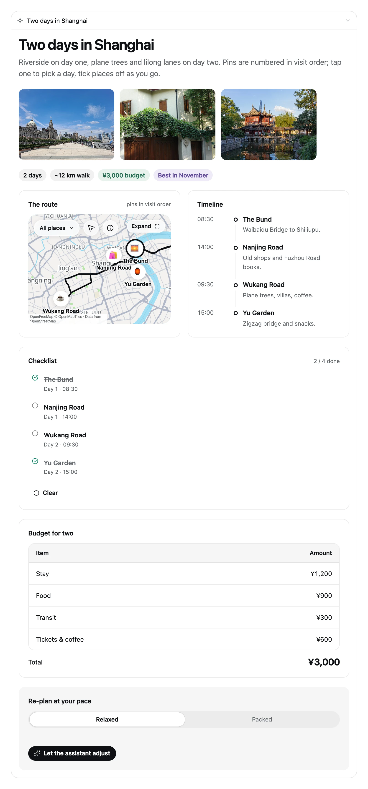

- 用户问「帮我排一个上海两日游」，模型不再只回一段文字：回答末尾直接渲染一张可点击、可勾选、可拖动的行程页面（地图 + 照片 + 时间线 + 清单 + 预算）。
- 卡片内的 `$变量`、`@Set`、`@functions` 全部在浏览器本地执行：勾选、滑动条、Stepper、计时器、预算分配都不需要再请求模型。
- 只有真正需要继续对话的动作（`@ToAssistant`，例如表单提交）会把一条简短消息放回输入框并发送。

## 组件一览

渲染器不是把一段文字包进聊天气泡，而是一套完整的组件库：**57 个组件、73 个函数、5 种动作**。下面三张卡片都是扩展的真实渲染结果——同一套渲染器、同一套 DSH 主题 token，没有设计稿：

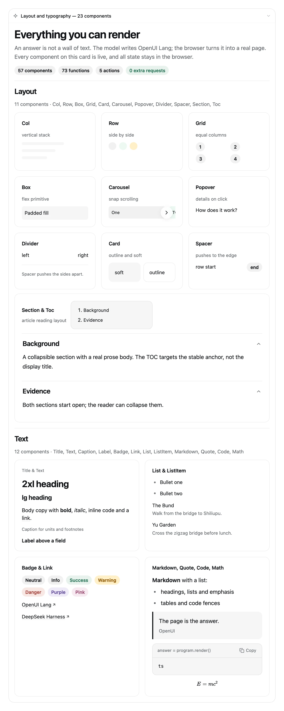

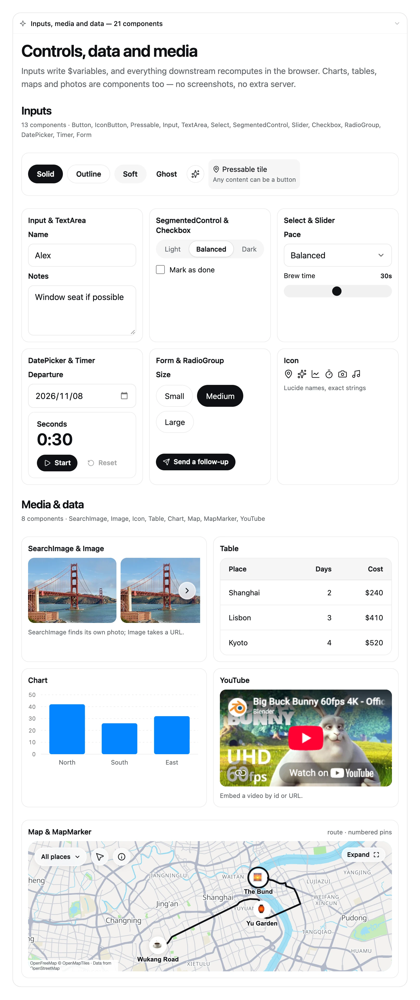

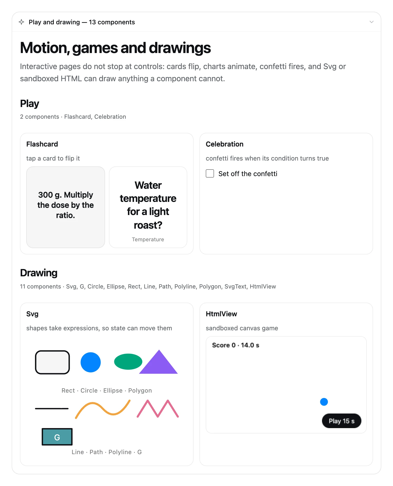

## 更多示例

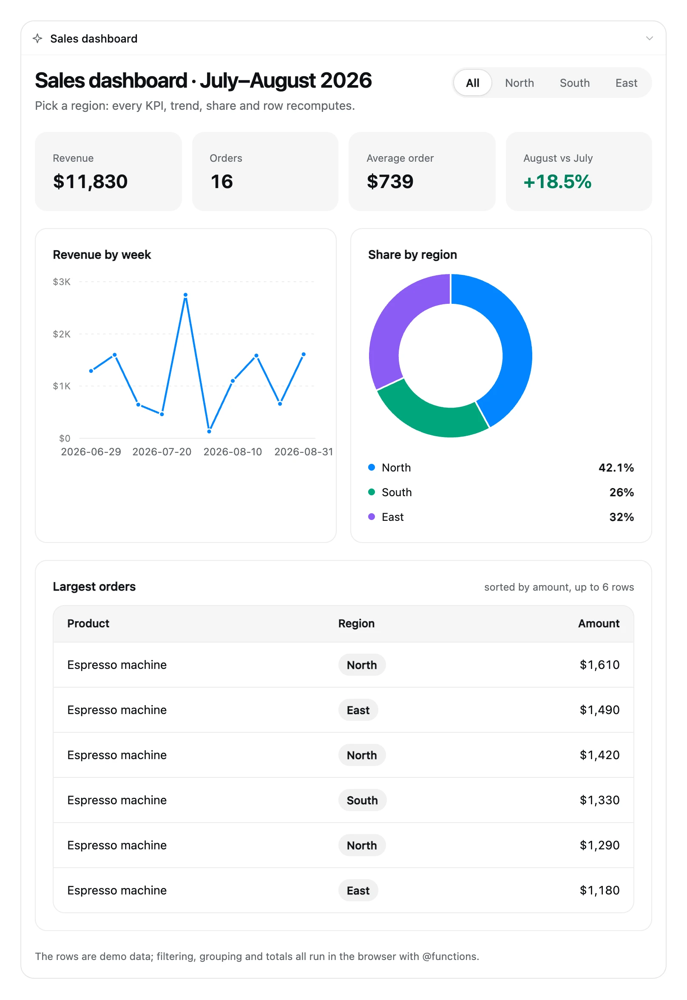

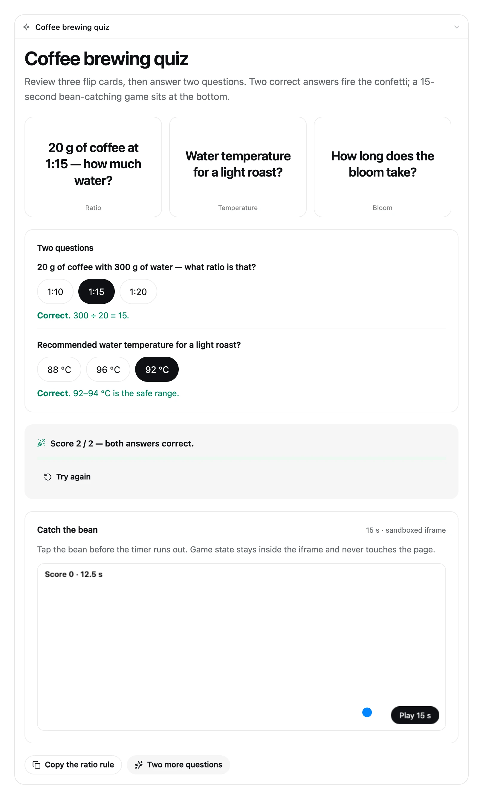

窄屏下卡片自动切为单列，地图与图表按卡片宽度自适应；图表分类标签过长时会截断而不是溢出（约 380 px 宽）：

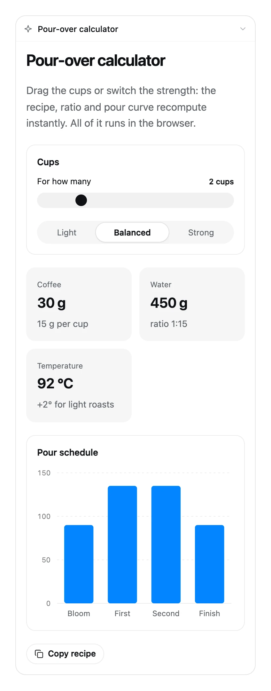

## 核心能力

| 能力 | 说明 |
|---|---|
| 交互页面 | 地图、照片、图表、清单、表单、SVG 绘图、小游戏都是真实组件，不是截图 |
| 导出图片 | 把该轮渲染结果保存为一张 PNG：原始 / 圆角 / 卡片三种美化；背景色与 1x/2x 在插件详情页设置 |
| 导出交互页面 | 把该轮全部卡片导出为单个 HTML 文件，浏览器打开后继续交互；`@ToAssistant` 改为复制文案并提示回 DSH 粘贴 |
| 本地执行 | `$变量`、`@Set`、`@functions` 在浏览器运行；只有 `@ToAssistant` 回写消息 |
| 开关与样式 | 全局默认在插件详情页；输入框 UI 控件按会话覆盖；内置 Auto / Card / Article 与自定义模板 |
| 自定义模板与视觉主题 | 保存可复用的展示偏好与明暗配色、字体、圆角、密度、阴影；在「我的样式」中使用、重命名、编辑或删除 |
| 聊天内按需生成 | 无需模板；在 UI 面板选择「按需生成」，正常发送需求，必要时用内置提问工具澄清 |
| 临时结果与可选保存 | 结果自带内联样式快照，可直接使用、调整样式或事后保存为模板；不强制预览、命名或保存 |
| 双语界面 | 跟随 DSH 的界面语言；字典在 `src/shared/locales.ts` |
| Agent Skill | 随插件注册 `intelligent-ui`，模型按需加载完整语法、示例与排障 |
| 插件详情页 | 插件 → 智能 UI 详情页：可用性（全局启用）、回答样式（内置或已保存模板）、我的样式管理、编排方式（自由布局）、导出（背景色、分辨率、图片/页面导出是否移除追问区块，默认移除） |
| 可重放 | 程序与临时样式随工具参数重放；导出页面冻结导出时的主题方案 |

## 获取代码

从 GitHub 克隆仓库：

```bash
git clone https://github.com/Zephinel/dsh-intelligent-ui.git
cd dsh-intelligent-ui
```

如果要提交改动，先 Fork 本仓库再克隆自己的副本；只想使用插件时，直接安装 npm 包即可（见[快速开始](#快速开始)）。

## 前置条件

- **DSH 0.2.1**（[`dsh` CLI](https://www.npmjs.com/package/@deepseek-ai/dsh)）：Host/Client 与插件协议按这个版本开发；实际验证版本是 `0.2.1-rc.2`，更晚版本未验证。安装：`npm install -g @deepseek-ai/dsh`。
- **[Node.js 24](https://nodejs.org/en/download)**：构建、测试与 `npm pack` 都在 Node 24 下验证；Host 产物编译目标是 Node 22（`target: 'node22'`），仓库没有 `engines` 或 `.nvmrc` 版本锁，使用更低版本前请自行验证。
- **`@deepseek-ai/dsh-client-locale`**：浏览器半边要求部署组合了它；DSH Web 0.2.1 默认包含，缺少时开关和卡片不会挂载（Host 工具与提示词仍可用）。

确认工具存在：

```bash
node --version   # v24.x
dsh --version    # 0.2.1 或 0.2.1-rc.2
```

重启示例覆盖前台 `dsh web`、macOS launchd 与 Linux systemd；用其他方式托管时重启对应服务。验证平台：macOS（Web + DSH Desktop）与 Windows（DSH Desktop）；Linux 未验证。

## 快速开始

从 npm 安装（前置条件见上一节）：

```bash
dsh plugin --profile web add @zephinel/dsh-intelligent-ui

# 固定当前版本
dsh plugin --profile web add @zephinel/dsh-intelligent-ui@0.4.0

# 或从 GitHub 安装
dsh plugin --profile web add github:Zephinel/dsh-intelligent-ui
```

重启承载 Web UI 的 DSH 进程（前台 `dsh web`：Ctrl+C 后重新运行；launchd/systemd：重启对应服务），打开它打印的 URL，输入框右侧出现 **UI** 控件即加载成功。

**DSH Desktop（桌面版）** 不需要终端命令，在应用内安装：

1. 侧栏 **插件** → **添加插件**（或箭头 → **安装第三方插件**）。
2. 输入 `@zephinel/dsh-intelligent-ui@0.4.0`（或只填包名装最新版），点 **安装**。
3. 安装完成后点 **立即启用**；若输入框右侧没有 **UI** 控件，退出并重开 DSH Desktop。

桌面版的 profile 由 Electron 应用独占管理，`dsh plugin --profile desktop` 会被拒绝。国内镜像可能晚于 npm 官方源同步刚发布的版本；装不到时把安装源切回 npm 官方源。

然后在输入框右侧点 **UI** 控件，选择「仅本会话」（或 `/iui on`），需要时在同一面板里设置本会话的 Auto / Card / Article 样式，直接提问，例如：

```text
帮我排一个上海两日游，要能勾选和调整
```

本地开发（从 checkout 构建并安装）、卸载与排障见[开发与部署](https://github.com/Zephinel/dsh-intelligent-ui/blob/main/docs/development.md)；扩展没有独立的开发服务器。

## 开关与回答样式


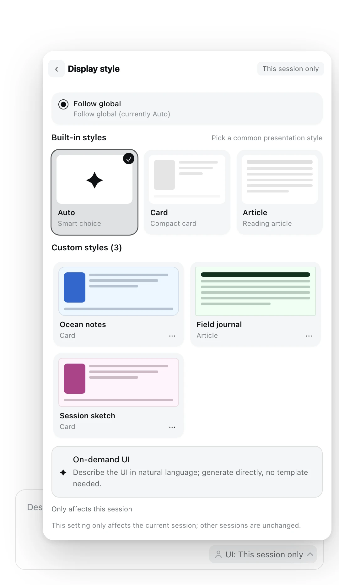

- **全局默认**：插件详情页的「在所有会话中启用」与「回答样式」设置新会话默认值；可以选择内置样式或已保存的全局模板。
- **会话覆盖**：点 Composer 的 **UI** chip →「仅本会话」或「显示样式」进入面板。上方是内置 Auto / Card / Article 预览卡片，中间是「自定义样式」（已保存模板），底部是「按需生成」。「全部会话」表示本会话跟随全局开关，不会打开全局开关；`/iui on|off|inherit` 与 `/iui style auto|card|article|inherit|<cs_id>` 提供命令入口。
- **Auto** 由模型按请求选择：交互/结构化用紧凑 Card，详尽/深入/长文用 Article。Article 需要 `Toc`、可折叠 `Section` 和实质正文。
- **按需生成**：选择后面板关闭，焦点回到输入框，出现可取消的提示与示例；示例只填入内容，保留已有草稿，不自动发送。正常发送后，清晰需求直接渲染，有重要歧义时由内置 `ask_user_question` 结构化提问，回答后继续生成。
- 会话启用/样式设置原子写入 `<DSH_HOME>/dsh-intelligent-ui.json`；按需操作不改这些设置，临时样式也不是当前选中的样式。完整边界见[架构与行为](https://github.com/Zephinel/dsh-intelligent-ui/blob/main/docs/architecture.md)。

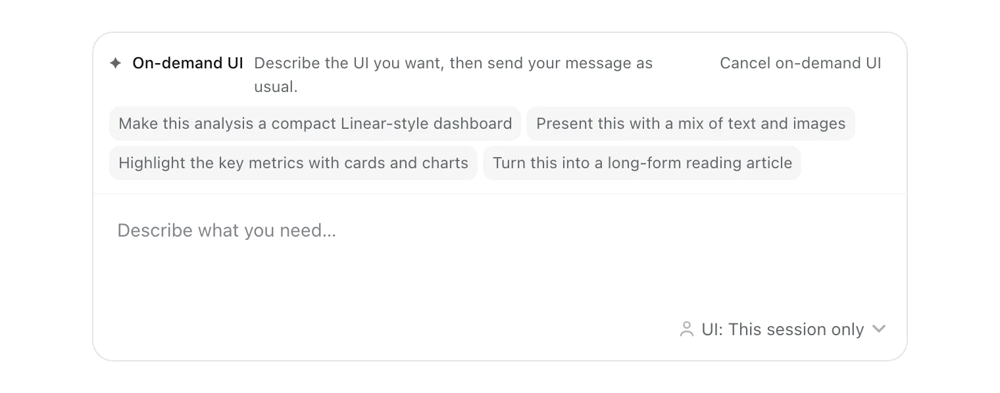

## 使用

打开开关后直接用自然语言提问，例如：

- 「帮我排一个上海两日游，要能勾选和调整」
- 「做一个 7 速自行车的换挡模拟器」
- 「把这几张表变成一个可以筛选的销售看板」
- 「介绍一下中国历史，要能按朝代展开」
- 先选「按需生成」，再发送「把这次分析做成紧凑仪表盘，用卡片和图表突出关键指标」
- 点结果下的「调整样式」，再发送「保留内容，改成留白更多的阅读版式」

开启后，**有结构的回答默认用卡片呈现**——包括讲解、介绍、时间线、阶段、对比和可探索内容；文字只用于单个事实、一两句话的答复、你明确要文字/文档/代码，或渲染连续失败。开关没打开时，模型看不到 `render_ui`，会直接用文字回答——这不是故障；打开开关再问即可。

如果一定要保证出卡片（或模型仍然回了文字），在开关已打开的会话里用 `/intelligent-ui` 显式调用技能；显式调用会被当作直接指令。也可以说「读取 intelligent-ui skill 然后用 render_ui 做一个…」。

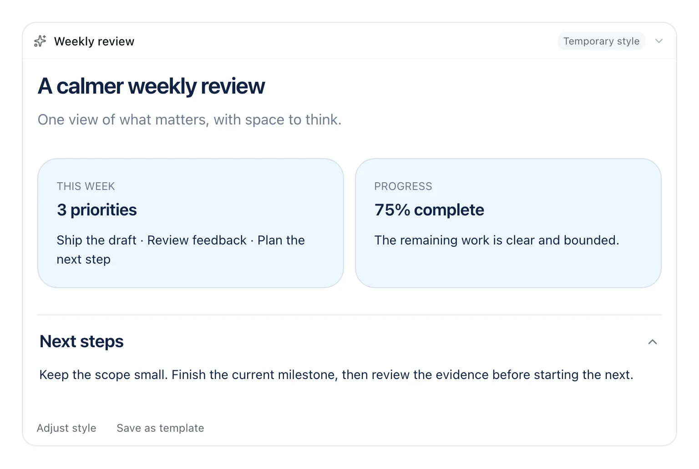

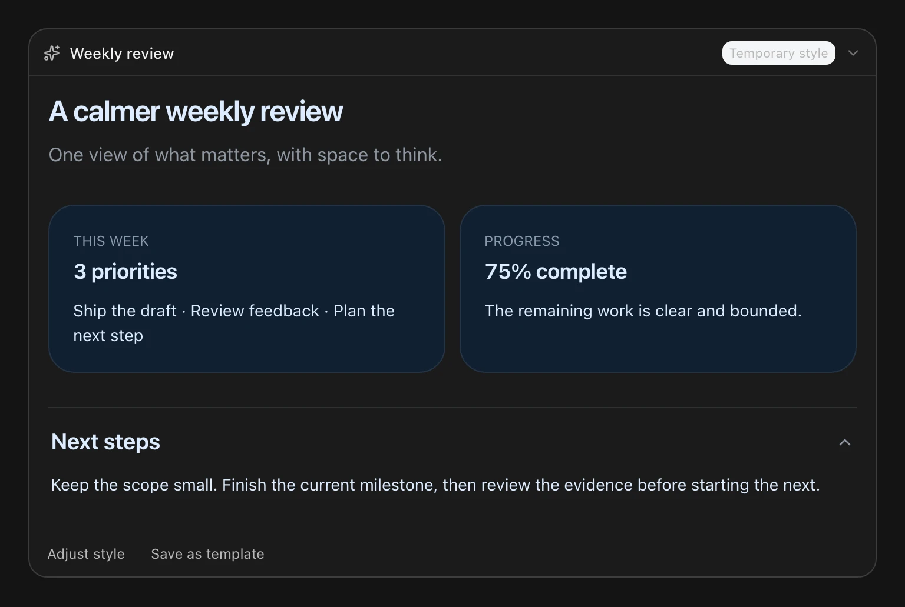

临时结果可以立即使用。点「调整样式」会关联这张结果并在保留草稿的前提下填入调整提示，仍需正常发送；点「保存为模板」才填写名称、描述与可用范围（本会话或全局）。保存复用该结果的已校验样式，不再次生成，也不自动选中模板或更改全局默认；不要求先预览、命名或保存。

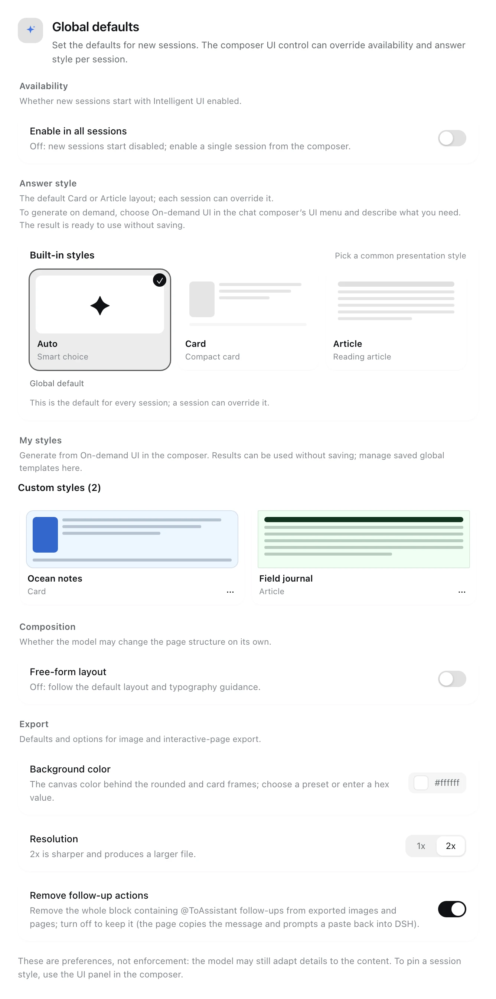

插件详情页按 **可用性**、**回答样式**、**我的样式**、**编排方式** 和 **导出** 分组。「我的样式」管理已保存的全局模板，可设为默认、重命名、编辑描述/展示偏好、导出 JSON 或删除；Composer 管理当前会话可见的全局与会话模板。生成入口在 Composer，设置页提供说明，不设生成工作台。全局值是新会话的默认；输入框 UI 控件里的会话值优先。**自由布局**只影响设计规范的建议强度，与回答样式正交。**导出** 保存图片的默认背景色、1x/2x 分辨率，以及图片/交互页面是否移除包含 `@ToAssistant` 追问的整个区块（默认移除）。

回答渲染完成后，消息底部操作栏的**最右侧**会出现带「导出」字样的**药丸按钮**（只有扩展渲染的回答才有）。点开后可把该轮全部卡片保存为一张 PNG——**原始**（只截取答案本身）、**圆角**（背景色 + 圆角留白）或 **卡片**（留白、圆角与柔和阴影）；也可以导出为单文件 HTML，直接在浏览器打开即可继续交互，页面里的 `@ToAssistant` 改为复制消息并提示回到 DSH 粘贴。导出的图片只包含渲染出的卡片，不包含聊天里的 Markdown 文字或导出按钮本身。完整流程见[架构与行为](https://github.com/Zephinel/dsh-intelligent-ui/blob/main/docs/architecture.md)。

## 构建、测试与部署

从全新 clone 本地开发时，先安装依赖、构建并写入本地 DSH profile：

```bash
npm install
npm run build
node scripts/install.mjs
```

重启承载 Web UI 的 DSH 进程，再打开它打印的 URL；输入框右侧出现 **UI** 控件即成功。扩展没有独立开发服务器，也没有 watch 模式；细节与卸载见[开发与部署](https://github.com/Zephinel/dsh-intelligent-ui/blob/main/docs/development.md)。

日常检查与打包：

```bash
npm run build       # 生成 prompt、Host 与 Client bundle
npm run check       # 构建 + Host/Client/打包测试 + renderer 检查
npm run pack:check  # 检查 npm pack 的最终文件清单
npm run test:browser # 先构建；7 个浏览器套件：按需生成、样式面板、主题、图片、交互页面、Article 间距、设置（需要 Chrome）
```

- 当前 Node 测试 **179** 项；renderer 解析/渲染各 **41/41**，i18n **4** 个程序，排版 **22/22**。浏览器为组件/契约验证；按需生成主链路（清晰需求→临时样式卡片→保存为模板）、缺少内容时的自由输入澄清与真实数据来源约束，均已在隔离 DSH Web 实例中用真实模型验证；其余场景见[验证记录](https://github.com/Zephinel/dsh-intelligent-ui/blob/main/docs/verification.md)。
- `node scripts/capture-screenshots.mjs` 以固定 DSH token、生产组件与假服务在 Chrome 2x 重建面板、提示、临时结果与设置截图；英文 UI，卡片壳层图标用 lucide 替身。
- `npm run check` 里的排版检查（typography）需要本机 Chrome；没有 Chrome 时该检查会跳过，其余测试仍会运行。

发布物是一个 DSH bundle；部署就是把插件安装进目标 DSH profile。卸载与版本注意事项见[开发与部署](https://github.com/Zephinel/dsh-intelligent-ui/blob/main/docs/development.md)。

## 贡献

- 问题与功能请求：使用 [GitHub Issues](https://github.com/Zephinel/dsh-intelligent-ui/issues)。
- 提交前运行 `npm run check`；仓库没有 PR CI，以本地命令结果为准。发布由 GitHub Actions 的 Trusted Publishing 工作流执行（推送与 `package.json` 版本一致的 `v*` tag）。
- 行为、文案或计数变化时，中英 README、`CHANGELOG.md` 与 `docs/` 对应文档要一起更新；同步规则见 `.agents/skills/sync-iui-docs/SKILL.md`（开发环境使用，不随 npm 包发布）。
- 仓库内的维护技能与文档同步规则在 `.agents/skills/`（不随 npm 包发布）；AI 协作代理同样以 `npm run check` 作为提交前门槛。
- 维护者：[@Zephinel](https://github.com/Zephinel)。

## 已知限制

- 卡片在该轮**结束时**出现；生成过程中进程区显示一行「交互式回答」（英文界面 "Interactive answer"）。
- 模型偶发生成不合法 OpenUI Lang；Host 校验会返回精确错误，通常同一轮内自修（实测 1–2 次）。
- 地图底图依赖 OpenFreeMap 瓦片，路线依赖 OSRM demo，照片依赖 Wikipedia/Wikimedia；离线时地图降级为地点列表、照片降级为占位块。
- KaTeX 使用 DSH 壳层已加载的全局样式；若该样式被移除，Math 组件会退化为纯文本。
- 生成提示词约 9.5K tokens，**只在开关命中该会话时发送**（全局开启，或该会话显式开启）；关闭时这部分开销为 0（工具 schema 也不出现）。Article 模式会生成更长的页面，输出 token 与渲染时间相应增加。
- 扩展 UI 文案随 DSH 界面语言切换；但 `/iui` 的 Host 返回文案、命令面板里的命令描述与 README 截图仍是英文（前两者是 DSH 平台行为）。
- 导出图片时，沙盒 iframe（`HtmlView` 里的小游戏）不会被截入图片，图片中该区域会缺失；地图通过保留 WebGL 绘制缓冲入图，禁用 WebGL 的浏览器会按地图自身的降级逻辑显示地点列表。
- 同一轮回复渲染出的多张卡片会合并成一张图片；导出的是**当前屏幕上渲染出的内容**，因此导出的图片会包含当时的交互状态（勾选项、筛选结果等）。导出会等待卡片内的图片加载和图片搜索完成（最多约 12.5 秒）；离线或仍未就绪时按页面上的占位状态导出。
- 交互页面导出会把渲染器、当前主题与全部卡片内联进一个 HTML（约 3.4–4.9 MB），因此文件较大但无需安装；地图、照片等组件仍依赖网络。页面里的 `@ToAssistant` 会尝试写入剪贴板并弹出提示；剪贴板不可用时提示会保留原消息供手动复制。
- 浏览器半边要求部署组合 `dsh-client-locale`（DSH Web 0.2.1 默认包含）；最小自定义 profile 缺少它时开关和卡片不挂载，Host 工具与提示词仍可用。
- 插件详情页里的配置依赖 DSH 的 settings 服务：最小自定义 profile 未组合 `dsh-settings` / `dsh-client-ui-settings` 时不出现；Host/Client 版本错位时开关可能显示为不可用。全局启用/样式与自由布局只改变提示词与页面形态，不保证每个模型都完全遵守；会话样式覆盖仍以 Host 注入的提示词为准。
- 交互页面导出需要部署提供 `webServer` 服务（DSH Web 0.2.1 默认包含）；最小自定义 profile 缺少它时无法导出交互页面，图片导出不受影响。

- 临时样式保存在工具参数/结果快照中，不进入模板库；历史工具参数仍在加载窗口时可重放。事后保存依赖有界结果注册表（最近 200 条），被淘汰的结果可能仍能重放但无法再保存。保存模板与结果快照在 `<DSH_HOME>` 的独立 JSON 文件中持久化。
- 样式创建/按需生成使用部署的默认主对话模型服务；扩展不提供独立生成模型或 draft 访谈服务。`ask_user_question` 是结构化澄清路径；工具不可用时降级为文字提问，文字轮结束后提示会保留，下一条消息继续同一操作，不需要重新选择「按需生成」（过期、重启或失败后除外）。
- 按需操作只在内存中：等待发送（armed）10 分钟过期，重启后活动操作无法恢复，需要重新武装；已完成结果不因此丢失。每会话最多一个活动操作：armed 时重新武装会替换，已绑定的 running/clarifying 拒绝重新武装且需先取消；最多两轮澄清。文本结束但未渲染时操作回到待继续状态，下一条消息继续；失败/中断会显示重试/关闭提示。
- 多标签页采用保守绑定：提示只显示在发起标签页，但 Host 绑定该会话的下一条人工消息，并不验证发送标签来源；请在发起标签页发送，避免另一标签同时发送。
- 自定义主题只应用到 renderer host，portaled Popover 与沙盒 iframe 保留默认主题；语义状态色保持渲染器定义。导出交互页面冻结导出时的明/暗方案，不随系统切换。
- 已保存模板的 directives 是有界展示偏好（最多 2,000 字符），不能覆盖系统、工具或安全规则；模板库上限为全局 40 个、每会话 20 个。删除/不可用的已保存模板按默认主题降级；内联临时结果的重放/导出不依赖模板库。

## 常见问题

**必须先建模板、预览或命名吗？** 不需要。选「按需生成」后正常聊天，结果可以直接使用；只有主动「保存为模板」才需要名称。临时结果不会替换当前会话选中的样式。

**能晚些保存或继续调整吗？** 可以。使用那张结果下的「调整样式」或「保存为模板」；保存的是点选结果的版本，不会自动保存后来生成的版本。注册表已淘汰该结果时会提示快照不可用。

**为什么追问后没有继续生成？** 结构化 `ask_user_question` 回答会恢复同一操作；文字提问后，下一条消息会自动继续同一操作。只有过期、重启、失败或中断后才需要重新武装/重试。多个标签同时发送也可能消费同一意图。

**为什么回答只有文字、没有卡片？** 先确认该会话的开关已打开（输入框右侧 **UI** 控件，或 `/iui on`）；开启后模型仍可能把单个事实、一两句话或明确的文字/代码请求当作有界例外。想强制出卡片时，在开关已打开的会话里用 `/intelligent-ui` 显式调用技能。详见[使用](#使用)。

**回答底部为什么没有「导出」按钮？** 只有扩展渲染出的回答才有这个药丸按钮；开关关闭、模型用文字回答或渲染失败时都不会出现。详见[使用](#使用)与[已知限制](#已知限制)。

**重建插件后 UI 没变化或报错？** 只刷新页面可能拿到旧 revision：先重启承载 Web UI 的 DSH 进程，再打开页面。具体错误信息与处理方式见[开发与部署](https://github.com/Zephinel/dsh-intelligent-ui/blob/main/docs/development.md)。

## 文档

- [架构与行为](https://github.com/Zephinel/dsh-intelligent-ui/blob/main/docs/architecture.md)：Host/Client 组件树、开关与回答样式的完整语义、界面语言、图片与交互页面导出流程、Agent Skill。
- [开发与部署](https://github.com/Zephinel/dsh-intelligent-ui/blob/main/docs/development.md)：安装与卸载、开发命令、改名/重建后的重启提示、Host/Client 版本错位、发布物布局与插件市场维护。
- [验证记录](https://github.com/Zephinel/dsh-intelligent-ui/blob/main/docs/verification.md)：端到端验证、测试与打包结果（历史记录）。
- [变更日志](https://github.com/Zephinel/dsh-intelligent-ui/blob/main/CHANGELOG.md)：按版本记录新增、变更与修复（英文）。

## 许可证

本项目采用 [MIT](LICENSE) 许可证。基于 Open Intelligent UI（MIT, Copyright (c) 2026 Thesys Inc.）与 OpenUI 生态；浏览器 bundle 内含 lucide-react（ISC）、KaTeX（MIT）、MapLibre GL JS（BSD-3-Clause）、zod（MIT）与 SnapDOM（MIT）；交互页面的独立 bundle 还内联 React / React DOM（MIT）。完整声明与许可证全文见 `NOTICE` 与 `licenses/`。
