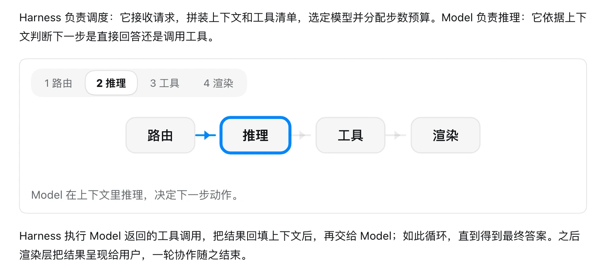
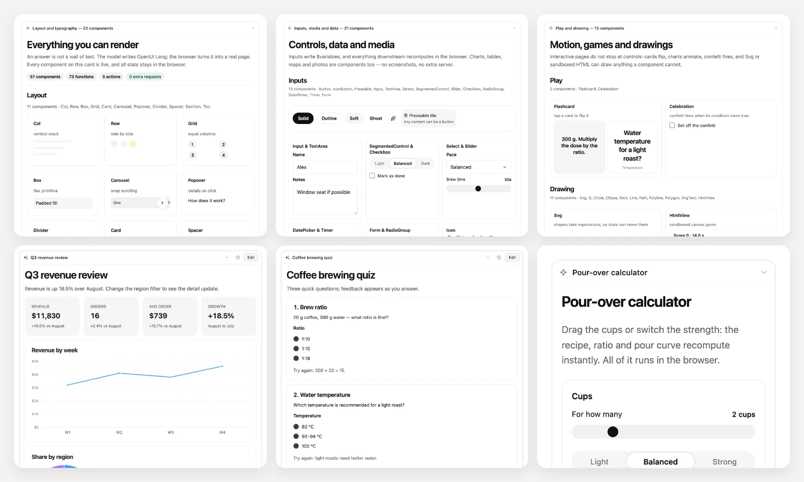
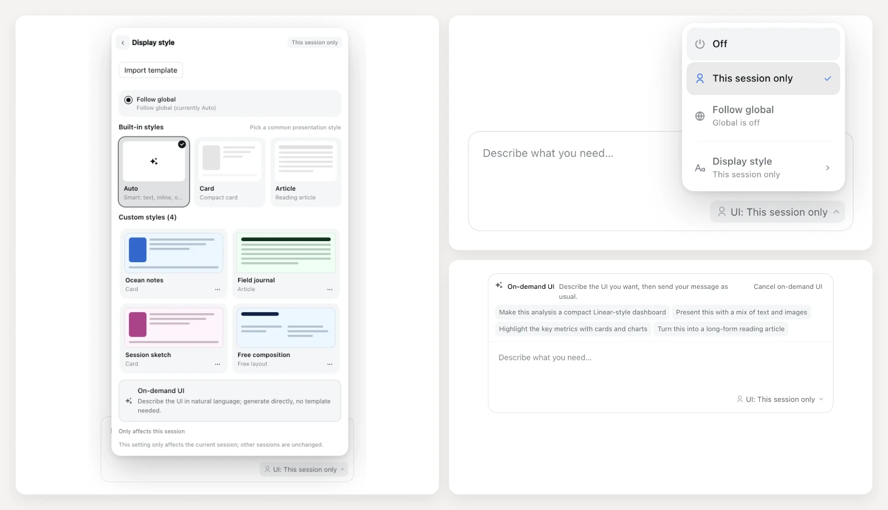
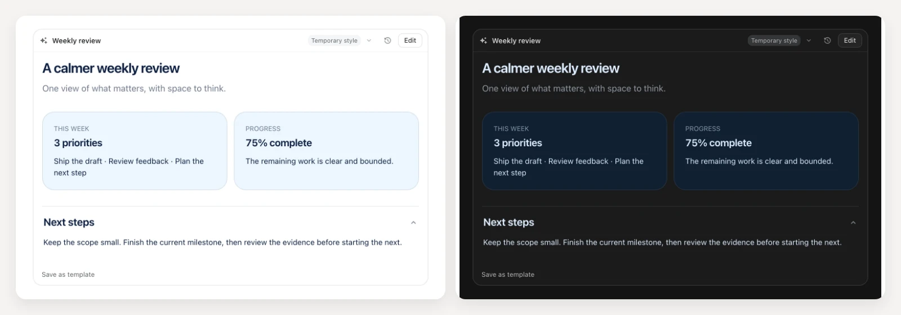

# dsh-intelligent-ui

中文 | [English](README.en.md)

[](https://www.npmjs.com/package/@zephinel/dsh-intelligent-ui)
[](LICENSE)
[](https://www.npmjs.com/package/@deepseek-ai/dsh)
[](https://github.com/Zephinel/dsh-intelligent-ui/actions/workflows/publish.yml)

**让 DeepSeek Harness（DSH）的回答里直接长出可交互界面。** 解释、分析类回答保持 Markdown，需要图表、流程或小交互时直接嵌在正文里一起阅读；需要独立可用的行程、看板、表单或小测时，在轮末交付一张可编辑、可导出、可存模板的交互页面。基于 [Open Intelligent UI](https://github.com/thesysdev/open-intelligent-ui)（MIT）与 [OpenUI Lang 1.0](https://openui.com) 移植，并随插件自动注册 Agent Skill（`intelligent-ui`）。



> **当前状态**：npm `latest` 为 `@zephinel/dsh-intelligent-ui@0.7.0`：解释类回答默认正文内嵌 UI，独立页面以可编辑卡片交付，并含编辑、修订、导出与模板。已收录于 awesome-dsh-plugin / dsh-market、Open Plugin Market 等社区市场，版本变更见 [CHANGELOG](https://github.com/Zephinel/dsh-intelligent-ui/blob/main/CHANGELOG.md)。

[安装](#安装) · [效果](#效果) · [生成与编辑](#生成与编辑) · [文档索引](#文档索引) · [本地开发](#获取代码与本地开发)

## 安装

**DSH Web**（二选一，安装后若已有 Web 进程请重启）：

```bash
# npm 最新版：正文内嵌 UI、轮末卡片、编辑与导出
dsh plugin --profile web add @zephinel/dsh-intelligent-ui
# 或跟随 GitHub main 的最新提交（需本地构建工具，首次可能提示允许 build scripts）
dsh plugin --profile web add github:Zephinel/dsh-intelligent-ui
dsh web
```

**DSH Desktop**：插件市场跟随 npm `latest`（当前 `0.7.0`），可在应用内直接安装；也可从 **插件 → 添加插件 → 箭头 → 安装第三方插件** 输入 `github:Zephinel/dsh-intelligent-ui` 跟随仓库最新提交。

打开 DSH 后输入框右侧出现 **UI** 控件即加载成功。点击 **UI → 仅本会话**（或发送 `/iui on`）启用，直接像平常一样提问：

```text
解释一下 harness 和 model 的区别        # 在正文里直接嵌入可交互 UI
帮我排一个上海两日游，要能勾选和调整    # 轮末交付可编辑的独立页面卡片
```

正文内嵌需要 DSH 0.2.2-rc.2+ 的 `conversation.chat.markdown.fence` 插槽；更旧的 Host 会把内嵌程序保留为代码块。安装来源、卸载、版本切换与排障见[开发与部署](https://github.com/Zephinel/dsh-intelligent-ui/blob/main/docs/development.md#安装)。

## 效果


正文内嵌与轮末卡片共用同一套浏览器渲染器，交互状态（`$变量`、`@Set`、`@functions`）全部在本地执行：勾选、滑动条、计时器、阶段切换与预算重算都不再请求模型。只有明确需要继续对话的动作（`@ToAssistant`，如提交表单）才会把简短消息填回输入框。

## 生成与编辑


上面的三张页面均由真实 DSH 会话（DeepSeek V4.1 Flash）直接生成，不是手写样例。

**自动**（Auto）模式下，模型按每次回答的实际需要在四种形态里自动选择：纯 Markdown、正文内嵌 UI、轮末独立页面卡片，或“正文内嵌解释 + 轮末交付页”（两者各司其职、不重复内容，单轮最多一张卡片）。生成独立页面时，也可在 **UI → 显示样式** 按会话固定卡片 / 文章版式，或通过**按需生成**直接用自然语言描述期望界面。


已渲染的轮末卡片可以继续迭代：点选区块填写编辑需求、拖拽或键盘调整顺序、切换或用自然语言描述新样式，每次修改都会记为独立修订，随时可对比或回退。完整流程见[使用指南](https://github.com/Zephinel/dsh-intelligent-ui/blob/main/docs/usage.md#编辑已渲染页面)。

## 组件



内建 **57 个组件、73 个函数、5 种动作**，涵盖布局、排版、表单输入、地图/图片媒体、图表表格、交互测验与 SVG 绘图；窄屏自动单列重排，长标签自动截断不溢出。完整参数表见[组件目录](https://github.com/Zephinel/dsh-intelligent-ui/blob/main/skills/intelligent-ui/references/components.md)。

## 开关与样式



- **开关分层**：插件详情页设全局默认，输入框右侧 **UI** 控件按会话覆盖（或用 `/iui on|off|inherit`、`/iui style …`）。正文内嵌无需额外开关。
- **临时样式与模板**：按需生成的页面即刻可用；带主题的结果支持「保存为模板」，保存复用当前已校验的样式，不影响会话默认选择。



完整开关、模板与导出说明见[使用指南](https://github.com/Zephinel/dsh-intelligent-ui/blob/main/docs/usage.md)。

## 文档索引

详细文档位于仓库 `docs/`（不随 npm 包发布，链接指向 GitHub 仓库）：

| 文档 | 能查到什么 |
| --- | --- |
| [使用指南](https://github.com/Zephinel/dsh-intelligent-ui/blob/main/docs/usage.md) | 开关与提问、内嵌 UI、编辑与修订历史、样式模板、导出、常见问题 |
| [开发与部署](https://github.com/Zephinel/dsh-intelligent-ui/blob/main/docs/development.md) | 安装/卸载/重启、本地开发命令、CI、发布流程、插件市场维护 |
| [架构与行为](https://github.com/Zephinel/dsh-intelligent-ui/blob/main/docs/architecture.md) | Host/Client 组件树、开关语义、编辑流水线、导出与更新提示 |
| [已知限制](https://github.com/Zephinel/dsh-intelligent-ui/blob/main/docs/limitations.md) | 当前版本仍存在或未验证的边界 |
| [验证记录](https://github.com/Zephinel/dsh-intelligent-ui/blob/main/docs/verification.md) · [CHANGELOG](https://github.com/Zephinel/dsh-intelligent-ui/blob/main/CHANGELOG.md) · [GitHub Releases](https://github.com/Zephinel/dsh-intelligent-ui/releases) | 测试与打包记录、版本变更与发布页 |
| [Agent Skill](https://github.com/Zephinel/dsh-intelligent-ui/blob/main/skills/intelligent-ui/SKILL.md) · [组件目录](https://github.com/Zephinel/dsh-intelligent-ui/blob/main/skills/intelligent-ui/references/components.md) | 模型侧语法、交付规则与组件参数表 |

## 获取代码与本地开发

```bash
git clone https://github.com/Zephinel/dsh-intelligent-ui.git
cd dsh-intelligent-ui
npm install                # prepare 会自动构建
node scripts/install.mjs   # 装进 web profile
dsh web
```

环境要求：DSH 0.2.2 插件接口（验证于 `0.2.2-rc.5`；正文内嵌需要 `0.2.2-rc.2+` 的 `conversation.chat.markdown.fence` 插槽）、Node 24（含 npm）与 Git；浏览器端依赖 `@deepseek-ai/dsh-client-locale`（DSH Web 0.2.2 默认包含）。无独立 watch 服务，改动后运行 `npm run build` 并重启 DSH。

当前验证：Node 测试 **880/880**（Host 324、Client 516、packaging 40）；浏览器 **12/12** 套件通过，其中 Artifact 区块编辑套件 **944** 条检查、嵌套编辑渲染套件 **75** 条检查、图片导出 **76** 条断言。完整命令与历史记录见[开发与部署](https://github.com/Zephinel/dsh-intelligent-ui/blob/main/docs/development.md#开发)与[验证记录](https://github.com/Zephinel/dsh-intelligent-ui/blob/main/docs/verification.md)。

## 贡献

- 反馈与需求：提交到 [GitHub Issues](https://github.com/Zephinel/dsh-intelligent-ui/issues)；提交 PR 请先 Fork 再克隆，并在提交前运行 `npm run check`。
- CI（[`ci.yml`](https://github.com/Zephinel/dsh-intelligent-ui/blob/main/.github/workflows/ci.yml)）：CHANGELOG/PRODUCT/docs 等纯文档改动只跑文档检查，README 属打包内容走全量门禁；发版由 [Trusted Publishing 工作流](https://github.com/Zephinel/dsh-intelligent-ui/blob/main/.github/workflows/publish.yml)在 `v*` tag 上执行。
- 改动行为、文案或计数时，请按[文档同步技能](https://github.com/Zephinel/dsh-intelligent-ui/blob/main/.agents/skills/sync-iui-docs/SKILL.md)同步中英 README、`CHANGELOG.md` 与 `docs/`。维护者：[@Zephinel](https://github.com/Zephinel)。

## 许可证

本项目采用 [MIT](LICENSE) 许可证，基于 Open Intelligent UI（MIT, Copyright (c) 2026 Thesys Inc.）与 OpenUI 生态。第三方组件与完整声明见 [NOTICE](NOTICE) 与 [licenses/](licenses/)；地图底图与路线数据来自 OpenFreeMap / OpenMapTiles / OpenStreetMap、Esri 与 OSRM，渲染时在图内展示相应 attribution。
