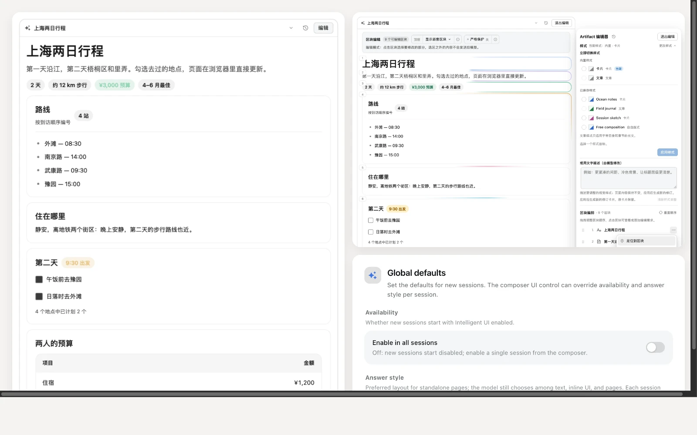
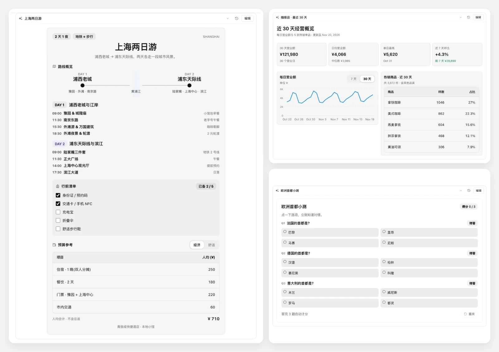
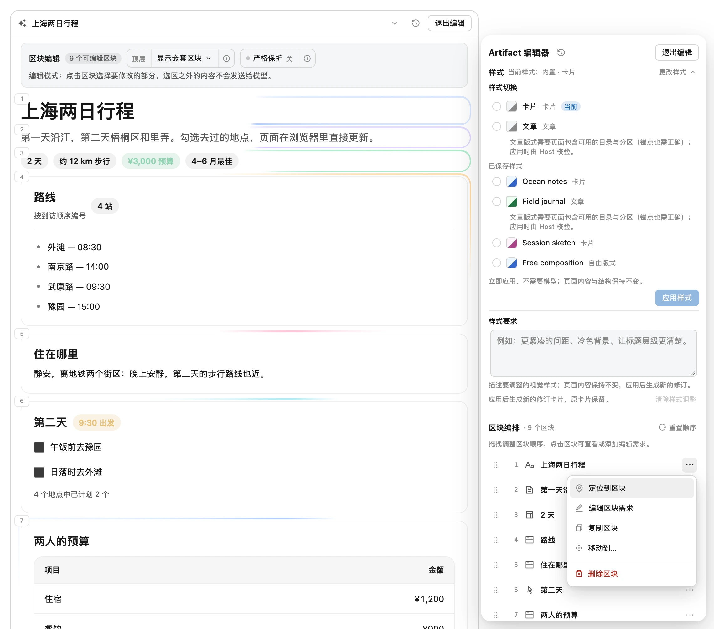

# dsh-intelligent-ui

中文 | [English](README.en.md)

[](https://www.npmjs.com/package/@zephinel/dsh-intelligent-ui)
[](LICENSE)
[](https://www.npmjs.com/package/@deepseek-ai/dsh)
[](https://github.com/Zephinel/dsh-intelligent-ui/actions/workflows/publish.yml)

**把 DeepSeek Harness（DSH）的模型回答变成一张真正能用的页面。** 安装并启用后直接提问：

```text
帮我排一个上海两日游，要能勾选和调整
```

模型调用 `render_ui` 工具，把答案写成一份 [OpenUI Lang 1.0](https://openui.com) 程序；DSH 在该轮结束时把它渲染成可交互页面——地图、照片、图表、清单、表单、SVG 绘图、小游戏都是真实组件。基于 [Open Intelligent UI](https://github.com/thesysdev/open-intelligent-ui)（MIT）移植，并附带随插件注册的 Agent Skill（`intelligent-ui`）。

> [!NOTE]
> **当前状态**：已发布到 GitHub 与 npm，`@zephinel/dsh-intelligent-ui@0.6.2` 是 npm `latest`，也已收录于 awesome-dsh-plugin / dsh-market、Open Plugin Market 等社区市场。验证：Node 测试 **863/863**（Host 323、Client 501、packaging 39）；浏览器 **11/11** 套件通过，其中 Artifact 区块编辑套件 **944** 条检查、嵌套编辑渲染套件 **75** 条检查、图片导出 **76** 条断言。版本变更见 [CHANGELOG](https://github.com/Zephinel/dsh-intelligent-ui/blob/main/CHANGELOG.md)，历史验证见[验证记录](https://github.com/Zephinel/dsh-intelligent-ui/blob/main/docs/verification.md)。

[效果](#效果) · [安装](#安装) · [生成与编辑](#生成与编辑) · [文档索引](#文档索引) · [本地开发](#获取代码与本地开发)

## 效果



页面在回答末尾出现，里面的 `$变量`、`@Set`、`@functions` 都在浏览器本地执行：勾选、滑动条、Stepper、计时器、预算分配都不再请求模型。只有真正需要继续对话的动作（`@ToAssistant`，例如表单提交）会把一条简短消息放回输入框。

## 安装

**DSH Web**：安装 npm 上已发布的 `0.6.2`，再启动 Web UI。

```bash
dsh plugin --profile web add @zephinel/dsh-intelligent-ui@0.6.2
dsh web
```

已有 Web 进程时，安装后重启该进程；打开它打印的 URL（地址与端口由 DSH profile 决定），输入框右侧出现 **UI** 控件即加载成功。跟随最新版去掉 `@0.6.2` 即可；从 GitHub 已提交代码安装用 `github:Zephinel/dsh-intelligent-ui`。

**DSH Desktop**：侧栏 **插件** → **添加插件**，输入 `@zephinel/dsh-intelligent-ui@0.6.2`（或只填包名装最新版）→ **安装** → **立即启用**。

首次使用点 **UI** 控件选择「仅本会话」（或发送 `/iui on`），再发送上面的行程示例；该轮结束后出现可交互页面即验证成功。安装来源、卸载、版本切换与排障见[开发与部署](https://github.com/Zephinel/dsh-intelligent-ui/blob/main/docs/development.md#安装)。

## 生成与编辑



上面的组合图来自真实 DSH 会话（DeepSeek V4.1 Flash · Max）：同一套渲染器生成了行程、数据看板和小测，不是手写样例。

模型按「是否让用户更快、更准地理解」决定这次回答用页面还是文字——概念、机制/流程、结构、对比、数据或交互用页面；裸事实、一句话定义、代码/翻译、闲聊或明确要文字时直接用 Markdown。要出页面时，可在 **UI → 显示样式** 按会话选 Card / Article，或交给 **Auto**；**按需生成** 则只描述需求、不选模板。



已渲染的页面可以继续改：为区块填写修改要求、拖拽或用键盘调整顺序、切换或描述样式，结果作为新的修订记录，随时可以回看历史。完整操作见[使用指南](https://github.com/Zephinel/dsh-intelligent-ui/blob/main/docs/usage.md#编辑已渲染页面)。

## 组件


生成的页面由 **57 个组件、73 个函数、5 种动作** 组成：布局、文本、输入、媒体、数据、交互与绘图。窄屏下卡片自动切为单列，图表标签过长时截断而不是溢出。完整参数表见[组件目录](https://github.com/Zephinel/dsh-intelligent-ui/blob/main/skills/intelligent-ui/references/components.md)。

## 开关与样式


- **全局默认**在插件详情页；输入框右侧的 **UI** 控件按会话覆盖（或 `/iui on|off|inherit`），也提供 `/iui style …` 命令入口。
- **临时结果**可以直接使用；只有带主题的临时样式结果会显示「保存为模板」，保存时才需要命名，且保存复用该结果已校验的样式，不更改当前选择或全局默认。


开关语义、样式与模板的完整说明见[使用指南](https://github.com/Zephinel/dsh-intelligent-ui/blob/main/docs/usage.md)。

## 文档索引

详细文档都在仓库 `docs/`，不随 npm 包发布，因此下面使用 GitHub 绝对链接；未提交的功能以 checkout 内的对应文件为准。

| 文档 | 能查到什么 |
| --- | --- |
| [使用指南](https://github.com/Zephinel/dsh-intelligent-ui/blob/main/docs/usage.md) | 打开开关、提问与样式、编辑已渲染页面与修订、模板、导出、常见问题 |
| [开发与部署](https://github.com/Zephinel/dsh-intelligent-ui/blob/main/docs/development.md) | 安装/卸载/重启、本地开发命令、CI、发布流程、插件市场维护 |
| [架构与行为](https://github.com/Zephinel/dsh-intelligent-ui/blob/main/docs/architecture.md) | Host/Client 组件树、开关语义、编辑流水线、导出与更新提示 |
| [已知限制](https://github.com/Zephinel/dsh-intelligent-ui/blob/main/docs/limitations.md) | 当前版本仍存在或未验证的边界 |
| [验证记录](https://github.com/Zephinel/dsh-intelligent-ui/blob/main/docs/verification.md) · [CHANGELOG](https://github.com/Zephinel/dsh-intelligent-ui/blob/main/CHANGELOG.md) · [GitHub Releases](https://github.com/Zephinel/dsh-intelligent-ui/releases) | 测试与打包结果、版本变更与发布页 |
| [Agent Skill](https://github.com/Zephinel/dsh-intelligent-ui/blob/main/skills/intelligent-ui/SKILL.md) · [组件目录](https://github.com/Zephinel/dsh-intelligent-ui/blob/main/skills/intelligent-ui/references/components.md) | 模型侧语法与组件参数表 |

## 获取代码与本地开发

```bash
git clone https://github.com/Zephinel/dsh-intelligent-ui.git
cd dsh-intelligent-ui
npm install          # prepare 会自动构建
node scripts/install.mjs   # 装进 web profile
dsh web
```

要提交改动时先 Fork 仓库，再克隆自己的副本。

环境：DSH 0.2.2 插件接口（在 `0.2.2-rc.1` 上验证，`dsh` CLI）、Node 24 与自带的 npm、Git；浏览器半边需要 `@deepseek-ai/dsh-client-locale`（DSH Web 0.2.2 默认包含）。扩展没有独立的开发服务器或 watch 模式：修改后重新 `npm run build` 并重启 DSH。提交前运行 `npm run check`；完整命令表、安装模式切换、CI 与发布流程见[开发与部署](https://github.com/Zephinel/dsh-intelligent-ui/blob/main/docs/development.md#开发)。

## 贡献

- 问题与功能请求：使用 [GitHub Issues](https://github.com/Zephinel/dsh-intelligent-ui/issues)。
- 提交 PR 前运行 `npm run check`。CI（[`ci.yml`](https://github.com/Zephinel/dsh-intelligent-ui/blob/main/.github/workflows/ci.yml)）在 PR 与 main 上跑本地门禁：CHANGELOG/PRODUCT/docs 等纯文档改动只跑文档检查，README 属打包内容走全量门禁。发布由 [Trusted Publishing 工作流](https://github.com/Zephinel/dsh-intelligent-ui/blob/main/.github/workflows/publish.yml)在 `v*` tag 上执行。
- 行为、文案或计数变化时，按[文档同步技能](https://github.com/Zephinel/dsh-intelligent-ui/blob/main/.agents/skills/sync-iui-docs/SKILL.md)（checkout 中以本地文件为准）同步中英 README、`CHANGELOG.md` 与 `docs/` 对应文档。维护者：[@Zephinel](https://github.com/Zephinel)。

## 许可证

本项目采用 [MIT](LICENSE) 许可证，基于 Open Intelligent UI（MIT, Copyright (c) 2026 Thesys Inc.）与 OpenUI 生态。分发物内含的第三方组件与完整许可证声明见 [NOTICE](NOTICE) 与 [licenses/](licenses/)；地图底图与路线数据来自 OpenFreeMap / OpenMapTiles / OpenStreetMap、Esri 与 OSRM，使用时会在图内显示相应 attribution。如果发现遗漏或归属有误，欢迎提 issue 或 PR。
