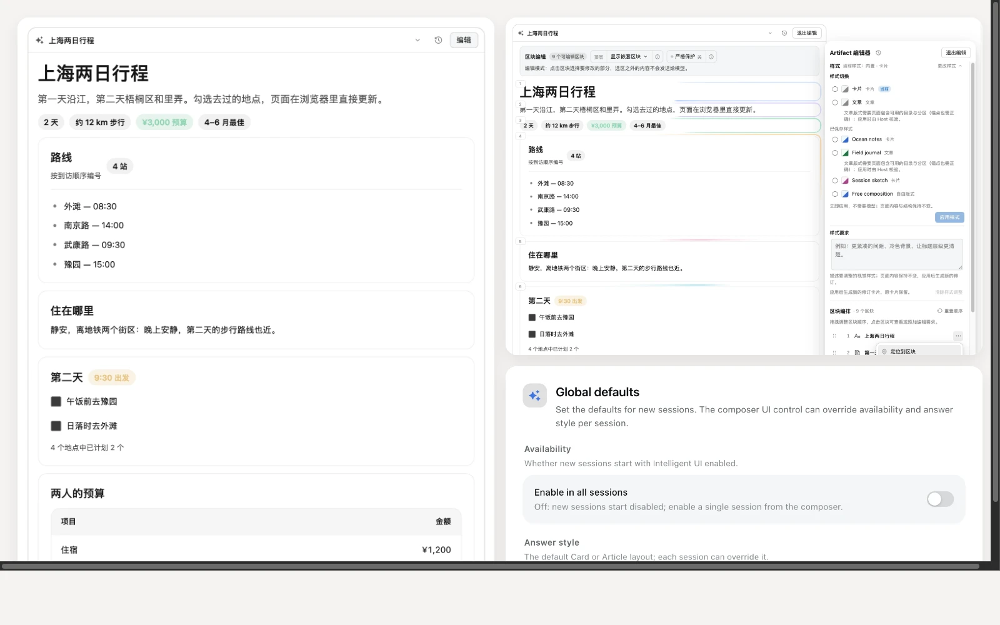
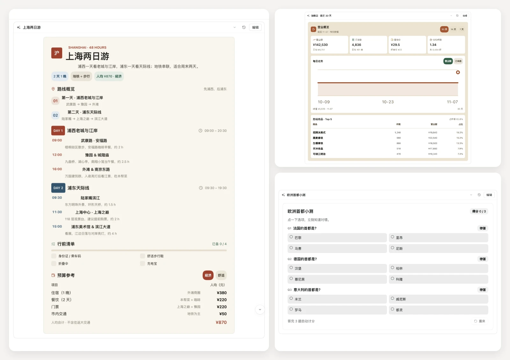
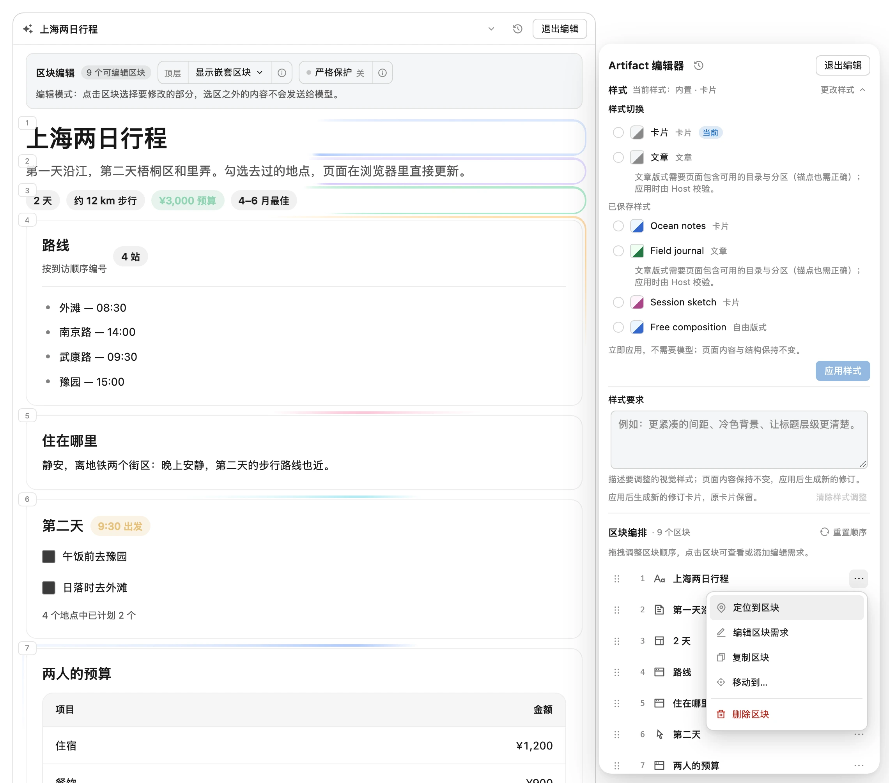

# dsh-intelligent-ui

中文 | [English](README.en.md)

[](https://www.npmjs.com/package/@zephinel/dsh-intelligent-ui)
[](LICENSE)
[](https://www.npmjs.com/package/@deepseek-ai/dsh)
[](https://github.com/Zephinel/dsh-intelligent-ui/actions/workflows/publish.yml)

**把 DeepSeek Harness（DSH）的模型回答变成一张真正能用的页面。** 安装并启用后，直接提问：

```text
帮我排一个上海两日游，要能勾选和调整
```

模型调用 `render_ui` 工具，把答案写成一份 [OpenUI Lang 1.0](https://openui.com) 程序；DSH 聊天页在该轮结束时把它渲染成可交互页面——地图、照片、图表、清单、表单、SVG 绘图、小游戏都是真实组件。

基于 [Open Intelligent UI](https://github.com/thesysdev/open-intelligent-ui)（MIT）移植，并附带一个随插件自动注册的 Agent Skill（`intelligent-ui`）。

> [!NOTE]
> **当前状态**：已发布到 GitHub 与 npm，npm 版本 **`@zephinel/dsh-intelligent-ui@0.6.1`**（`latest`）。0.6.1 修复内置 OpenUI parser 的指数展开导致的 Host 卡顿/OOM（`@openuidev/lang-core` 1.0.1 → 1.1.1）；0.6.0 的就地编辑与修订历史、Auto 页面/文字决策、实验性「回答即文档」、本地图片、样式切换与侧栏更新提示继续可用。

[快速开始](#快速开始) · [获取代码](#获取代码) · [构建、测试与部署](#构建测试与部署)

## 效果



- 用户问「帮我排一个上海两日游」，模型不再只回一段文字：回答末尾直接渲染一张可点击、可勾选、可拖动的行程页面（地图 + 照片 + 时间线 + 清单 + 预算）。
- 卡片内的 `$变量`、`@Set`、`@functions` 全部在浏览器本地执行：勾选、滑动条、Stepper、计时器、预算分配都不需要再请求模型。
- 已经渲染的页面可以继续改：点卡片标题栏的「编辑」，选择区块填写修改要求，或在「区块编排」里拖拽/键盘调整顺序；复制、删除、移动、嵌套编辑、快捷调整和修订会由 Host 确定性记录。完整操作见[使用指南](docs/usage.md#编辑已渲染页面)。
- 只有真正需要继续对话的动作（`@ToAssistant`，例如表单提交）会把一条简短消息放回输入框并发送。

## 生成

生成是插件的核心：打开输入框右侧的 **UI** 控件（或发送 `/iui on`），然后正常提问。模型调用 `render_ui`，把答案写成一份 [OpenUI Lang](https://openui.com) 程序；DSH 在该轮结束时把它渲染成可交互页面。

- 不需要额外步骤：提问 → 模型生成 → 轮末出现卡片。
- **模型决定要不要出页面（Auto 无默认）**：按「是否让用户更快、更准地理解」判断——概念、机制/流程、结构、对比、数据或交互用页面；裸事实、术语复述、不解释运作方式的一句话定义、代码/翻译、闲聊或明确要文字时直接用 Markdown。两边都像适用时看**种类**：解释「怎么运作」即使文字版本很短也用页面。出页面时可在 **UI → 显示样式** 里按会话选 Card / Article，或交给 **Auto**（Card、Article 或自由布局）；**按需生成** 则只描述需求、不选模板。
- 页面里的 `$变量`、`@Set`、`@functions` 在浏览器本地运行；只有 `@ToAssistant` 会把一条简短消息放回输入框。
- 生成的是真实组件：可以勾选、拖动、展开、播放，也可以继续编辑。



上面的组合图来自真实 DSH 会话（DeepSeek V4.1 Flash · Max）：同一套渲染器生成了行程、数据看板和小测三种不同类型的页面，不是手写样例。

更完整的开关、样式、模板和按需生成说明见[使用指南](docs/usage.md)。

## 编辑已渲染页面

页面渲染出来之后，还可以继续改。



- 点卡片标题栏的 **编辑** 进入画布；根层区块显示淡色轨道光晕。
- 每行右侧的 **更多** 菜单提供定位/编辑/复制/移动到…/删除；删除在菜单内二次确认。
- 区块请求、拖拽/键盘排序、嵌套编辑、Divider/Spacer 快捷调整和结构预览都在左侧面板完成；结构操作先进入本轮待执行队列，点底部「应用」并在总预览中确认后，由 Host 一次性记录一条结构修订。仅含结构操作的 Apply 记录修订后关闭草稿；同时含区块请求/整体说明/排序时，剩余请求会在结构修订后自动发送（输入框有正文时保留 chip 手动发送）。
- 修订历史（卡片头部历史图标，编辑过的修订会在图标后显示修订号）可查看每个 Artifact 的修订，并删除已记录的修订；删除前会内联确认，初始渲染不可删，仍被其他修订作为基础的修订需先删更新的那条。删除卡片正在渲染的修订时，确认文案会写明回退目标；删除后该卡片回退到修订号更小、program 仍保留的最新一条修订（回退目标后来又删除时会沿回退链继续解析到仍存在的修订），stage 选中这个回退目标并在显示它时保持只读；选择其他修订即可恢复编辑。回退后的卡片只读，避免与原生卡片共用编辑会话。会话内任一张卡有未发送编辑草稿时，对应基础修订不可删。找不到可回退目标时这一行不提供删除；仍被更新的修订作为基础的修订直接隐藏删除说明原因。其他仍显示该修订的卡片只在回退目标可用时才会一起回退，否则可能变为 stale。
- 面板顶部的 **样式** 区（点 **更改样式** 展开）有两件事：一是 **样式切换**——用单选列表选择并预览内置 Card/Article 或已保存模板，再点 **应用样式**（零模型、立即记录一条新修订，只换样式与主题、不改内容；Article 需要页面本身有目录和章节，不满足时该行会置灰）；二是 **或用文字描述（由模型修改）**——用一句话描述视觉调整（≤2000 字），发送后模型按说明调整样式（版式由 Host 强制保持，内容变动只会告警），并记录为新的临时样式修订。临时结果也可以在这里调样式。支持新 Host 且可编辑的卡片不再显示底部的「调整样式」按钮（旧 Host/不可编辑卡片保留回退；被重定向的只读回退卡不显示 Save/Adjust）。
- 完整流程见[使用指南](docs/usage.md#编辑已渲染页面)。

## 组件一览

生成的页面由下面这些组件构成。渲染器不是把一段文字包进聊天气泡，而是一套完整的组件库：**57 个组件、73 个函数、5 种动作**。下面这张总览来自扩展的真实渲染结果——同一套渲染器、同一套 DSH 主题 token，没有设计稿：


三个真实示例（销售看板、咖啡冲煮小考、手冲计算器·窄屏）也在同一张图里；窄屏下卡片自动切为单列，图表标签过长时截断而不是溢出。

## 核心能力

| 能力 | 说明 |
|---|---|
| 交互页面 | 地图、照片（含工作区里的本地图片文件）、图表、清单、表单、SVG 绘图、小游戏都是真实组件 |
| 区块编辑与编排 | 在已渲染页面上为区块填写修改要求、拖拽或用键盘调整顶层区块顺序（画布实时预览目标顺序）；支持只改内容、只调顺序或两者同时，内容修改以区块片段返回、由 Host 合并回未选区块逐字节不变的页面，结果是新的修订。同一聊天可并行保留多份草稿（单画布激活、每 Artifact 一个 chip），一次发送最多提交 3 个 Artifact 的修改请求，各修订独立生成；历史修订可零模型恢复为本地修订卡片，或在冲突时基于旧修订创建新分支；临时样式结果支持区块内容修改（保留原样式快照）；容器内嵌套区块（`Col`/`Row`/`Box`/`Grid`/`Card`/`Section`/`Carousel`，opt-in）支持内容修改、同父内部排序、模型新增区块，以及零模型的复制/删除/跨容器移动结构操作（记录新修订，根层顺序不变） |
| 导出图片 | 把该轮渲染结果保存为一张 PNG：原始 / 圆角 / 卡片三种美化；背景色与 1x/2x 在插件详情页设置 |
| 导出交互页面 | 把该轮全部卡片导出为单个 HTML 文件，浏览器打开后继续交互；工作区本地图片会内联为 data URL，离线也能显示；`@ToAssistant` 改为复制文案并提示回 DSH 粘贴 |
| 本地执行 | `$变量`、`@Set`、`@functions` 在浏览器运行；只有 `@ToAssistant` 回写消息 |
| 回答即文档（实验） | 插件详情页「实验性功能 → 回答即文档（实验）」开关；开启后普通回答渲染为无卡片外壳的文档，读起来接近聊天正文，模型把整篇内容写进页面、不再额外输出文字；边界见[已知限制](https://github.com/Zephinel/dsh-intelligent-ui/blob/main/docs/limitations.md) |
| 开关与样式 | 全局默认在插件详情页；输入框 UI 控件按会话覆盖；内置 Auto / Card / Article 与自定义模板 |
| 自定义模板与视觉主题 | 保存可复用的展示偏好与明暗配色、字体、圆角、密度、阴影；在「我的样式」中使用、重命名、编辑或删除 |
| 聊天内按需生成 | 无需模板；在 UI 面板选择「按需生成」，正常发送需求，必要时用内置提问工具澄清 |
| 按需自由布局 | 按用户需求编排页面；保存模板保留自由布局、偏好与主题，再次使用仍无 Card/Article 外壳 |
| 临时结果与可选保存 | 结果自带内联样式快照，可直接使用、在编辑画布内调整样式或事后保存为模板；不强制预览、命名或保存 |
| 双语界面 | 跟随 DSH 的中文或英文界面语言 |
| Agent Skill | 随插件注册 `intelligent-ui`，模型按需加载完整语法、示例与排障 |
| 插件详情页 | 集中管理全局启用、默认样式、模板、编排方式、实验性功能与导出偏好 |
| 更新提示 | Host 侧查询 npm 最新稳定版与本次 Release 的更新要点（6 小时缓存；要点来自发布前人工审核的 `release-notes/<version>.md`，英文可选同目录 `<version>.en.md`、缺失时回退默认文件）；有新版本时在侧栏插入卡片，点「点击查看详情」只弹出要点浮窗，点卡片其余区域（含右侧箭头）打开插件详情页；箭头始终朝右，卡片在正常文档流中，不遮挡 Plugins / Automation tasks |
| 可重放 | 程序与临时样式随工具参数重放；导出页面冻结导出时的主题方案 |

## 获取代码

从 GitHub 克隆仓库：

```bash
git clone https://github.com/Zephinel/dsh-intelligent-ui.git
cd dsh-intelligent-ui
```

如果要提交改动，先 Fork 本仓库再克隆自己的副本；只想使用插件时，直接安装 npm 包即可（见[快速开始](#快速开始)）。

## 前置条件

以下命令用于 DSH Web 与源码开发；DSH Desktop 用户可直接按[快速开始](#快速开始)中的应用内步骤安装。

- **DSH 0.2.2 插件接口**（[`dsh` CLI](https://www.npmjs.com/package/@deepseek-ai/dsh)）：Host/Client 与插件协议按这个版本开发；实际验证版本是 `0.2.2-rc.1`（当前最新），更晚版本未验证。安装最新版：`npm install -g @deepseek-ai/dsh`。
- **[Node.js 24 与自带的 npm](https://nodejs.org/en/download)**：构建、测试与发布工作流使用 Node 24。仓库没有 `engines` 或 `.nvmrc` 版本锁，运行 `npm install` 前需自行选用 Node 24；Host 的 Node 22 编译目标不代表整个工具链已在 Node 22 验证。
- **[Git](https://git-scm.com/downloads)**：仅获取源码时需要，仓库未指定最低版本。
- **`@deepseek-ai/dsh-client-locale`**：浏览器半边要求部署组合了它；DSH Web 0.2.2 默认包含，缺少时开关和卡片不会挂载（Host 工具与提示词仍可用）。

确认工具存在：

```bash
node --version   # v24.x
npm --version
dsh --version    # 已验证：0.2.2-rc.1
git --version    # 仅获取源码时需要
```

重启示例覆盖前台 `dsh web`、macOS launchd 与 Linux systemd；用其他方式托管时重启对应服务。验证平台：macOS（Web + DSH Desktop）与 Windows（DSH Desktop）；Linux 未验证。

## 快速开始

**DSH Web**：从 npm 安装已发布的 0.6.1，再启动 Web UI（首次前台运行示例）：

```bash
dsh plugin --profile web add @zephinel/dsh-intelligent-ui@0.6.1
dsh web
```

已有 Web 进程时，安装后重启该进程（前台：Ctrl+C 后重新运行 `dsh web`；launchd/systemd：重启对应服务）。打开它打印的 URL，输入框右侧出现 **UI** 控件即加载成功；地址与端口由 DSH profile 决定。

其他安装来源可替代上面的安装命令：跟随 npm 最新版用 `dsh plugin --profile web add @zephinel/dsh-intelligent-ui`；从 GitHub 已提交代码安装用 `dsh plugin --profile web add github:Zephinel/dsh-intelligent-ui`。两者都不会安装当前 checkout 的未提交改动。

**DSH Desktop（桌面版）** 不需要终端命令，在应用内安装：

1. 侧栏 **插件** → **添加插件**（或箭头 → **安装第三方插件**）。
2. 输入 `@zephinel/dsh-intelligent-ui@0.6.1`（或只填包名装最新版），点 **安装**。
3. 安装完成后点 **立即启用**；若输入框右侧没有 **UI** 控件，退出并重开 DSH Desktop。

桌面版的 profile 由 Electron 应用独占管理，`dsh plugin --profile desktop` 会被拒绝。国内镜像可能晚于 npm 官方源同步刚发布的版本；装不到时把安装源切回 npm 官方源。

安装后在输入框右侧点 **UI** 控件，选择「仅本会话」（或发送 `/iui on`），再发送开头的行程示例。该轮结束后出现可交互的行程页面即验证成功。需要时再打开 **UI** 菜单，选「显示样式」（或点击已激活的「仅本会话」项）设置本会话的 Auto / Card / Article 样式——切换启用范围本身不会再自动弹出样式面板。

本地开发（从 checkout 构建并安装）、卸载与排障见[开发与部署](https://github.com/Zephinel/dsh-intelligent-ui/blob/main/docs/development.md)；扩展没有独立的开发服务器。

## 开关与回答样式


- **全局默认**：插件详情页的「在所有会话中启用」与「回答样式」设置新会话默认值；可以选择内置样式或已保存的全局模板。
- **会话覆盖**：点 Composer 的 **UI** chip：切换启用范围只改变开关状态、不自动打开面板；要打开样式面板，点菜单里的「显示样式」行，或点击已激活的「仅本会话」/「跟随全局」项（仅在解析为开启时）。上方是内置 Auto / Card / Article 预览卡片，中间是「自定义样式」（已保存模板），底部是「按需生成」。「跟随全局」表示本会话跟随全局开关，不会打开全局开关；chip 会直接显示「全局开启 / 全局关闭」，全局关闭时这里会明确显示 `跟随全局 · 全局关闭`；`/iui on|off|inherit` 与 `/iui style auto|card|article|inherit|<cs_id>` 提供命令入口。
- **Auto** 由模型决定格式与版式：先判断这次回答该不该出页面；要出时交互/结构化用紧凑 Card，详尽/深入/长文用 Article，两种外壳都不合适时用自由布局（`Toc`/`Section` 可选）。Article 需要 `Toc`、可折叠 `Section` 和实质正文。**Card / Article 只是出页面时的版式偏好**，模型认为文字更合适时仍可只回 Markdown。
- **实验性：回答即文档**：插件详情页的「实验性功能」分组提供「回答即文档（实验）」。开启后，普通回答出页面时不再有标题栏、折叠、边框和卡片操作，页面读起来就是这一轮的聊天正文；模型把正文、表格等普通内容与交互块一起写进同一个 `render_ui` 程序，并且不再额外输出 Markdown。它是消息内嵌 UI 的过渡呈现：页面仍挂在轮末，复制、搜索和会话导出 Markdown 不包含页面正文，DSH 原生支持后会移除此开关；按需生成、保存模板与 Artifact 编辑请求不受影响。
- **按需生成**：选择后面板关闭，焦点回到输入框，出现可取消的提示与示例；示例只填入内容，保留已有草稿，不自动发送。正常发送后，清晰需求直接渲染，有重要歧义时由内置 `ask_user_question` 结构化提问，回答后继续生成。
- 会话启用/样式设置原子写入 `<DSH_HOME>/dsh-intelligent-ui.json`；按需操作不改这些设置，临时样式也不是当前选中的样式。完整边界见[架构与行为](https://github.com/Zephinel/dsh-intelligent-ui/blob/main/docs/architecture.md)。

## 使用

打开开关后直接用自然语言提问，例如：

- 「帮我排一个上海两日游，要能勾选和调整」
- 「做一个 7 速自行车的换挡模拟器」
- 「把这几张表变成一个可以筛选的销售看板」
- 「介绍一下中国历史，要能按朝代展开」
- 先选「按需生成」，再发送「把这次分析做成紧凑仪表盘，用卡片和图表突出关键指标」
- 点已渲染页面标题栏的「编辑」，修改区块或调整顺序后正常发送

编辑请求会留在输入框的 chip 里：每个 Artifact 一个 chip，标签为「编辑 {title} · 修订 N · {摘要}」；从旧修订分支时追加「 · 分支」。删除 chip 只会把对应草稿从本次发送移除，草稿仍可在「待提交编辑」区重新附加；一次发送最多合并 3 个 Artifact。

开关打开后由模型按回答判断是否出页面；想确保这次一定出页面（或模型仍然回了文字），在已开启的会话里用 `/intelligent-ui` 显式调用技能。更完整的开关、模板、按需生成和编辑教程见[使用指南](docs/usage.md)。

### 临时结果


临时结果可以立即使用；样式调整在卡片的「编辑」画布内完成（在 **样式 → 更改样式** 区描述或直接切换内置/已保存样式；版式由 Host 保持，内容变动只会告警），点「保存为模板」才填写名称和范围。保存复用该结果的已校验样式，不自动选中模板或更改全局默认。旧 Host 或不可编辑的临时卡片仍保留底部的「调整样式」回退按钮。

## 构建、测试与部署

从[获取代码](#获取代码)的 checkout 根目录开始。`npm install` 的 `prepare` 会自动构建；本地安装器默认写入 `web` profile 并自动备份。若该 profile 已安装 npm/GitHub 版，先用 `dsh plugin --profile web remove @zephinel/dsh-intelligent-ui` 移除，避免同一插件重复注册。切换与回滚步骤见[两种安装模式与切换](https://github.com/Zephinel/dsh-intelligent-ui/blob/main/docs/development.md#两种安装模式与切换)；发布前按[发布前检查](https://github.com/Zephinel/dsh-intelligent-ui/blob/main/docs/development.md#发布前检查)依次运行三条命令。

```bash
npm install
dsh plugin --profile web list  # 检查 profile；首次使用会初始化
node scripts/install.mjs
dsh web
```

已有 Web 进程时，安装后重启该进程，再打开它打印的 URL；输入框右侧出现 **UI** 控件后按[快速开始](#快速开始)启用并试问。扩展没有独立开发服务器或 watch 模式；每次修改后重新 `npm run build` 并重启 DSH。卸载与排障见[开发与部署](https://github.com/Zephinel/dsh-intelligent-ui/blob/main/docs/development.md)。

日常检查与打包：

| 命令 | 用途 |
|---|---|
| `npm run build` | 生成 prompt、Host、Client 与独立导出页面 bundle |
| `npm test` | 构建后运行 Host、Client 与打包的 Node 测试 |
| `npm run typecheck` | 运行 `tsc --noEmit`（浏览器 `src/client` 暂因运行时平台类型不可解析而排除） |
| `npm run check` | 提交前完整检查：typecheck、构建、Node 测试、renderer 检查、文档事实/链接与打包事实检查 |
| `npm run pack:check` | 预览 npm 包最终文件清单，不发布 |
| `npm run check:release` | 打包产物解包后校验每个打包路径都在 checkout 中存在，并对 `lib/`、`skills/`、`locale/` 与 bundle patch 全量哈希比对，再装进一次性 `$DSH_HOME`（独立端口），校验安装后文件集合与哈希、插件挂载、实际提供的 client bundle 与卸载；不改动现有 profile，需要 `dsh` 与 `pnpm` 在 PATH 上 |
| `npm run test:browser` | 先构建；运行 10 个浏览器套件，需要 Chrome |

- 当前验证记录（本地 `main` 已推送并与 origin/main 同步；含 Auto 智能格式决策、已合并的修订舞台/版本条与区块编排批量操作、composer 通知与草稿行 chip、本轮独立复审修复与侧栏更新提示（Host 查 npm latest、点击打开插件详情页））：Node 测试 **821/821**（Host 320、Client 464、packaging 37；覆盖区块编辑/编排/多卡片/分支/恢复/草稿持久化/临时样式/嵌套编辑/层级排序/结构操作/容器扩展/模型新增/跨容器移动/结构预览/严格保护/运行时状态/面板动画与宽度适配、实验性文档模式（提示词/工具/回放/浏览器渲染）、修订历史与删除回退、本地图片来源、活动舞台与可见性回落、最近任务式版本条与截图缩略图、顶层与嵌套区块批量操作（批量排序/复制/删除与草稿确认）、编辑流水线（结构操作待执行队列、批量保存/取消、整体说明显式保存、总预览 Apply、结构修订后草稿重映射与模型请求自动发送、深层页面（CST 深度≤10）根级结构操作、Phase A 复审修复（嵌套 Apply 重建、队列阻塞普通 Send、attached 保留、预览契约与诚实自动发送）、Phase B 复审修复（删除显示修订的回退选择与只读恢复、图片导出具体错误、版本条 props 来源、20 上限单一定义、文档事实检查器上下文匹配）等特性）；renderer 解析/渲染各 **42/42**，CSS/组件契约 **50/50** 与 **63/63**，排版 **22/22**，i18n **4** 个程序，嵌套 CSS 补偿契约 **28/28 direct + 5/5 scoped**；浏览器 **10/10** 套件通过，其中设置页模板交换 **101** 条、按需流程 **114** 条、交互页面 **50** 条、图片导出 **76** 条断言，Artifact 区块编辑套件 **944** 条检查、嵌套编辑渲染套件 **75** 条检查。浏览器测试覆盖组件/契约；真实模型验证范围与尚未覆盖的场景见[验证记录](https://github.com/Zephinel/dsh-intelligent-ui/blob/main/docs/verification.md)（历史记录）。
- `node scripts/capture-screenshots.mjs` 以固定 DSH token、生产组件与假服务在 Chrome 2x 重建面板、提示、临时结果与设置截图；英文 UI，卡片壳层图标用 lucide 替身。
- `npm run check` 里的排版检查（typography）需要本机 Chrome；没有 Chrome 时该检查会跳过，其余测试仍会运行。非默认安装位置可用 `CHROME_BIN` 指定 Chrome 可执行文件（也适用于浏览器套件）。

发布物是一个 DSH bundle；部署就是把插件安装进目标 DSH profile。卸载与版本注意事项见[开发与部署](https://github.com/Zephinel/dsh-intelligent-ui/blob/main/docs/development.md)。

## 上架与分发

扩展已发布到 npm 与 GitHub，并收录在这些 DSH 社区市场（DSH 官方没有内置插件市场；Discover 只读取用户添加的索引源）：

- **awesome-dsh-plugin / dsh-market**：[awesome 条目](https://github.com/awesome-dsh-plugin/awesome-dsh-plugin/blob/main/data/plugins/Zephinel__dsh-intelligent-ui.yml) · [展示页](https://awesome-dsh-plugin.com/p/Zephinel/dsh-intelligent-ui/)；dsh-market 的目录来自 awesome，随其同步。
- **Open Plugin Market**：[索引条目](https://dshopen.org/zh/plugins/@zephinel/dsh-intelligent-ui/)（[dshopen.org](https://dshopen.org/zh/)）。
- **bradeGithub/DSH-Plugins-Marketplace**：按 GitHub `dsh-plugin` topic 自动收录。

npm 包：[`@zephinel/dsh-intelligent-ui`](https://www.npmjs.com/package/@zephinel/dsh-intelligent-ui)（默认 `latest`）；GitHub 仓库：[Zephinel/dsh-intelligent-ui](https://github.com/Zephinel/dsh-intelligent-ui)（topics：`dsh-plugin`、`dsh-bundle`、`deepseek-harness`、`intelligent-ui`、`agent-skills`）。

市场里的版本跟随 npm `latest`；发布新版本并推送仓库后，各市场按自己的周期自动刷新，无需重新申请收录。截图来自本仓库 `screenshots.json`，维护细节见[开发与部署](https://github.com/Zephinel/dsh-intelligent-ui/blob/main/docs/development.md#插件市场维护)。

## 贡献

- 问题与功能请求：使用 [GitHub Issues](https://github.com/Zephinel/dsh-intelligent-ui/issues)。
- 提交 PR 前运行 `npm run check`；CI（[`ci.yml`](https://github.com/Zephinel/dsh-intelligent-ui/blob/main/.github/workflows/ci.yml)）在 PR 与 main 上跑本地门禁：CHANGELOG/PRODUCT/docs 等纯文档改动只跑文档检查，README 属打包内容走全量门禁；main 上的代码改动另跑 10 个浏览器套件。发布由 [GitHub Actions Trusted Publishing 工作流](https://github.com/Zephinel/dsh-intelligent-ui/blob/main/.github/workflows/publish.yml)在 `v*` tag 上执行，流程见开发文档。
- 贡献者与 AI 协作代理都应遵循[文档同步技能](https://github.com/Zephinel/dsh-intelligent-ui/blob/main/.agents/skills/sync-iui-docs/SKILL.md)：行为、文案或计数变化时，同步中英 README、`CHANGELOG.md` 与 `docs/` 对应文档。checkout 中以本地 `.agents/skills/sync-iui-docs/SKILL.md` 为准。
- 维护者：[@Zephinel](https://github.com/Zephinel)。

## 已知限制

卡片在轮末出现；模型校验、网络依赖、导出、模板安全、编辑范围、旧页面/base 限制、真机和 a11y 未验证项等完整边界见[已知限制](docs/limitations.md)。

- 实验性「回答即文档」只模拟消息正文的呈现：内容仍在轮末的 `render_ui` 结果里，不在消息正文内；复制、搜索和会话导出 Markdown 不包含页面正文；文档页没有卡片编辑入口与修订历史；只有 Web 渲染器（Web/Desktop）显示，TUI/headless 等不渲染插件卡片的客户端看不到内容。开关只影响之后的回答，已生成的结果保持生成时的文档呈现。
- 编辑覆盖根 `Col` 直接子区块和七个容器内部的区块；CST 节点预算 200，超出时页面不可编辑。
- 旧版本渲染的卡片不需要手动迁移：首次打开编辑、修订历史或恢复时客户端会自动登记权威 program；旧 Host 混部或登记失败时，快捷属性调整退回指令编辑，结构操作可能需要重新渲染。
- 真实屏幕阅读器、Windows 高对比度、iPad/Safari 和深色主题下的输入框焦点对比度尚未实测；视觉基线是手动对照。
- client bundle 更新后必须重启 `dsh-web`，刷新页面不够。

## 常见问题

**必须先建模板、预览或命名吗？** 不需要。选「按需生成」后正常聊天，结果可以直接使用；只有主动「保存为模板」才需要名称。临时结果不会替换当前会话选中的样式。

**能晚些保存或继续调整吗？** 可以。点卡片「编辑」进入画布，在顶部 **样式 → 更改样式** 里描述视觉调整，或直接用 **样式切换** 应用内置/已保存样式；「保存为模板」仍在卡片底部。保存的是点选结果的版本，不会自动保存后来生成的版本。注册表已淘汰该结果时会提示快照不可用。

**为什么追问后没有继续生成？** 结构化 `ask_user_question` 回答会恢复同一操作；文字提问后，下一条消息会自动继续同一操作。只有过期、重启、失败或中断后才需要重新武装/重试。多个标签同时发送也可能消费同一意图。

**为什么回答只有文字、没有卡片？** 先确认该会话的开关已打开（输入框右侧 **UI** 控件，或 `/iui on`）；开启后是否出页面由模型按内容判断——短回答、概念解释、代码/翻译或明确要文字时直接用 Markdown 是预期行为。想让这次一定出页面时，在开关已打开的会话里用 `/intelligent-ui` 显式调用技能。详见[使用](#使用)。

**回答底部为什么没有「导出」按钮？** 只有扩展渲染出的回答才有这个药丸按钮；开关关闭、模型用文字回答或渲染失败时都不会出现。详见[使用](#使用)与[已知限制](#已知限制)。

**重建插件后 UI 没变化或报错？** 只刷新页面可能拿到旧 revision：先重启承载 Web UI 的 DSH 进程，再打开页面。具体错误信息与处理方式见[开发与部署](https://github.com/Zephinel/dsh-intelligent-ui/blob/main/docs/development.md)。

## 文档

详细文档、变更日志与仓库维护技能不随 npm 包发布，因此链接使用绝对 GitHub 地址；未提交功能以 checkout 内对应文件为准。

- [架构与行为](https://github.com/Zephinel/dsh-intelligent-ui/blob/main/docs/architecture.md)：Host/Client 组件树、开关与回答样式的完整语义、Artifact 区块编辑、编排与多卡片并行、界面语言、图片与交互页面导出流程、Agent Skill。
- [开发与部署](https://github.com/Zephinel/dsh-intelligent-ui/blob/main/docs/development.md)：安装与卸载、开发命令、改名/重建后的重启提示、Host/Client 版本错位、发布物布局与插件市场维护。
- [验证记录](https://github.com/Zephinel/dsh-intelligent-ui/blob/main/docs/verification.md)：端到端验证、测试与打包结果（历史记录）。
- [变更日志](https://github.com/Zephinel/dsh-intelligent-ui/blob/main/CHANGELOG.md)：按版本记录新增、变更与修复（英文）。
- [使用指南](https://github.com/Zephinel/dsh-intelligent-ui/blob/main/docs/usage.md)：开关、提问、编辑、模板与导出。
- [已知限制](https://github.com/Zephinel/dsh-intelligent-ui/blob/main/docs/limitations.md)：当前边界与未验证项。
- [GitHub Releases](https://github.com/Zephinel/dsh-intelligent-ui/releases)：带日期的版本发布页与安装说明。

## 致谢与第三方依赖

这个扩展建立在下面这些开源项目与素材之上，感谢作者和维护者：

- **[Open Intelligent UI](https://github.com/thesysdev/open-intelligent-ui) / [OpenUI](https://github.com/thesysdev/openui)** — 组件库、渲染层、系统提示词与组件规范的起点。MIT，Copyright (c) 2026 Thesys Inc.
- **OpenUI packages** — `@openuidev/lang-core`、`@openuidev/react-lang`，以及随依赖树附带的 `@openuidev/devtools`、`@openuidev/observability`；负责 OpenUI Lang 解析、组件定义与渲染。MIT。
- **[Remix Icon](https://github.com/Remix-Design/RemixIcon)** — 插件自身 chrome 的图标（编辑、删除、移动、定位、信息等），path 数据按原样内联。Remix Icon License v1.0，Copyright (c) 2017-2026 Remix Design。
- **[lucide-react](https://github.com/lucide-icons/lucide)** — 模型生成内容中 `Icon` 组件的图标。ISC。
- **[KaTeX](https://github.com/KaTeX/KaTeX)** — `Math` 组件的公式渲染，含随包内联的字体。MIT。
- **[MapLibre GL JS](https://github.com/maplibre/maplibre-gl-js)** — 地图与路线渲染，worker 源码随 bundle 内嵌。BSD-3-Clause，Copyright (c) MapLibre contributors。
- **[SnapDOM](https://github.com/zumerlab/snapdom)**（`@zumer/snapdom`）— 把回答卡片导出为图片。MIT，Copyright (c) 2025 ZumerLab。
- **[zod](https://github.com/colinhacks/zod)** — 组件 props 与 OpenUI 程序结构的运行时校验。MIT。

此外，**React / React DOM**（MIT）由 DSH Web 平台提供，独立交互页面 bundle 会内置它们。地图底图与路线数据来自 OpenFreeMap / OpenMapTiles / OpenStreetMap、Esri 与 OSRM，使用时会在图内显示相应 attribution。

每项的完整许可证见 [NOTICE](NOTICE) 与 [licenses/](licenses/)。如果发现遗漏或归属有误，欢迎提 issue 或 PR。

## 许可证

本项目采用 [MIT](LICENSE) 许可证。基于 Open Intelligent UI（MIT, Copyright (c) 2026 Thesys Inc.）与 OpenUI 生态；浏览器 bundle 内含 lucide-react（ISC）、KaTeX（MIT）、MapLibre GL JS（BSD-3-Clause）、zod（MIT）与 SnapDOM（MIT）；交互页面的独立 bundle 还内联 React / React DOM（MIT）。完整声明与许可证全文见 [NOTICE](NOTICE) 与 [licenses/](licenses/)。
