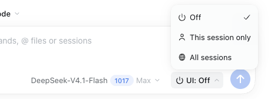

# Architecture and behavior

[中文](architecture.md) | English

[← Back to README](../README.en.md)

This page expands the structural and behavioral details summarised in the README.

## Architecture

```
Host  lib/index.js (Node)
├─ ctx.tools.register(render_ui)          # args { program, title? }
│   └─ @openuidev/lang-core validates against the component library spec; errors are returned precisely, and the model repairs them in the same turn
├─ three-state switch (off/session/global, persisted)   # /iui command + projection + per-agent tool visibility
├─ ctx.systemPrompt.section(...)          # injects the OpenUI Lang generation prompt only when the switch is on
└─ ctx.skills.register(intelligent-ui)    # embedded Agent Skill (skills/intelligent-ui/SKILL.md)

Client  lib/client.js (browser, lazily loaded by the DSH module loader)
├─ ctx.locale.register('intelligent-ui')  # zh/en UI dictionaries; slots declare locale and receive the injected t
├─ conversation.input.activity             # the UI control on the right side of the composer (chip + native Menu; reads the projection + runs switch commands)
├─ conversation.chat.turnTail list item    # at the end of each turn, takes that turn's render_ui program and renders the card
│   └─ <OpenUIRenderer> = @openuidev/react-lang <Renderer> + 55 ported components (chrome reads the renderer i18n context)
├─ tool.call.toolview keyed 'render_ui'   # leaves a single "Interactive answer" (交互式回答 in Chinese) line in the process area
└─ built-in CSS (the component library / MapLibre / KaTeX use DSH global styles + a scoped reset)
```

With the switch off there is no trace of this tool on the model side; only after it is turned on does the model see the tool, a system prompt section and an on-demand skill. All UI rendering and interaction happen in the browser; the program itself enters the session log as a tool argument and is replayed with history.

## Switch: off by default, three scopes



> The screenshot uses the English UI; the extension's copy follows DSH's UI language (a Chinese UI shows 「关闭 / 仅本会话 / 全部会话」).

- **Off** (default): the `render_ui` schema is absent from requests in all sessions, the ~8.5K-token generation prompt expands to nothing, and tool calls are explicitly rejected.
- **This session only**: enabled only in the current session; other sessions (including new ones) stay off.
- **All sessions**: enabled in every session, including sessions opened later.
- State is written atomically to `<DSH_HOME>/dsh-intelligent-ui.json` (default `~/.dsh/dsh-intelligent-ui.json`, shaped like `{ "global": false, "sessions": ["<session-id>"] }`) and survives a refresh or a DSH restart; "All sessions" and "This session only" are mutually exclusive, and choosing "Off" clears the allowlist for all sessions.
- Command-line equivalents: `/iui off` / `/iui session` / `/iui global` (a bare `/iui` shows the current state; `on` and `all` are aliases for `global`).
- The command log in a session folds into the `intelligent-ui` projection, which carries the switch's pending state; toggles made from the control sync to other tabs over BroadcastChannel.
- The composer control and the slash commands are equivalent; both work in DSH Desktop and Web.
- The switch requires a deployment that composes both `sessionProjections` and `commands` (DSH Web has both by default). If either service is missing, the switch cannot be displayed or persisted, and the extension falls back to the old **always on** behavior.

## UI language

- All of the extension's own browser-side copy (the composer switch, its menu, card titles and states, render-failure notices, component chrome such as the map, code blocks and timers, and accessible labels) is translated through DSH's locale service: `ctx.locale.register('intelligent-ui', { zh, en })`, with slot registrations declaring `locale` so components receive the injected `t`.
- The browser half therefore requires a deployment that composes `@deepseek-ai/dsh-client-locale` (included by default in DSH Web 0.2.1); in a custom composition without it the browser half does not mount (the Host tool and prompt are unaffected).
- It follows DSH's UI language setting (**Settings → General → Language**); switches apply immediately with no reload. The bilingual dictionaries live in `src/shared/locales.ts`: `zh` is the key-set source of truth and `en` is checked against the same key set.
- The plugin's title and description in the Plugins list come from `locale/en.json` and `locale/zh.json` (the `PluginLocalizedMeta` convention), a separate mechanism from the UI dictionaries above.
- Model-facing text (the `render_ui` tool description, the OpenUI Lang generation prompt and the Agent Skill) and the `/iui` command's Host replies stay in English: DSH's locale service covers browser UI only, and built-in Host commands are English as well.
- The renderer library defaults to English when used outside DSH (tests, standalone embeds) and does not depend on the locale service.

## Agent Skill

On mount, the plugin registers `skills/intelligent-ui/SKILL.md` as an **embedded skill** (only when the deployment also composes the `dsh-skill` skill service; deployments without a skill service are unaffected):

- `intelligent-ui` appears in the session catalog, and the model loads it on demand with the `skill` tool;
- the skill catalog entry is always visible (at negligible cost); but **do not call `render_ui` while the switch is off** — the Host rejects it, so ask the user to turn the switch on first;
- users can also invoke it directly with `/intelligent-ui` (`userInvocable`);
- the skill contains:
  - `SKILL.md` — when to use it / when not to, the workflow (including the read-only-checkout preflight rule while answering), hard OpenUI Lang rules, design guidelines, DSH behavior, and a reference index;
  - `references/components.md` — complete parameter tables for 55 components + 73 `@functions` (14 core + 59 library) + 5 action steps;
  - `references/language.md` — syntax, expressions, `$` state, `@Each`, and a table of common errors;
  - `references/examples.md` — 6+ complete, directly runnable programs (itinerary, calculator, SVG tutorial, dashboard, forms, mini-game);
  - `references/troubleshooting.md` — raw Host validation errors and how to fix them, runtime fallbacks and the preflight rule;
  - `references/integration.md` — integration steps and contracts for other deployments/agents.

The skill files also ship with the package as an ordinary directory (`skills/`), making them easy to read, reuse and redistribute.
