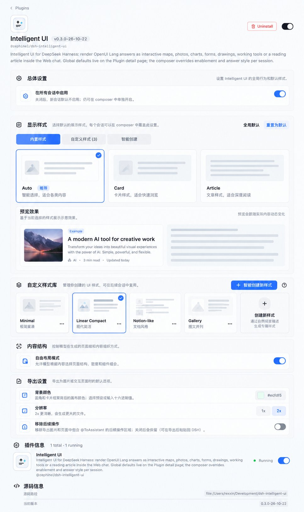
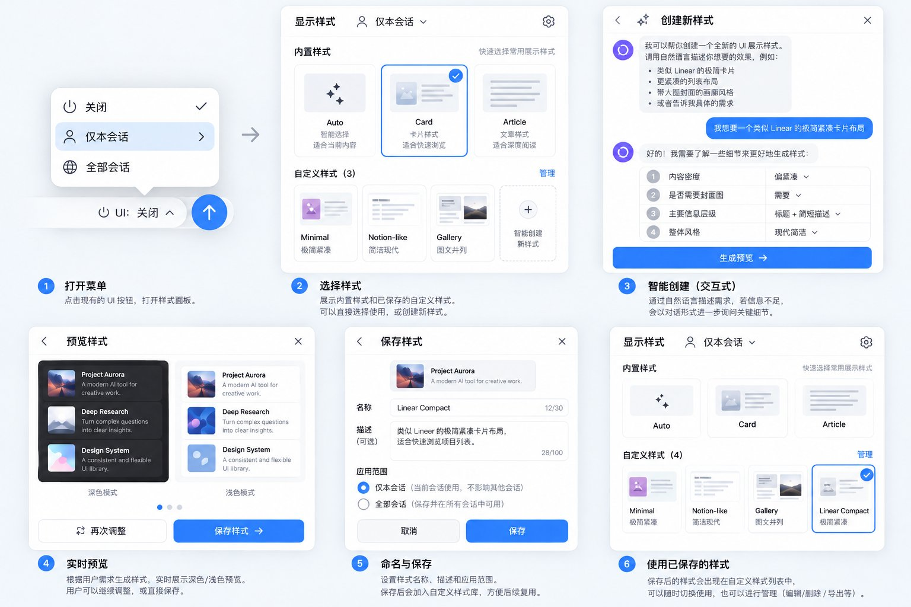

# 自定义 UI 样式（模板）方案

> **状态：as-planned（方案，未实现）— 2026-10-22。**
> 本文是实现前的对齐稿，保留方案意图；实现落地后，行为以代码与 [架构与行为](../../architecture.md) 为准。
> 设计稿见下方，原图同目录：[插件详情页](mockup-plugin-page.jpg) · [交互流程](mockup-creation-flow.jpg)。

## 1. 目标

在保留现有 **Auto / Card / Article** 的前提下，新增**自定义 UI 样式模板**：

- 由用户在 GUI 里**智能创建**（自然语言描述 + 交互式澄清），生成一份可复用的样式定义；
- 模板持久保存，之后像内置样式一样**直接选用、直接生成**，不再每次提问；
- 模板同时控制两层：**生成规范**（结构、密度、语气、组件偏好、基础版式）和**视觉主题**（配色、字体、圆角、背景、密度等 token）；
- 样式选择菜单与插件详情页按设计稿改版，承载内置样式、自定义样式、创建入口与管理。

术语：本文的「样式」与「模板」指同一个东西——一份可复用的 UI 样式定义。

## 2. 已确认的决策

1. **不新增 `/intelligent-ui-create` 斜杠技能/命令**；创建由 **GUI 触发**。
2. 自定义样式控制到 **b 层**：生成规范 **+** 视觉主题（明/暗），需要实时预览。
3. UI/UX 以两张设计稿为准。
4. 提问策略：
   - **内置样式**（Auto / Card / Article）：不提问，直接生成；
   - **使用自定义模板**：默认按模板直接生成，只有缺关键信息或请求与模板冲突时，才在回答前追问，不逐次重复问；
   - **创建新模板**：不清晰就问（用途、内容类型、结构、密度、语气、视觉偏好等），已提供或可推断的不再问；问题尽量以选项形式给出。
5. 菜单新增**两个入口**：
   - **使用自定义**：已保存模板的列表，多个时选择，选中即用；
   - **生成新样式**：打开 GUI 创建流程。
6. 原设想的「手动调用技能」现在等价于手动点「智能创建」；创建、使用、管理都在 GUI 内闭环。

## 3. 使用与提问规则

| 场景 | 是否提问 | 说明 |
| --- | --- | --- |
| 选择内置样式（Auto / Card / Article） | 否 | 保持现状：按已注入样式的决策策略直接生成 |
| 使用自定义模板回答 | 默认否 | 模板就是可复用规范，直接按模板生成；仅当请求缺少模板必需的信息或与模板冲突时，先在回答前追问一次 |
| 创建新模板（GUI 智能创建） | 是，按需 | 信息不足才问；已说明/可推断的不重复问；问题尽量是可直接选择的选项 |
| 管理模板（编辑/删除/导出等） | 否 | 纯 GUI 操作 |

## 4. 设计稿

### 4.1 设计稿 1：插件详情页

要点：

- **总体设置**：在所有会话中启用（关闭后新会话默认不启用，composer 里仍可单独开启）。
- **显示样式**：全局默认 + 「重置为默认」；三个 tab：**内置样式 / 自定义样式 (n) / 智能创建**。
  - 内置样式：Auto（推荐，智能选择）、Card（卡片，适合快速浏览）、Article（文章，适合深度阅读）三张预览卡。
  - **预览效果**：按当前选择展示样例，并随实际内容动态变化。
  - **自定义样式库**：卡片网格（缩略图 + 名称 + 描述 + 选中态 + `...` 管理），右上「智能创建新样式」，末尾「创建新样式」虚线卡片（通过自然语言描述生成专属样式）。
- **内容结构**：自由布局模式（允许模型按内容选择页面结构、密度和组件组合）。
- **导出设置**：背景颜色、分辨率、移除后续操作等现有设置。
- 插件信息、源码信息保留。

### 4.2 设计稿 2：交互流程（6 步）

1. **打开菜单**：点击现有的 UI 按钮，打开样式面板（作用域：关闭 / 仅本会话 / 全部会话）。
2. **选择样式**：面板分「内置样式」和「自定义样式 (n)」；可直接选择使用，或创建新样式；含「管理」与「智能创建新样式」虚线卡片。
3. **智能创建（交互式）**：通过自然语言描述需求；信息不足时以对话形式追问关键细节（示例问题：内容密度、是否需要封面图、主要信息层级、整体风格），完成后点「生成预览」。
4. **预览样式**：按需求生成样式，实时展示**深色 / 浅色**预览；可「重新调整」，或直接保存。
5. **命名与保存**：样式名称（≤30 字）、描述（≤100 字，可选）、应用范围：**仅本会话**（当前会话使用，不影响其他会话）/ **全部会话**（保存在所有会话中可用）；保存后加入自定义样式库。
6. **使用已保存的样式**：保存后的样式出现在自定义样式列表中，可随时切换使用，也可管理（编辑 / 删除 / 导出等）。

## 5. 菜单与面板改版

### 5.1 输入框 UI 控件

- 作用域菜单：**关闭 / 仅本会话 / 全部会话**（文案按设计稿；状态语义沿用现有「跟随全局 / 使用全局默认」，不改变状态模型）。
- 「显示样式」面板改为：
  - **内置样式**：Auto / Card / Article 三张预览卡；
  - **自定义样式 (n)**：卡片网格 + 「管理」；
  - **两个入口**：使用自定义（选已保存模板）、生成新样式（打开创建流程）；
  - 列表可滚动，保留作用域说明；面板尺寸、间距、圆角、选中态按设计稿。

### 5.2 插件详情页

- 按设计稿重组：总体设置 / 显示样式（内置、自定义、智能创建三个 tab）/ 自定义样式库 / 内容结构 / 导出设置。
- 显示样式复用同一套选择器组件，并与 composer 面板保持视觉一致。
- 自定义样式库承担管理：重命名、编辑生成规范、删除、导出等（具体动作以设计稿的 `...` 菜单为准）。

## 6. 创建流程

1. 从 composer 面板「生成新样式」或插件详情页「智能创建」进入；
2. 对话式描述需求 → 只追问缺失的关键细节 → 「生成预览」；
3. 实时预览（深/浅色）→ 可「重新调整」→「保存样式」；
4. 填写名称（≤30）、描述（≤100）、应用范围（仅本会话 / 全部会话）→ 保存；
5. 保存后立即出现在自定义样式列表；询问是否应用到当前会话（或按设计稿引导选择）；
6. 后续可直接选用；管理动作（编辑/删除/导出等）在自定义样式库中完成。

## 7. 模板定义与能力

- **生成规范**：结构、密度、语气、组件偏好、基础版式（Card 或 Article）。
- **视觉主题**：palette / typography / radius / background / density 等受控 token，支持 light/dark。
- **基础版式约束**：Article 的 `Toc` + `Section` 硬校验继续生效；自定义模板声明 base 版式，Host 按 base 校验。
- **预览与导出一致性**：主题需作用于实时卡片、创建预览、图片导出、交互页面导出（standalone），并保持明暗一致。
- **数据模型（建议字段）**：
  - `id`、`name`、`description`
  - `baseLayout`: `card` | `article`
  - `generationDirectives`: 文本（注入提示词）
  - `themeTokens`: 受控 token 集合
  - `scope`: `session` | `global`
  - `createdAt` / `updatedAt`
  - 可选：示例程序（用于缩略图/预览）

## 8. 持久化与作用域

- 自定义模板持久保存，后续会话可复用；作用域为**仅本会话 / 全部会话**。
- 全局默认可在插件详情页设置；会话内可覆盖，语义与现有全局/会话样式一致。
- 删除或失效引用要有兜底（回退到 Auto / 全局默认）；旧版静态枚举做兼容迁移。

## 9. 技术实现要点与风险

- **Host**：模板 CRUD 与持久化；提示词注入（内置样式逻辑保持现状，自定义模板追加生成规范）；`render_ui` 校验扩展（自定义 id + base 版式）；创建问答与模板生成的模型调用。
- **Client**：样式面板、插件详情页、主题应用与实时预览、管理 UI、导出。
- **共享契约**：放宽 `AnswerStyle` / `StylePreference` / projection / settings 的静态枚举，支持自定义 id 并做校验；保留旧值兼容。
- **创建面板的模型通道**：DSH Host 侧存在可注入的 `llm` 服务（类型已确认），实现前先做最小验证；若不可用，降级为脚本化问题 + 单次模型生成。
- **主要风险**：
  - 主题 token 覆盖 57 个组件、明暗主题、图片导出与 standalone 页面的一致性；
  - 动态枚举迁移与多标签同步；
  - 无 settings / webServer 服务时的降级（内置样式不受影响）；
  - 面板/弹层尺寸、滚动、键盘与无障碍；
  - 文案、测试、文档、截图的同步成本。
- **质量门禁**：`npm run check`（含 renderer/typography，需本机 Chrome）、`npm run test:browser`；中英文 README/docs、`CHANGELOG.md` 与截图按仓库规则同步。

## 10. 阶段计划（Codex 执行）

开发由 Codex 执行，模型 `gpt-6.1-sol`、reasoning `xhigh`；Lead 负责拆分任务、写自包含 brief、审查 diff、跑门禁与验收。

1. **基础架构**：模板数据模型 + 持久化 + Host 提示词注入 + 内置/自定义选择（自定义先占位）。
2. **视觉主题**：token schema + 渲染器作用域 + 明暗 + 实时预览 + 导出/standalone 一致性。
3. **菜单改版**：composer 样式面板 + 插件详情页 tabs/卡片/管理/预览效果。
4. **智能创建**：GUI 创建面板 + 模型问答 + 生成/校验/保存/调整 + 管理动作。
5. **收尾**：E2E、中英文文档、CHANGELOG、截图、`npm run check` 全绿。

## 11. 非目标

- 不改变内置 Card / Article 的既有行为与决策策略；
- 不新增斜杠命令/技能；
- 不允许任意 CSS 注入：主题 token 走受控白名单；
- 不改 DSH 壳层 UI。

## 12. 追加需求（2026-10-22）：单次使用与跳过模板

创建出来的样式**不必先保存**才能使用；同时允许完全跳过模板，直接为"这一次生成"临时确定样式。

### 12.1 仅本次使用（用完即弃）

- 智能创建得到样式后，结果页除「保存样式」外增加 **「仅本次使用」**：不写入样式库、不持久化，直接把这份样式作为一次性样式应用到接下来的回答。
- 一次性样式保存在 Host 内存中（不写盘），只在当前会话有效；用于一次回答后自动失效，回到原来的样式选择。若该次回答没有渲染页面，则保留到下一次回答。
- 仍然可以随时选择保存（仅本会话 / 全部会话），保存后按模板库的常规方式长期使用。

### 12.2 跳过模板，直接生成

- 不创建模板、不进入样式库：直接进入交互式澄清——用户说明"想生成什么 + 想要什么样式"，不清楚的地方由模型提问（尽量给可选项），用户补充后**立即用这次确定的样式生成回答**。
- 内容来源：优先使用输入框里已有的草稿问题；没有草稿时，在创建面板里补问"这次想生成什么"。
- 该路径不产生任何持久化模板；如果用户之后想复用，可以在生成前/生成后选择"保存为模板"。

### 12.3 交互与入口

- 创建结果页：**仅本次使用** / **保存样式** 两个出口；「仅本次使用」可再勾选"生成后保存"以便复用。
- 样式面板的创建入口同时承载两种意图：只定这次样式（不保存）或存入样式库（保存）；样式面板继续负责选择已保存模板。
- 一次性样式不进入"自定义样式库"；如果当前选择是一次性样式，样式面板需要能显示它（带"一次性"标记）并在失效后回到原选择。

## 13. 交互重构（2026-10-22 二次修订，覆盖 §4.2、§5、§6、§12 的创建交互）

> 本节优先于前文的创建流程。设计稿见 [按需生成交互稿](mockup-on-demand-flow.jpg)。
> 核心变化：**「按需生成」是聊天中的一次性生成意图，不是独立创建应用，也不是长期选中的样式。**
> 旧的创建弹窗（StyleCreator）与 draft LLM 访谈路由不再作为用户路径。

### 13.1 原则

1. 不强制创建模板、不强制预览、不强制保存、不强制命名。
2. 需求明确时直接生成；只有影响结果的歧义才交互澄清。
3. 临时使用与持久化保存解耦：默认临时，只有用户主动保存才成为模板。
4. 复用现有 Composer 入口与 DSH 已有的交互式提问能力，不新增独立工具栏/工作台。
5. 「按需生成」意图是一次性的；生成完成后清除，后续普通消息不会重复触发。

### 13.2 Composer 面板

- 作用域仍为：关闭 / 仅本会话 / 全部会话。
- 「显示样式」面板：
  - **内置样式**：Auto / Card / Article（缩略预览，无滑杆）。
  - **我的样式**：已保存模板（缩略图、名称、直接使用、编辑、重命名、删除）。
  - **按需生成**：面板底部的独立入口，说明「用自然语言描述你想要的展示效果，直接生成，无须保存模板」。
- 点击「按需生成」：关闭菜单 → 回到并聚焦输入框 → 显示轻量提示/示例（点击示例只填充输入框，不提交、不覆盖用户已有内容）。

### 13.3 生成流程

1. 用户正常发送消息。
2. 需求明确：直接渲染结果，不显示确认页，不要求预览/命名/保存。
3. 有重要歧义：在当前聊天里用 DSH 已有的交互式提问（结构化选项 + 自由补充）澄清；回答后继续生成，不再额外确认。
4. 结果可直接使用；结果区保留低干扰操作：**调整样式**、**保存为模板**（可选：本会话继续使用）。
5. 调整样式继续通过普通聊天迭代，复用已生成的有效样式配置，不重新开始。
6. 保存为模板是后置可选动作：轻量 Popover 收名称/描述/范围，复用已有样式，不重新调用生成；不强制修改全局默认。

### 13.4 临时样式与数据

- 一次性生成结果携带**内联临时样式**（主题 token + 生成规范 + 可选名称），随 `render_ui` 调用记录，重放/导出不依赖模板库。
- 临时样式默认只服务于当前结果；用户显式选择后可应用到本会话后续回答（内存态，不写盘、不成为模板）。
- 保存为模板时才写入样式库；保存后出现在「我的样式」。
- 三个维度独立：插件启用范围 / 样式使用范围（仅本次回答、本会话后续、全局默认）/ 存储状态（临时、已保存模板）。

### 13.5 设置页职责

- 设置页保留，但只负责：全局启用、全局默认样式、已保存模板管理、内容结构、导出、组件/版本信息。
- **不在设置页实现智能生成工作台**；加说明文字：在聊天输入框的 UI 菜单里选择「按需生成」，直接描述需求，生成结果无需保存即可使用。

### 13.6 状态与边界

- 已有草稿、取消意图、连续追问、用户修改需求、生成失败重试、关闭页面/切换会话、保存前后多次调整、重名、模板被删除但其他会话仍在用。
- 临时状态不得意外持久化；可恢复的会话状态不能只依赖某个临时弹窗的生命周期。
- 生成内容遵循现有校验、主题、安全和渲染约束，不注入任意可执行代码。

### 13.7 验收场景

- 内置样式正常使用；按需生成后回到输入框、正常发送。
- 需求明确直接生成最终 UI；歧义时给出选项与自由补充，回答后直接生成。
- 临时结果无需保存即可使用；可继续聊天调整；可事后保存。
- 保存后模板出现在「我的样式」并可直接复用；设置页只做持久化管理。
- 启用范围、样式使用范围、存储状态互不干扰；Auto/Card/Article 与导出不退化；明暗主题正常。
- 完成后清除本次按需生成意图，后续普通消息不触发样式生成。

## 14. GPT 评审结论与架构决策（2026-10-22，基于 §13 二次修订）

完整评审原文：[reviews/gpt-review-2026-10-22.md](reviews/gpt-review-2026-10-22.md)。结论：**SHIP WITH CHANGES**——方向正确（主对话 + 一次性意图 + 内联样式快照 + 事后可选保存），但先解决四个 P0 再替换 UI。

### 14.1 采纳的架构决定

1. **Generation Intent ≠ Style Setting**：按需生成是请求级 Operation，不是会话样式开关。至少记录 `operationId / sessionId / clientInstanceId / triggerMessageId / status / clarificationRounds / resultIds / timestamps`；状态含 running / clarifying / completed / failed / cancelled / interrupted。Composer 的「已武装」状态尽量留在前端；用户真正发送消息时再与 Host Operation 原子绑定，避免"下一条任意消息"被误消费、多标签页误消费、取消后迟到结果提交。同一会话第一版最多一个活动 Operation。
2. **Style Snapshot 属于结果，不是模板**：`render_ui` 内联 `temporaryStyle` 采用可版本的 `StyleSnapshotV1`：`schemaVersion / baseLayout / directives / theme`（+ 可选 `suggestedName`）。必须包含 baseLayout，且 `baseLayout === render_ui.style`；与 `styleId` 互斥。`directives` 必须是可迁移的通用设计规则（布局原则、信息密度、层级、配色、组件表现），不能复制当前业务内容/私有数据。Host 负责规范化与校验（含对比度、字段/深度/长度限制、仅受控 token、禁止任意 CSS/HTML/脚本/URL）。
3. **临时样式授权由 Host 决定**（不由模型声明）：本轮合法 Operation 或明确的调整操作才允许 `temporaryStyle`；优先级：本轮授权的临时样式 → 会话覆盖 → 全局默认 → Auto。授权不得改写会话/全局设置。
4. **结果即 Artifact**：每次渲染保留不可变快照与 `resultId / revisionId / parentRevisionId`；调整产生新修订，而不是改一个可变"当前临时样式"；保存时保存用户点的那一版。历史结果在模板删除或 catalog 不可用时仍按自身快照重放/导出。
5. **保存接口引用结果**：新增 `POST /api/intelligent-ui/styles` `op:'saveFromResult'`（`resultId / revisionId / name / description / scope`），Host 从已校验快照转成现有 `StyleTemplate`；客户端不重新 POST 一份可改的 directives/theme。保存幂等、重名提示、不自动改全局默认；模板可用范围（global/session）与"自动应用"在文案上区分。
6. **澄清三层约束**：请求级提示词（只在 Operation 中注入）+ 验证 `ask_user_question` 在 DSH 主对话中确实可用（结构、自由输入、跳过、恢复方式；不可用则降级为文字提问并说明）+ Host 依据工具事件维护 clarifying、禁止"没得到必要回答就提前 render"。初版每轮 1–3 问、最多 2 轮主动澄清，优先选项、允许跳过，缺失非必要偏好直接用默认值。同轮先 ask 再 render 要阻止。
7. **结果操作由扩展自己渲染**（调整样式 / 保存为模板 / 可选本会话继续使用），不写进模型生成程序；调整与具体 `resultId/revisionId` 关联，保留用户输入框草稿，并预填调整意图。
8. **迁移顺序**：先抽离并保留 Stage 3 的草稿 JSON 校验、明暗双预览组件、主题/对比度校验、Catalog、真实 renderer；先建立新的聊天内按需生成与结果快照，跑完回归 + 真实模型测试，确认旧路径无引用后再删除 StyleCreator 弹窗与 `/draft` 路由。最终代码只保留一套样式校验与持久化服务。

### 14.2 落地阶段（替代 §10 的阶段计划）

1. **Phase 1（P0）**：`StyleSnapshotV1` + `render_ui.temporaryStyle` + Host 校验/互斥/授权 + 原有样式行为不退化。
2. **Phase 2（P0）**：验证 DSH 消息历史是否保留完整工具参数，补齐结果快照、`resultId/revisionId`、重放/明暗/导出还原。
3. **Phase 3（P0）**：On-Demand Operation Controller（消息绑定、澄清关联、取消、失败、重试、完成、多标签页收敛）。
4. **Phase 4（P1）**：Composer「按需生成」入口与结果操作 UI；移除强制预览/命名/保存；保留草稿。
5. **Phase 5（P1）**：`saveFromResult`、模板管理（Composer 轻量入口 + 设置页持久化管理）、重名/删除/失效。
6. **Phase 6（P1）**：真实模型端到端验证（清晰需求直接 render、真正歧义才问、无冗余确认、directives 可复用、连续调整关联正确）、清理旧弹窗/访谈路由与过期测试、文档同步。

### 14.3 仍需在代码中验证的前提

- DSH 消息发送是否带可绑定元数据；若无，则用 Operation token + 发送时绑定，而不是"下一条任意消息"。
- 主对话模型运行中 `ask_user_question` 的可用性与事件形态。
- 聊天历史是否完整保留 `render_ui` 参数（含内联快照），以及导出链路对快照主题的处理。
- 现有 card/article 基础版式对仪表盘、画廊、看板等形态的真实限制（先做真实模型测试，暂不引入第三版式）。
